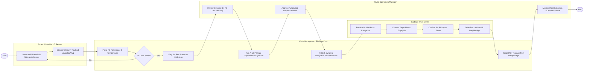

# Swimlane Diagram — Urban Waste Collection Management System

## Mermaid Code

## Flow Description | Mô tả luồng

| Lane | Actor | Role in Flow |
|------|-------|-------------|
| 1 | Smart Waste Bin IoT Sensor | Đo khoảng cách mức rác bằng cảm biến siêu âm, truyền gói tin dữ liệu qua mạng LoRaWAN/NB-IoT về trung tâm. |
| 2 | Waste Management Platform Core | Bóc tách dữ liệu % rác, phát hiện thùng rác đã đầy, chạy thuật toán AI tối ưu hóa tuyến đường gom rác và ghi nhận khối lượng rác tại trạm cân. |
| 3 | Waste Operations Manager | Rà soát bản đồ nhiệt thùng rác trên GIS, phê duyệt lộ trình điều động đội xe rác và giám sát hiệu năng SLA thu gom. |
| 4 | Garbage Truck Driver | Nhận lộ trình dẫn đường di chuyển trên máy tính bảng cabin, thực hiện trút rác các thùng đầy, xác nhận hoàn thành và đổ rác tại bãi cân. |
