# Action Tree — Urban Waste Collection Management System

## Mermaid Code

```mermaid
graph TD
    Root["Urban Waste Collection Management System"]

    Root --> M1["Smart Bin Telemetry & Sensors"]
    Root --> M2["Dynamic Route Optimization"]
    Root --> M3["Garbage Truck Dispatch & GPS"]
    Root --> M4["Illegal Dumping & Citizen Reports"]
    Root --> M5["Landfill & Recycling Processing"]
    Root --> M6["Analytics & Environmental Audit"]

    M1 --> A11["Ingest Ultrasonic Bin Telemetry"]
    M1 --> A12["Monitor Bin Battery & Temperature"]
    M1 --> A13["Predict Overflow Fill Times AI"]
    M1 --> A14["Detect Fire In-Bin Temperature"]

    M2 --> A21["Filter Bins Exceeding Fill Threshold"]
    M2 --> A22["Run AI VRP Route Optimization"]
    M2 --> A23["Consider Real-time Traffic Jam Data"]
    M2 --> A24["Enforce Truck Max Load Limits"]

    M3 --> A31["Dispatch Garbage Trucks Shift"]
    M3 --> A32["Provide Navigation Routes Driver App"]
    M3 --> A33["Track Real-time Truck GPS Location"]
    M3 --> A34["Monitor Fleet Fuel Consumption"]

    M4 --> A41["Receive Citizen Dumping Incident"]
    M4 --> A42["AI Verify Photo Coordinates GPS"]
    M4 --> A43["Schedule Bulky Hazardous Pickup"]
    M4 --> A44["Issue Illegal Dumping Fine Notice"]

    M5 --> A51["Record Weighbridge Net Tonnage"]
    M5 --> A52["Scan Truck License Plate OCR"]
    M5 --> A53["Track Recycled Material Ratios"]
    M5 --> A54["Manage Landfill Capacity Limits"]

    M6 --> A61["Audit Contractor Collection SLAs"]
    M6 --> A62["Calculate Carbon Reduction Metrics"]
    M6 --> A63["Manage Citizen Sanitation Fees"]
    M6 --> A64["Export MONRE Environmental Compliance"]
```

## Module Description | Mô tả Module

| # | Module | Description | Actions |
|---|--------|-------------|---------|
| 1 | Smart Bin Telemetry & Sensors | Thu thập dữ liệu cảm biến siêu âm mức đầy thùng rác, theo dõi pin, nhiệt độ và dự báo thời gian rác tràn | Ingest Ultrasonic Bin Telemetry, Monitor Bin Battery & Temperature, Predict Overflow Fill Times AI, Detect Fire In-Bin Temperature |
| 2 | Dynamic Route Optimization | Thuật toán AI tính toán lộ trình gom rác ngắn nhất chỉ đi qua thùng đầy, tích hợp giao thông thực tế | Filter Bins Exceeding Fill Threshold, Run AI VRP Route Optimization, Consider Real-time Traffic Jam Data, Enforce Truck Max Load Limits |
| 3 | Garbage Truck Dispatch & GPS | Điều động đội xe rác, cung cấp bản đồ dẫn đường di động cho tài xế và giám sát vị trí xe rác GPS | Dispatch Garbage Trucks Shift, Provide Navigation Routes Driver App, Track Real-time Truck GPS Location, Monitor Fleet Fuel Consumption |
| 4 | Illegal Dumping & Citizen Reports | Tiếp nhận phản ánh đổ rác chui từ người dân, xác minh ảnh GPS, đặt lịch thu rác cồng kềnh và phạt vi phạm | Receive Citizen Dumping Incident, AI Verify Photo Coordinates GPS, Schedule Bulky Hazardous Pickup, Issue Illegal Dumping Fine Notice |
| 5 | Landfill & Recycling Processing | Đọc biển số xe tự động tại trạm cân bãi rác, ghi nhận khối lượng rác thực tế và thống kê tỷ lệ rác tái chế | Record Weighbridge Net Tonnage, Scan Truck License Plate OCR, Track Recycled Material Ratios, Manage Landfill Capacity Limits |
| 6 | Analytics & Environmental Audit | Kiểm toán SLA thu gom đúng hạn của nhà thầu, tính toán cắt giảm khí thải cacbon và nộp báo cáo Sở TN&MT | Audit Contractor Collection SLAs, Calculate Carbon Reduction Metrics, Manage Citizen Sanitation Fees, Export MONRE Environmental Compliance |
