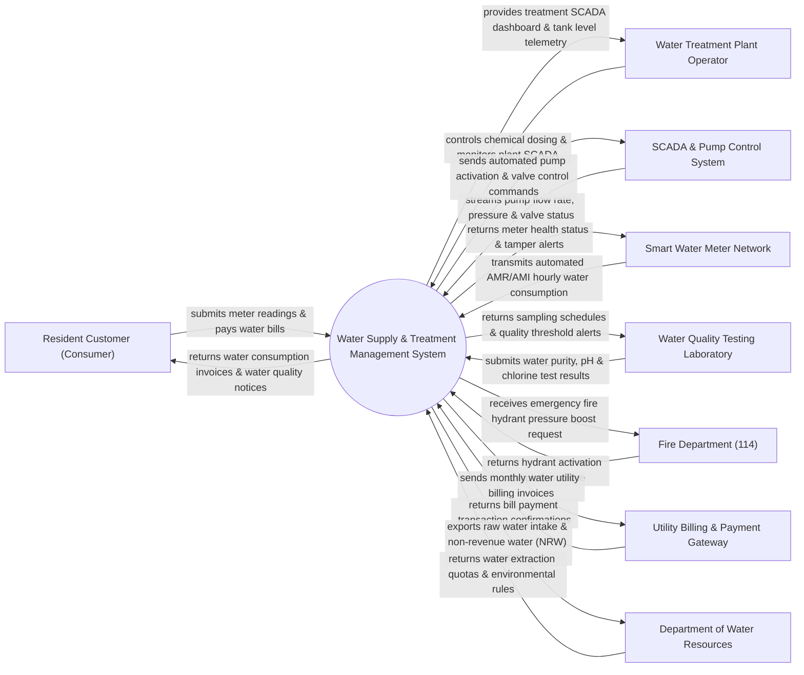

# Context Diagram — Water Supply & Treatment Management System

## Mermaid Code

## Actor & Interaction Table | Bảng Actor & Tương tác

| # | Actor | Actor Type | Data Sent TO System | Data Received FROM System | Notes |
|---|-------|------------|---------------------|---------------------------|-------|
| 1 | Resident Customer (Consumer) | Primary | Water bill payments, meter self-readings, leak reports | Monthly water consumption bills, water quality notices, outage alerts | Khách hàng hộ gia đình/doanh nghiệp sử dụng nước sạch |
| 2 | Water Treatment Plant Operator | Primary | Chemical dosing adjustments, pump override commands, tank rules | Plant SCADA dashboard, raw water intake levels, dosage alerts | Cán bộ kỹ thuật vận hành Nhà máy xử lý nước sạch |
| 3 | SCADA & Pump Control System | Supporting | Real-time flow rate, pipe pressure, reservoir tank levels | Automated pump start/stop signals, valve position commands | Hệ thống điều khiển giám sát tự động hóa SCADA tại các trạm bơm |
| 4 | Smart Water Meter Network | Supporting | Hourly water volume data (AMR/AMI), backflow alerts | Meter status queries, remote shut-off valve commands | Mạng lưới đồng hồ đo nước thông minh đọc dữ liệu từ xa |
| 5 | Water Quality Testing Laboratory | Supporting | Lab water purity, pH, residual chlorine, turbidity metrics | Water sampling task schedules, contamination threshold alerts | Phòng nghiệm hóa lý vi sinh kiểm tra chất lượng nước sạch |
| 6 | Fire Department (114) | Supporting | Fire hydrant water pressure boost request, location | Hydrant water main pressure confirmation, booster status | Cảnh sát PCCC yêu cầu tăng áp lực nước chữa cháy khẩn cấp |
| 7 | Utility Billing & Payment Gateway | Supporting | Water bill payment confirmations, bank transaction IDs | Monthly billing invoices, customer account balances | Cổng thanh toán ngân hàng/ví điện tử thu tiền nước |
| 8 | Department of Water Resources | Regulatory | Water extraction quotas, river/reservoir environmental rules | Raw water extraction statistics, Non-Revenue Water (NRW) reports | Sở Tài nguyên & Môi trường quản lý nguồn nước thô |

## System Boundary Description | Mô tả Phạm vi Hệ thống

Hệ thống Water Supply & Treatment Management System (Hệ thống Quản lý Cấp nước và Xử lý Nước sạch Đô thị) chịu trách nhiệm tự động hóa quy trình cung cấp nước sạch đô thị: Giám sát quy trình xử lý nước thô tại nhà máy, tự động hóa định lượng hóa chất xử lý (Clo, PAC), giám sát mạng lưới ống cấp nước qua SCADA, phát hiện rò rỉ thất thoát nước (Non-Revenue Water - NRW), đọc chỉ số đồng hồ nước thông minh từ xa (AMR/AMI) và lập hóa đơn tiền nước hàng tháng. Tuy nhiên, hệ thống KHÔNG trực tiếp vận hành động cơ bơm cơ khí tại trạm bơm và KHÔNG thay thế công việc đào đường thay thế đường ống vật lý tại hiện trường.
