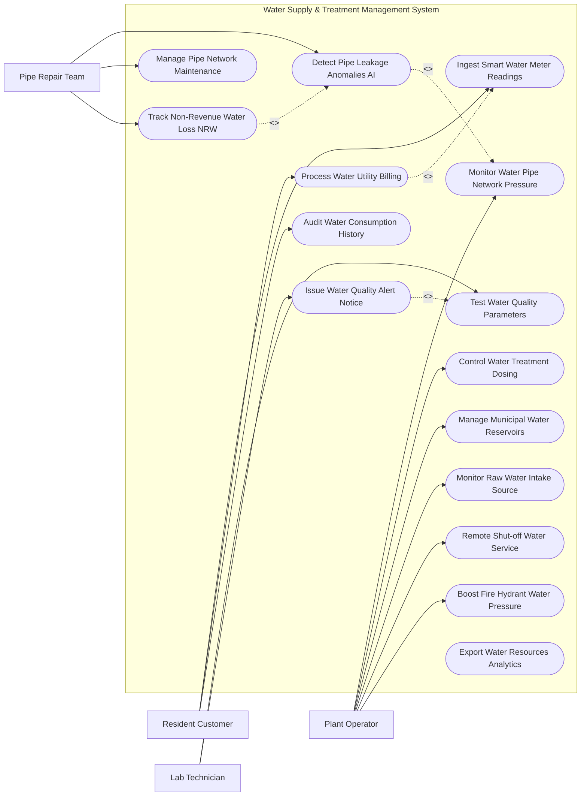

# Use Case Diagram — Water Supply & Treatment Management System

## Mermaid Code

## Actor Table | Bảng Actor

| # | Actor | Actor Type | Role Description | Related Use Cases |
|---|-------|------------|------------------|-------------------|
| 1 | Resident Customer | Primary | Khách hàng sử dụng nước xem chỉ số đồng hồ, nhận hóa đơn và nộp tiền nước | UC01, UC08, UC14 |
| 2 | Plant Operator | Primary | Kỹ sư vận hành nhà máy nước điều khiển định lượng hóa chất, trạm bơm SCADA | UC02, UC04, UC06, UC07, UC09, UC13 |
| 3 | Lab Technician | Primary | Kỹ thuật viên phòng nghiệm kiểm tra chỉ số lý hóa nước sạch và phát cảnh báo | UC05, UC10 |
| 4 | Pipe Repair Team | Primary | Đội sửa chữa đường ống nước tiếp nhận cảnh báo rò rỉ và khắc phục bể ống | UC03, UC11, UC12 |

## Use Case Table | Bảng Use Case

| # | UC ID | Use Case Name | Primary Actor | Secondary Actor | Description | Priority |
|---|-------|---------------|---------------|-----------------|-------------|----------|
| 1 | UC01 | Ingest Smart Water Meter Readings | Customer | AMR Meter | Tự động đọc và lưu chỉ số đồng hồ nước thông minh theo giờ qua mạng không dây | High |
| 2 | UC02 | Monitor Water Pipe Network Pressure | Operator | SCADA Sensor | Giám sát áp lực nước (Bar) và lưu lượng (m3/h) trên mạng lưới đường ống | High |
| 3 | UC03 | Detect Pipe Leakage Anomalies AI | FieldTeam | AI Engine | Thuật toán AI phân tích chênh lệch áp suất để phát hiện điểm rò rỉ bể ống | High |
| 4 | UC04 | Control Water Treatment Dosing | Operator | SCADA System | Tự động hóa định lượng hóa chất xử lý nước (Clo, PAC, Vôi) theo lưu lượng nước thô | High |
| 5 | UC05 | Test Water Quality Parameters | Lab | - | Kiểm tra các chỉ tiêu chất lượng nước (độ đục, độ pH, Clo dư, vi sinh) | High |
| 6 | UC06 | Manage Municipal Water Reservoirs | Operator | SCADA System | Giám sát và điều tiết mực nước tại các bể chứa nước sạch toàn thành phố | Medium |
| 7 | UC07 | Monitor Raw Water Intake Source | Operator | Weather API | Giám sát chất lượng và mực nước nguồn nước thô (sông, hồ) trước khi đưa vào nhà máy | Medium |
| 8 | UC08 | Process Water Utility Billing | Customer | Billing Gateway | Tự động lập hóa đơn tiền nước hàng tháng theo biểu giá lũy tiến và thu tiền | High |
| 9 | UC09 | Remote Shut-off Water Service | Operator | Smart Meter | Tự động đóng van từ xa ngắt cấp nước đối với khách hàng nợ tiền nước kéo dài | High |
| 10 | UC10 | Issue Water Quality Alert Notice | Lab | Customer | Phát thông báo cảnh báo sự cố ô nhiễm nguồn nước tới người dân khu vực | High |
| 11 | UC11 | Manage Pipe Network Maintenance | FieldTeam | GIS System | Lập kế hoạch bảo trì, thay thế đường ống nước hư hỏng theo định kỳ | Medium |
| 12 | UC12 | Track Non-Revenue Water Loss NRW | FieldTeam | Operator | Thống kê và quản lý tỷ lệ thất thoát nước không thu tiền (NRW) | High |
| 13 | UC13 | Boost Fire Hydrant Water Pressure | Operator | FireDept | Tự động tăng áp lực máy bơm tại tuyến ống khu vực xảy ra cháy nổ | High |
| 14 | UC14 | Audit Water Consumption History | Customer | - | Cung cấp biểu đồ lịch sử tiêu thụ nước theo ngày/tháng cho khách hàng tra cứu | Low |
| 15 | UC15 | Export Water Resources Analytics | SysAdmin | Water Dept | Trích xuất báo cáo khai thác tài nguyên nước nộp Sở Tài nguyên & Môi trường | Low |

## Use Case Specification | Đặc tả Use Case

---

### UC01 — Ingest Smart Water Meter Readings

| Field | Detail |
|-------|--------|
| **UC ID** | UC01 |
| **Use Case Name** | Ingest Smart Water Meter Readings |
| **Actor(s)** | Primary: Resident Customer / Secondary: Smart Water Meter (AMR/AMI) |
| **Description** | Tiếp nhận tự động chỉ số tiêu thụ nước theo giờ từ đồng hồ nước thông minh từ xa mà không cần nhân viên ghi sổ thủ công. |
| **Precondition** | 1. Đồng hồ nước thông minh gắn module truyền thông không dây (NB-IoT/LoRaWAN) hoạt động bình thường. |
| **Main Flow** | 1. Smart Water Meter đo thể tích nước chảy qua và định kỳ gửi gói tin chỉ số ($m^3$) về hệ thống.   2. System tại IoT Gateway giải mã gói tin và xác thực mã định danh đồng hồ.   3. System kiểm tra chỉ số nước mới vs chỉ số nước cũ (đảm bảo $Chỉ\_số\_mới \ge Chỉ\_số\_cũ$).   4. System ghi nhận sản lượng tiêu thụ nước theo giờ vào CSDL.   5. System cập nhật sản lượng lũy kế tháng trên ứng dụng di động của Customer.   6. System kiểm tra các dấu hiệu bất thường (Dòng chảy liên tục 24h - cảnh báo vỡ ống nước trong nhà). |
| **Alternative Flow** | **AF1** — Đồng hồ cơ (Manual Reading): Nhân viên ghi chữ chụp ảnh mặt đồng hồ bằng ứng dụng di động, công nghệ OCR tự động bóc tách chỉ số. |
| **Exception Flow** | **EX1** — Chỉ số nước tăng vọt bất thường (> 500% so với tháng trước): System đánh dấu "Chỉ số nghi vấn", tạm dừng lập hóa đơn tự động và cử nhân viên đến kiểm tra đồng hồ. |
| **Postcondition** | Chỉ số nước được ghi nhận chính xác thời gian thực, phục vụ tính hóa đơn tiền nước (UC08). |
| **Business Rule** | **BR1**: Tỷ lệ đọc thành công chỉ số đồng hồ nước thông minh từ xa qua sóng không dây phải đạt tối thiểu 99.5%. |

---

### UC02 — Monitor Water Pipe Network Pressure

| Field | Detail |
|-------|--------|
| **UC ID** | UC02 |
| **Use Case Name** | Monitor Water Pipe Network Pressure |
| **Actor(s)** | Primary: Plant Operator / Secondary: SCADA Sensors |
| **Description** | Giám sát áp lực nước (Bar) và lưu lượng ($m^3/h$) trên toàn bộ mạng lưới đường ống cấp nước đô thị qua hệ thống SCADA. |
| **Precondition** | 1. Các cảm biến áp suất và lưu lượng trên tuyến ống được kết nối với hệ thống SCADA. |
| **Main Flow** | 1. Các cảm biến áp suất trên đường ống truyền dữ liệu telemetry về hệ thống theo tần suất 10 giây/lần.   2. System hiển thị sơ đồ mạng lưới đường ống cấp nước (GIS Network Map) kèm chỉ số áp lực tại từng vùng DMA (District Metered Area).   3. Operator xem màu sắc áp lực trên bản đồ: Xanh (Áp lực chuẩn 2.0 - 3.5 Bar), Vàng (Áp lực yếu < 1.5 Bar), Đỏ (Áp lực quá cao > 5.0 Bar - nguy cơ bể ống).   4. System tự động điều chỉnh tốc độ máy bơm biến tần tại trạm bơm để duy trì áp lực ổn định.   5. Nếu phát hiện giảm áp đột ngột tại một vùng: System cảnh báo rò rỉ bể ống (UC03). |
| **Alternative Flow** | **AF1** — Tăng áp khẩn cấp chữa cháy (UC13): Khi nhận yêu cầu PCCC 114, Operator điều khiển tăng công suất trạm bơm tăng áp vùng tương ứng. |
| **Exception Flow** | **EX1** — Tụt áp toàn mạng lưới do vỡ ống dẫn nước thô: System báo động còi khẩn cấp tại trung tâm điều hành, đề xuất đóng van phân đoạn sự cố. |
| **Postcondition** | Áp lực nước trên toàn mạng lưới được duy trì ổn định, đảm bảo nước chảy mạnh tới các hộ gia đình cuối nguồn. |
| **Business Rule** | **BR1**: Áp lực nước tại các điểm đấu nối hộ gia đình phải được duy trì trong khoảng từ 1.5 Bar đến 3.0 Bar. |

---

### UC03 — Detect Pipe Leakage Anomalies AI

| Field | Detail |
|-------|--------|
| **UC ID** | UC03 |
| **Use Case Name** | Detect Pipe Leakage Anomalies AI |
| **Actor(s)** | Primary: Pipe Repair Team / Secondary: AI Leak Detection Engine |
| **Description** | Sử dụng thuật toán AI phân tích chênh lệch áp suất và lưu lượng đêm để phát hiện điểm bể ngầm rò rỉ nước sạch. |
| **Precondition** | 1. Mạng lưới cấp nước được phân chia thành các vùng quản lý DMA độc lập có đồng hồ tổng đầu vào và đầu ra. |
| **Main Flow** | 1. Thuật toán AI phân tích dữ liệu lưu lượng nước chảy ban đêm (Minimum Night Flow - MNF từ 02:00 đến 04:00 sáng).   2. System so sánh Tổng lưu lượng nước cấp vào vùng DMA vs Tổng lượng nước tiêu thụ trên các đồng hồ khách hàng.   3. AI Engine phát hiện vùng DMA có tỷ lệ tổn thất bất thường ($MNF_{thực\_tế} > MNF_{chuẩn} + 20\%$).   4. System tính toán khoanh vùng đoạn ống nghi ngờ bị vỡ ngầm trong bán kính 100m.   5. System khởi tạo Vé sự cố rò rỉ nước (Leak Ticket ID) và phát thông báo tới Pipe Repair Team.   6. Pipe Repair Team sử dụng thiết bị khuếch đại âm thanh dò bể ống tại hiện trường để xác định chính xác vị trí và sửa chữa (UC11). |
| **Alternative Flow** | **AF1** — Phát hiện bể vỡ lớn nổi trên mặt đường: Cư dân chụp ảnh gửi phản ánh (UC05), System ưu tiên cử đội sửa chữa đến xử lý ngay. |
| **Exception Flow** | **EX1** — Bể ống ngầm dưới dòng sông/cầu: System đề xuất phương án dùng robot dò ống chuyên dụng để kiểm tra. |
| **Postcondition** | Điểm rò rỉ nước ngầm được phát hiện sớm, giảm thiểu tỷ lệ thất thoát nước không thu tiền NRW (UC12). |
| **Business Rule** | **BR1**: Thuật toán AI phải phát hiện được các điểm rò rỉ ngầm có dung lượng thất thoát $> 0.5 m^3/h$ trong vòng 24 giờ. |

---

### UC04 — Control Water Treatment Dosing

| Field | Detail |
|-------|--------|
| **UC ID** | UC04 |
| **Use Case Name** | Control Water Treatment Dosing |
| **Actor(s)** | Primary: Plant Operator / Secondary: SCADA System |
| **Description** | Tự động hóa quá trình châm hóa chất xử lý nước (Keo tụ PAC, vôi nâng pH, Clo khử trùng) theo chất lượng nước thô đầu vào. |
| **Precondition** | 1. Các cảm biến đo độ đục, pH nước thô đầu vào truyền dữ liệu liên tục về SCADA.   2. Hệ thống bơm định lượng hóa chất kết nối tự động. |
| **Main Flow** | 1. Cảm biến đo chỉ số chất lượng nước thô (Độ đục NTU, độ pH, độ màu) tại cửa thu nước.   2. System tra cứu Bảng định lượng hóa chất (Dosing Model Table).   3. System tự động tính toán lưu lượng châm hóa chất tối ưu: $Lít\_hóa\_chất/h = f(Lưu\_lượng\_nước\_thô, Độ\_đục\_NTU)$.   4. System gửi tín hiệu điều khiển tốc độ bơm định lượng châm keo tụ PAC vào bể phản ứng.   5. Cảm biến tại bể lắng và bể lọc đo lại chất lượng nước sau xử lý.   6. System tự động châm Clo khử trùng sau lọc để duy trì nồng độ Clo dư đạt chuẩn (0.3 - 0.5 mg/L).   7. Operator giám sát các thông số châm hóa chất trên màn hình SCADA. |
| **Alternative Flow** | **AF1** — Điều khiển châm hóa chất thủ công: Khi nước thô có biến động đột biến (sau mưa lũ độ đục tăng x10 lần), Operator chuyển sang chế độ Manual Override để điều chỉnh hóa chất. |
| **Exception Flow** | **EX1** — Hết hóa chất trong bồn chứa: Cảm biến mức bồn báo động Đỏ "Hết Clo", System tự động chuyển sang bồn dự phòng và báo Operator nạp thêm hóa chất. |
| **Postcondition** | Nước sau xử lý đạt 100% tiêu chuẩn nước sạch sinh hoạt của Bộ Y tế, tối ưu hóa chi phí hóa chất. |
| **Business Rule** | **BR1**: Nồng độ Clo dư trong nước sạch ra khỏi nhà máy bắt buộc phải duy trì nghiêm ngặt từ 0.3 mg/L đến 0.5 mg/L. |

---

### UC08 — Process Water Utility Billing

| Field | Detail |
|-------|--------|
| **UC ID** | UC08 |
| **Use Case Name** | Process Water Utility Billing |
| **Actor(s)** | Primary: Resident Customer / Secondary: Utility Billing Gateway |
| **Description** | Tự động tính toán tiền nước theo biểu giá lũy tiến, lập hóa đơn điện tử và thu tiền nước hàng tháng qua ngân hàng. |
| **Precondition** | 1. Chỉ số nước tháng hiện tại đã được chốt (UC01).   2. Biểu giá nước sinh hoạt/kinh doanh được cấu hình trên hệ thống. |
| **Main Flow** | 1. System lấy Sản lượng nước tiêu thụ tháng ($V = Chỉ\_số\_mới - Chỉ\_số\_cũ$).   2. System áp dụng Biểu giá lũy tiến bậc thang: Bậc 1 ($0-10m^3$), Bậc 2 ($10-20m^3$), Bậc 3 ($20-30m^3$), Bậc 4 ($>30m^3$).   3. System tính Tiền nước + Phí bảo vệ môi trường (10%) + Thuế GTGT (5%).   4. System lập Hóa đơn tiền nước điện tử (e-Bill) có chữ ký số doanh nghiệp cấp nước.   5. System gửi thông báo hóa đơn tiền nước qua SMS/Email/Zalo/App cho Customer.   6. Customer thực hiện thanh toán tiền nước qua Ngân hàng/Ví điện tử.   7. Billing Gateway trả về xác nhận thanh toán thành công, System gạch nợ tự động cho Customer. |
| **Alternative Flow** | **AF1** — Trích nợ tự động qua Ngân hàng (Auto-debit): Đến kỳ hạn hóa đơn, Ngân hàng tự động trích tiền từ tài khoản Customer để nộp tiền nước. |
| **Exception Flow** | **EX1** — Khách hàng quá hạn nộp tiền nước 30 ngày: System gửi thông báo nhắc nợ lần 2. Nếu quá 60 ngày, chuyển sang Use Case Ngắt nước từ xa (UC09). |
| **Postcondition** | Doanh thu tiền nước được hạch toán chính xác, hóa đơn điện tử có mã tra cứu được lưu trữ vĩnh viễn. |
| **Business Rule** | **BR1**: Hóa đơn tiền nước điện tử phải tuân thủ đúng định dạng hóa đơn điện tử của Tổng cục Thuế. |
