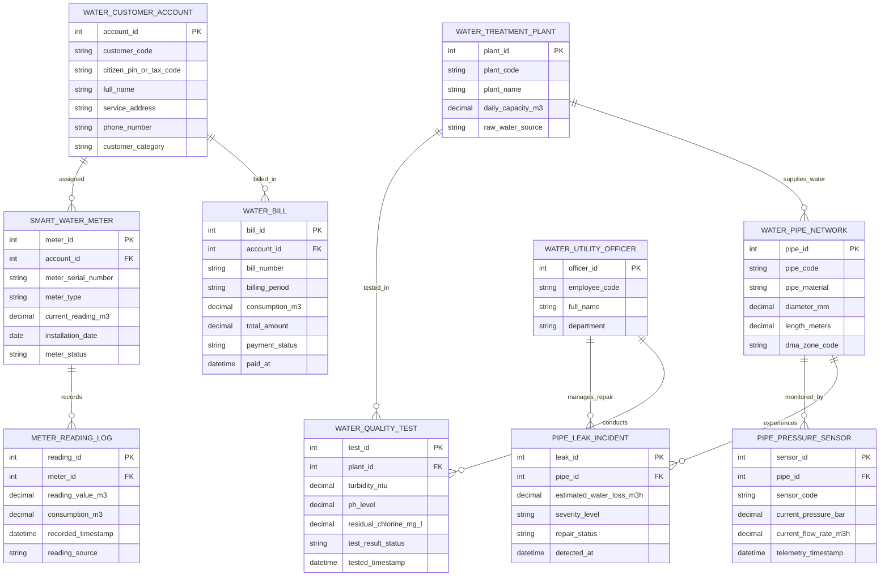

# Conceptual ERD — Water Supply & Treatment Management System

## Mermaid Code

## Entity Description Table | Bảng mô tả Entity

| # | Entity Name | Vietnamese Name | Description | Key Attributes | Main Relationships |
|---|-------------|-----------------|-------------|----------------|-------------------|
| 1 | WATER_CUSTOMER_ACCOUNT | Tài khoản Khách hàng Tiêu thụ Nước | Thông tin hộ gia đình, doanh nghiệp đăng ký sử dụng nước sạch | account_id, customer_code, full_name, service_address, customer_category | Assigned SMART_WATER_METER, billed in WATER_BILL |
| 2 | SMART_WATER_METER | Đồng hồ Nước Thông minh | Thông tin thiết bị đo thể tích nước tiêu thụ đọc chỉ số từ xa (AMR/AMI) | meter_id, meter_serial_number, current_reading_m3, meter_status | Belongs to WATER_CUSTOMER_ACCOUNT, records METER_READING_LOG |
| 3 | METER_READING_LOG | Nhật ký Chỉ số Nước | Chuỗi dữ liệu lịch sử chỉ số nước đo theo giờ/tháng của đồng hồ | reading_id, reading_value_m3, consumption_m3, recorded_timestamp | Belongs to SMART_WATER_METER |
| 4 | WATER_PIPE_NETWORK | Mạng lưới Đường ống Nước | Thông tin tuyến ống cấp nước đô thị, chất liệu, đường kính và vùng DMA | pipe_id, pipe_code, pipe_material, diameter_mm, dma_zone_code | Monitored by PIPE_PRESSURE_SENSOR, experiences PIPE_LEAK_INCIDENT |
| 5 | PIPE_PRESSURE_SENSOR | Cảm biến Áp suất & Lưu lượng | Cảm biến telemetry SCADA đo áp lực nước (Bar) và lưu lượng ($m^3/h$) | sensor_id, sensor_code, current_pressure_bar, current_flow_rate_m3h | Belongs to WATER_PIPE_NETWORK |
| 6 | WATER_TREATMENT_PLANT | Nhà máy Xử lý Nước sạch | Thông tin nhà máy xử lý nước thô thành nước sạch và công suất sản xuất | plant_id, plant_code, plant_name, daily_capacity_m3 | Tested in WATER_QUALITY_TEST, supplies WATER_PIPE_NETWORK |
| 7 | WATER_QUALITY_TEST | Kết quả Kiểm nghiệm Chất lượng Nước | Nhật ký kiểm tra độ đục, độ pH, Clo dư và tiêu chuẩn an toàn vi sinh | test_id, turbidity_ntu, ph_level, residual_chlorine_mg_l | Belongs to WATER_TREATMENT_PLANT |
| 8 | PIPE_LEAK_INCIDENT | Sự cố Rò rỉ Bể ống Nước | Hồ sơ ghi nhận các điểm bể ống rò rỉ nước sạch và ước tính thất thoát | leak_id, estimated_water_loss_m3h, severity_level, repair_status | Belongs to WATER_PIPE_NETWORK, managed by OFFICER |
| 9 | WATER_BILL | Hóa đơn Tiền nước | Hóa đơn tiền nước điện tử hàng tháng bao gồm thuế và phí bảo vệ môi trường | bill_id, bill_number, billing_period, total_amount, payment_status | Belongs to WATER_CUSTOMER_ACCOUNT |
| 10 | WATER_UTILITY_OFFICER | Cán bộ Công ty Cấp nước | Thông tin kỹ sư vận hành nhà máy, cán bộ quản lý mạng lưới đường ống | officer_id, employee_code, full_name, department | Manages PIPE_LEAK_INCIDENT, conducts WATER_QUALITY_TEST |

## Relationship Description | Mô tả Quan hệ

| # | From Entity | Cardinality | To Entity | Relationship Label | Business Explanation |
|---|-------------|-------------|-----------|-------------------|----------------------|
| 1 | WATER_CUSTOMER_ACCOUNT | one-to-many | SMART_WATER_METER | assigned | Một tài khoản khách hàng có thể sở hữu một hoặc nhiều đồng hồ nước |
| 2 | SMART_WATER_METER | one-to-many | METER_READING_LOG | records | Một đồng hồ nước ghi nhận chuỗi lịch sử chỉ số nước đo theo thời gian |
| 3 | WATER_CUSTOMER_ACCOUNT | one-to-many | WATER_BILL | billed_in | Một tài khoản khách hàng nhận hóa đơn tiền nước hàng tháng |
| 4 | WATER_PIPE_NETWORK | one-to-many | PIPE_PRESSURE_SENSOR | monitored_by | Một tuyến ống nước được lắp đặt nhiều cảm biến đo áp suất SCADA |
| 5 | WATER_PIPE_NETWORK | one-to-many | PIPE_LEAK_INCIDENT | experiences | Một tuyến ống nước có thể phát sinh các sự cố rò rỉ bể ống |
| 6 | WATER_TREATMENT_PLANT | one-to-many | WATER_QUALITY_TEST | tested_in | Một nhà máy xử lý nước thực hiện kiểm nghiệm chất lượng nước liên tục |
| 7 | WATER_UTILITY_OFFICER | one-to-many | PIPE_LEAK_INCIDENT | manages_repair | Một cán bộ quản lý điều phối sửa chữa cho nhiều sự cố rò rỉ |
| 8 | WATER_TREATMENT_PLANT | one-to-many | WATER_PIPE_NETWORK | supplies_water | Một nhà máy nước cấp nước sạch cho mạng lưới các tuyến ống đô thị |
| 9 | WATER_UTILITY_OFFICER | one-to-many | WATER_QUALITY_TEST | conducts | Một kỹ thuật viên phòng lab thực hiện nhiều đợt thử nghiệm chất lượng nước |
