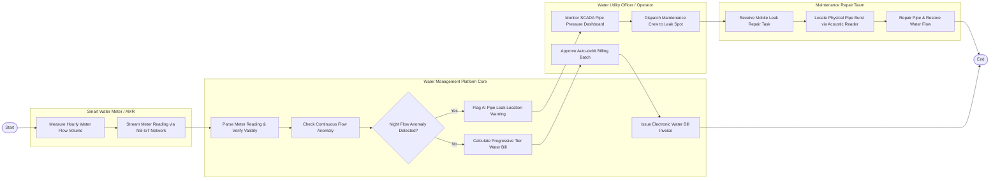

# Swimlane Diagram — Water Supply & Treatment Management System

## Mermaid Code

## Flow Description | Mô tả luồng

| Lane | Actor | Role in Flow |
|------|-------|-------------|
| 1 | Smart Water Meter / AMR | Đo thể tích nước tiêu thụ theo giờ, đóng gói và gửi dữ liệu chỉ số nước qua mạng không dây NB-IoT/LoRaWAN. |
| 2 | Water Management Platform Core | Giải mã chỉ số nước, kiểm tra dấu hiệu thất thoát bất thường, khoanh vùng vị trí bể ống AI và tự động tính hóa đơn tiền nước. |
| 3 | Water Utility Officer / Operator | Giám sát bảng điều khiển áp lực SCADA, điều động đội sửa chữa ống nước bể và phê duyệt phát hành hóa đơn tiền nước. |
| 4 | Maintenance Repair Team | Nhận lệnh sửa chữa trên ứng dụng di động, dò tìm chính xác vị trí vỡ ống bằng thiết bị âm thanh và khắc phục sự cố rò rỉ. |
