# Action Tree — Water Supply & Treatment Management System

## Mermaid Code

```mermaid
graph TD
    Root["Water Supply & Treatment Management System"]

    Root --> M1["Smart Metering & Automated Billing"]
    Root --> M2["Water Treatment & Chemical Dosing"]
    Root --> M3["Pipeline Network & SCADA Telemetry"]
    Root --> M4["Leak Detection & Non-Revenue Water"]
    Root --> M5["Water Quality & Lab Testing"]
    Root --> M6["Asset Maintenance & Resource Analytics"]

    M1 --> A11["Ingest AMR AMI Meter Telemetry"]
    M1 --> A12["Calculate Progressive Tier Water Bills"]
    M1 --> A13["Process Online E-Payment Integration"]
    M1 --> A14["Remote Shut-off Overdue Valves"]

    M2 --> A21["Monitor Raw Water Intake Source"]
    M2 --> A22["Automate PAC Chlorine Chemical Dosing"]
    M2 --> A23["Manage Clean Water Reservoir Tanks"]
    M2 --> A24["Control Treatment Plant Pumps SCADA"]

    M3 --> A31["Stream SCADA Pipe Pressure Telemetry"]
    M3 --> A32["Monitor District Metered Areas DMA"]
    M3 --> A33["Boost Fire Hydrant Water Pressure"]
    M3 --> A34["Map Pipe Network GIS Infrastructure"]

    M4 --> A41["Analyze Minimum Night Flow Anomalies"]
    M4 --> A42["AI Pinpoint Pipe Leak Locations"]
    M4 --> A43["Calculate Non-Revenue Water NRW Loss"]
    M4 --> A44["Dispatch Emergency Pipe Repair Teams"]

    M5 --> A51["Test Water Turbidity pH Chlorine"]
    M5 --> A52["Issue Contamination Water Quality Alert"]
    M5 --> A53["Schedule Lab Sampling Field Tasks"]
    M5 --> A54["Audit Health Ministry Water Standards"]

    M6 --> A61["Schedule Preventive Pipe Maintenance"]
    M6 --> A62["Track Pipe Asset Lifecycle History"]
    M6 --> A63["Log System Immutable SCADA Audits"]
    M6 --> A64["Export Water Resources Extraction Reports"]
```

## Module Description | Mô tả Module

| # | Module | Description | Actions |
|---|--------|-------------|---------|
| 1 | Smart Metering & Automated Billing | Tiếp nhận dữ liệu chỉ số nước thông minh từ xa (AMR/AMI), tự động tính hóa đơn tiền nước lũy tiến và khóa van từ xa | Ingest AMR AMI Meter Telemetry, Calculate Progressive Tier Water Bills, Process Online E-Payment Integration, Remote Shut-off Overdue Valves |
| 2 | Water Treatment & Chemical Dosing | Tự động hóa quá trình châm hóa chất xử lý nước (PAC, Clo), giám sát chất lượng nước thô và điều khiển bơm SCADA | Monitor Raw Water Intake Source, Automate PAC Chlorine Chemical Dosing, Manage Clean Water Reservoir Tanks, Control Treatment Plant Pumps SCADA |
| 3 | Pipeline Network & SCADA Telemetry | Giám sát áp lực và lưu lượng mạng lưới đường ống theo phân vùng DMA, tăng áp lực nước chữa cháy PCCC 114 | Stream SCADA Pipe Pressure Telemetry, Monitor District Metered Areas DMA, Boost Fire Hydrant Water Pressure, Map Pipe Network GIS Infrastructure |
| 4 | Leak Detection & Non-Revenue Water | Phân tích lưu lượng đêm tối thiểu bằng AI để phát hiện bể vỡ ống ngầm, tính tỷ lệ thất thoát nước NRW và điều xe sửa chữa | Analyze Minimum Night Flow Anomalies, AI Pinpoint Pipe Leak Locations, Calculate Non-Revenue Water NRW Loss, Dispatch Emergency Pipe Repair Teams |
| 5 | Water Quality & Lab Testing | Quản lý kiểm nghiệm chất lượng nước sạch (độ đục, Clo dư, pH), phát cảnh báo sự cố ô nhiễm nguồn nước tới công đồng | Test Water Turbidity pH Chlorine, Issue Contamination Water Quality Alert, Schedule Lab Sampling Field Tasks, Audit Health Ministry Water Standards |
| 6 | Asset Maintenance & Resource Analytics | Lập kế hoạch bảo trì phòng ngừa đường ống nước, theo dõi tài sản và trích xuất báo cáo khai thác tài nguyên nước | Schedule Preventive Pipe Maintenance, Track Pipe Asset Lifecycle History, Log System Immutable SCADA Audits, Export Water Resources Extraction Reports |
