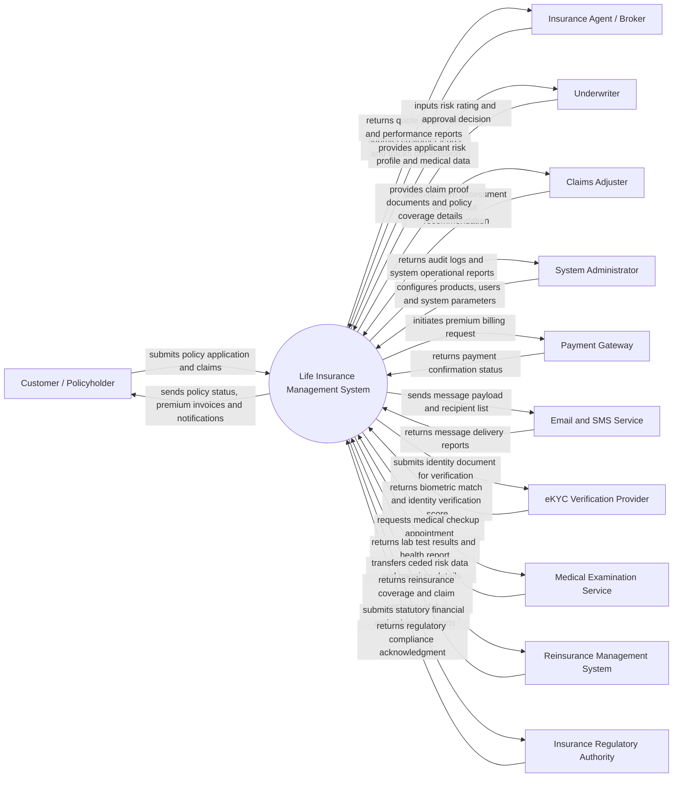

# Context Diagram — Life Insurance Management System

## Mermaid Code

## Actor & Interaction Table | Bảng Actor & Tương tác

| # | Actor | Actor Type | Data Sent TO System | Data Received FROM System | Ghi chú / Notes |
|---|-------|------------|---------------------|---------------------------|-----------------|
| 1 | Customer / Policyholder | Primary | Policy application, personal details, health declaration, premium payment, claim requests, proof documents | Quote proposals, policy documents, payment receipts, claim status updates, maturity notices | Khách hàng cá nhân hoặc chủ hợp đồng bảo hiểm nhân thọ |
| 2 | Insurance Agent / Broker | Primary | Customer lead info, application submissions, policy service requests | Quote generation tool, commission statements, policy status tracking, sales targets | Đại lý bảo hiểm hoặc môi giới trực tiếp tư vấn và bán hợp đồng |
| 3 | Underwriter | Primary | Risk evaluation rating, premium loading decision, exclusion terms, policy approval/rejection | Applicant medical records, eKYC status, financial declaration, risk scoring history | Chuyên viên thẩm định rủi ro và phê duyệt hợp đồng |
| 4 | Claims Adjuster | Primary | Claim assessment report, fraud investigation notes, approved payout amount | Claim file documents, policy coverage limits, beneficiary info, historical claims | Chuyên viên giám định và xử lý yêu cầu bồi thường bảo hiểm |
| 5 | System Administrator | Primary | User management, role permissions, product catalog configuration, audit parameters | System audit logs, security alerts, performance analytics, backup status | Quản trị viên hệ thống quản lý phân quyền và cấu hình hệ thống |
| 6 | Payment Gateway | Supporting | Payment confirmation, transaction ID, bank reference number | Premium payment invoice, bill amount, customer payment token | Cổng thanh toán (VNPay, Momo, NAPAS, Banking API) |
| 7 | Email and SMS Service | Supporting | Delivery status logs, bounce notifications | Message body, template ID, recipient phone number/email address | Hệ thống gửi thông báo tự động (AWS SES, Twilio, Brandname SMS) |
| 8 | eKYC Verification Provider | Supporting | OCR extracted data, liveness verification result, face matching score | Front/back ID card images, selfie video/photo payload | Dịch vụ xác thực danh tính điện tử (VNPT eKYC, FPT AI) |
| 9 | Medical Examination Service | Supporting | Medical checkup report, blood/urine lab results, doctor's evaluation | Patient appointment request, medical exam form checklist | Phòng khám/Bệnh viện đối tác cung cấp kết quả khám sức khỏe |
| 10 | Reinsurance Management System | Supporting | Reinsurance treaty acceptance, claim recovery confirmation | Risk exposure data, treaty allocation payload, ceded premium details | Hệ thống quản lý tái bảo hiểm chia sẻ rủi ro quy mô lớn |
| 11 | Insurance Regulatory Authority | Regulatory | Regulatory guidelines, statutory compliance notices, audit requirements | Solvency margin report, premium revenue statistics, fraud monitoring report | Cơ quan quản lý nhà nước (Cục Quản lý, giám sát bảo hiểm - Bộ Tài chính) |

## System Boundary Description | Mô tả Phạm vi Hệ thống

Hệ thống Quản lý Bảo hiểm Nhân thọ (Life Insurance Management System) chịu trách nhiệm tự động hóa và quản lý toàn bộ vòng đời hợp đồng bảo hiểm nhân thọ từ khâu tiếp nhận yêu cầu tham gia, thẩm định rủi ro, cấp phát hợp đồng, thu phí định kỳ, quản lý danh mục đầu tư tích lũy (đối với hợp đồng liên kết đầu tư), cho đến giải quyết quyền lợi bảo hiểm (tử vong, thương tật, bệnh hiểm nghèo, đáo hạn). Hệ thống trực tiếp lưu trữ dữ liệu khách hàng, hợp đồng, lịch sử đóng phí, và thông tin thụ hưởng.

Hệ thống **KHÔNG** trực tiếp xử lý hạ tầng giao dịch thanh toán ngân hàng (ủy quyền cho Payment Gateway), **KHÔNG** tự thực hiện khám sức khỏe lâm sàng (giao tiếp qua API với đối tác y tế), **KHÔNG** vận hành hạ tầng gửi SMS/Email vật lý (sử dụng dịch vụ Notification Gateway), và **KHÔNG** thay thế phần mềm kế toán tổng hợp của doanh nghiệp mà chỉ kết xuất dữ liệu tài chính định kỳ.
