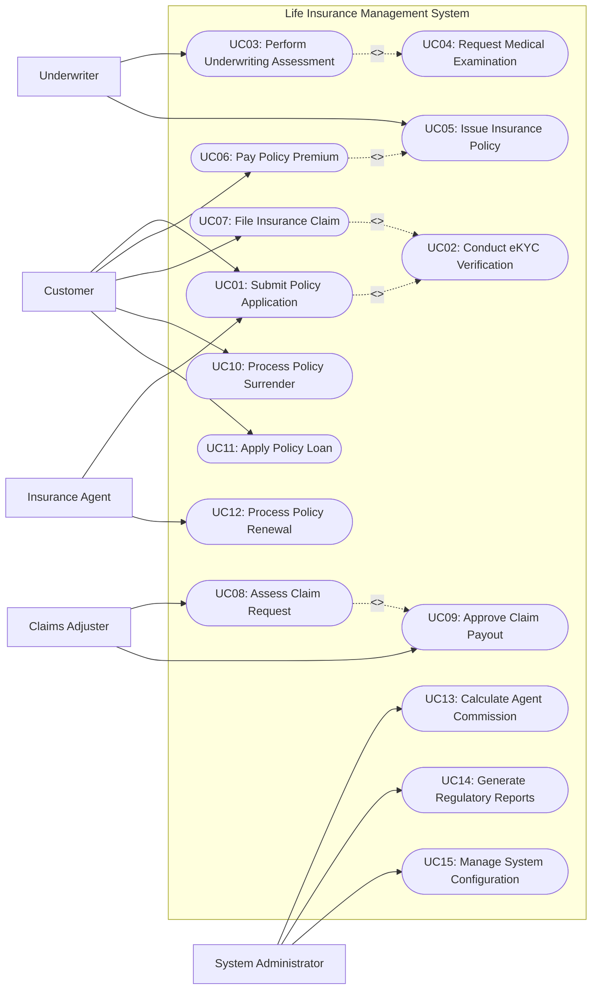

# Use Case Diagram — Life Insurance Management System

## Mermaid Code

## Actor Table | Bảng Actor

| # | Actor | Actor Type | Role Description | Related Use Cases |
|---|-------|------------|------------------|-------------------|
| 1 | Customer | Primary | Nguời mua bảo hiểm hoặc người được bảo hiểm thực hiện nộp hồ sơ, đóng phí, và gửi yêu cầu bồi thường | UC01, UC06, UC07, UC10, UC11 |
| 2 | Insurance Agent | Primary | Đại lý đại diện tư vấn khách hàng, nộp hồ sơ thay mặt khách hàng và theo dõi tái tục hợp đồng | UC01, UC12 |
| 3 | Underwriter | Primary | Chuyên viên thẩm định đánh giá mức độ rủi ro sức khỏe, tài chính và ra quyết định chấp nhận bảo hiểm | UC03, UC04, UC05 |
| 4 | Claims Adjuster | Primary | Chuyên viên giám định tổn thất, đối soát hồ sơ bồi thường và đề xuất phương án chi trả quyền lợi | UC08, UC09 |
| 5 | System Administrator | Primary | Quản trị viên hệ thống quản lý tài khoản người dùng, danh mục sản phẩm, tính hoa hồng và xuất báo cáo | UC13, UC14, UC15 |

## Use Case Table | Bảng Use Case

| # | UC ID | Use Case Name | Primary Actor | Secondary Actor | Description | Priority |
|---|-------|---------------|---------------|-----------------|-------------|----------|
| 1 | UC01 | Submit Policy Application | Customer | Insurance Agent | Khách hàng hoặc Đại lý tạo và nộp hồ sơ đề nghị tham gia bảo hiểm nhân thọ | High |
| 2 | UC02 | Conduct eKYC Verification | System | Customer | Xác thực danh tính điện tử của khách hàng qua giấy tờ tùy thân và sinh trắc học | High |
| 3 | UC03 | Perform Underwriting Assessment | Underwriter | Medical API | Thẩm định rủi ro sức khỏe, nghề nghiệp và tài chính của người đề nghị bảo hiểm | High |
| 4 | UC04 | Request Medical Examination | Underwriter | Medical API | Chỉ định kiểm tra sức khỏe tại phòng khám liên kết khi hồ sơ cần làm rõ | Medium |
| 5 | UC05 | Issue Insurance Policy | Underwriter | Customer | Khởi tạo hợp đồng bảo hiểm chính thức sau khi hồ sơ được phê duyệt và hoàn tất đóng phí lần đầu | High |
| 6 | UC06 | Pay Policy Premium | Customer | Payment Gateway | Thực hiện thanh toán phí bảo hiểm định kỳ (hàng năm, nửa năm, quý) qua cổng thanh toán | High |
| 7 | UC07 | File Insurance Claim | Customer | Claims Adjuster | Khách hàng gửi yêu cầu giải quyết quyền lợi bảo hiểm (tử vong, nằm viện, bệnh hiểm nghèo) | High |
| 8 | UC08 | Assess Claim Request | Claims Adjuster | External Expert | Giám định tính hợp lệ của hồ sơ bồi thường và đối soát với các điều khoản bảo hiểm | High |
| 9 | UC09 | Approve Claim Payout | Claims Adjuster | Payment Gateway | Phê duyệt phương án bồi thường và thực hiện lệnh chi trả tiền bảo hiểm | High |
| 10 | UC10 | Process Policy Surrender | Customer | Underwriter | Xử lý yêu cầu chấm dứt hợp đồng trước hạn và hoàn trả giá trị hoàn lại (surrender value) | Medium |
| 11 | UC11 | Apply Policy Loan | Customer | System | Khách hàng vay tiền từ giá trị tài khoản tích lũy của hợp đồng bảo hiểm nhân thọ | Low |
| 12 | UC12 | Process Policy Renewal | Insurance Agent | Customer | Nhắc nhở và xử lý tái tục hợp đồng khi đến hạn kỳ đóng phí tiếp theo | Medium |
| 13 | UC13 | Calculate Agent Commission | System Administrator | Insurance Agent | Tự động tính toán hoa hồng đại lý dựa trên doanh số phí bảo hiểm thực thu | Medium |
| 14 | UC14 | Generate Regulatory Reports | System Administrator | Regulatory Portal | Kết xuất báo cáo định kỳ nộp Cục Quản lý Bảo hiểm theo quy định pháp luật | High |
| 15 | UC15 | Manage System Configuration | System Administrator | None | Cấu hình quy tắc tính phí, bảng tỷ lệ tử vong, phân quyền hệ thống | Low |

## Use Case Specification | Đặc tả Use Case

---

### UC01 — Submit Policy Application

| Field | Detail |
|-------|--------|
| **UC ID** | UC01 |
| **Use Case Name** | Submit Policy Application |
| **Actor(s)** | Primary: Customer / Insurance Agent   Secondary: eKYC Verification Provider |
| **Description** | Cho phép khách hàng hoặc đại lý khởi tạo hồ sơ yêu cầu bảo hiểm nhân thọ trực tuyến, nhập thông tin cá nhân, khai báo y tế và tải lên chứng từ cần thiết. |
| **Precondition** | 1. Khách hàng/Đại lý đã đăng nhập thành công vào hệ thống.   2. Sản phẩm bảo hiểm nhân thọ đang trong trạng thái hoạt động (Active). |
| **Main Flow** | 1. Khách hàng chọn gói sản phẩm bảo hiểm nhân thọ và số tiền bảo hiểm mong muốn.   2. Hệ thống hiển thị bảng tính phí minh họa quyền lợi bảo hiểm.   3. Khách hàng xác nhận và chọn "Tạo hồ sơ đề nghị".   4. Hệ thống kích hoạt quy trình eKYC để chụp ảnh CCCD và xác thực khuôn mặt (UC02).   5. Khách hàng điền thông tin cá nhân, người thụ hưởng và khai báo tiền sử bệnh lý.   6. Hệ thống kiểm tra tính đầy đủ của dữ liệu và tạo mã số hồ sơ (Application Number).   7. Khách hàng ký số / ký điện tử vào giấy đề nghị bảo hiểm.   8. Hệ thống lưu hồ sơ và chuyển trạng thái sang "Pending Underwriting". |
| **Alternative Flow** | **AF1** — Đại lý nộp thay khách hàng: Đại lý nhập thông tin khách hàng, gửi liên kết xác thực eKYC và ký số qua SMS/Email đến khách hàng để xác nhận.   **AF2** — Lưu nháp hồ sơ: Khách hàng chọn "Lưu nháp" ở bước 5, hệ thống lưu trạng thái hồ sơ để khách hàng có thể tiếp tục hoàn thiện sau. |
| **Exception Flow** | **EX1** — Xác thực eKYC thất bại: Nếu thông tin CCCD không hợp lệ hoặc sinh trắc học không khớp, hệ thống thông báo lỗi và yêu cầu tải lại ảnh rõ nét hoặc đến phòng giao dịch xác minh trực tiếp.   **EX2** — Thiếu thông tin bắt buộc: Nếu khách hàng bỏ qua các câu hỏi khai báo y tế bắt buộc, hệ thống tô đỏ trường dữ liệu thiếu và chặn không cho chuyển bước. |
| **Postcondition** | Hồ sơ đề nghị bảo hiểm được khởi tạo thành công với mã định danh duy nhất và chuyển sang hàng chờ thẩm định rủi ro. |
| **Business Rule** | **BR1**: Người được bảo hiểm phải nằm trong độ tuổi quy định của sản phẩm (từ 30 ngày tuổi đến 65 tuổi).   **BR2**: Tổng phần trăm phân bổ quyền lợi cho các người thụ hưởng phải đúng bằng 100%. |

---

### UC02 — Perform Underwriting Assessment

| Field | Detail |
|-------|--------|
| **UC ID** | UC03 |
| **Use Case Name** | Perform Underwriting Assessment |
| **Actor(s)** | Primary: Underwriter   Secondary: Medical Examination Service |
| **Description** | Chuyên viên thẩm định xem xét hồ sơ đề nghị bảo hiểm, phân tích rủi ro sức khỏe, tài chính, nghề nghiệp và đưa ra quyết định chấp nhận, tăng phí hoặc từ chối bảo hiểm. |
| **Precondition** | 1. Hồ sơ đề nghị bảo hiểm đang ở trạng thái "Pending Underwriting".   2. Quá trình eKYC và xác minh thông tin cá nhân đã hoàn tất thành công. |
| **Main Flow** | 1. Chuyên viên thẩm định truy cập danh sách hồ sơ cần xử lý và chọn mã hồ sơ cụ thể.   2. Hệ thống hiển thị chi tiết khai báo y tế, thông tin tài chính và điểm số rủi ro tự động (Auto-scoring).   3. Chuyên viên thẩm định kiểm tra lịch sử hợp đồng cũ và danh sách cảnh báo gian lận.   4. Chuyên viên thẩm định đánh giá tiêu chuẩn rủi ro và lựa chọn kết quả thẩm định.   5. Chuyên viên nhập chỉ số tăng phí (Premium Loading) hoặc điều khoản loại trừ rủi ro (nếu có).   6. Hệ thống ghi nhận kết quả, cập nhật trạng thái hồ sơ thành "Approved" (hoặc "Approved with Conditions") và gửi thông báo kết quả cho khách hàng/đại lý. |
| **Alternative Flow** | **AF1** — Tự động thẩm định (Auto-underwriting): Đối với hợp đồng có số tiền bảo hiểm nhỏ và khai báo y tế sạch, hệ thống tự động duyệt hồ sơ mà không cần sự can thiệp của Underwriter.   **AF2** — Từ chối bảo hiểm (Decline): Nếu người đề nghị có rủi ro quá cao, Underwriter chọn "Decline", nhập lý do từ chối và hệ thống gửi thư từ chối chính thức. |
| **Exception Flow** | **EX1** — Cần chỉ định khám sức khỏe bổ sung: Nếu thông tin y tế chưa đủ rõ ràng, Underwriter chuyển hồ sơ sang trạng thái "Medical Exam Required" và gửi yêu cầu khám sức khỏe (UC04).   **EX2** — Vượt hạn mức thẩm định: Nếu số tiền bảo hiểm vượt hạn mức phê duyệt của Underwriter hiện tại, hệ thống yêu cầu chuyển cấp lên Trưởng phòng Thẩm định (Senior Underwriter). |
| **Postcondition** | Hồ sơ được chuyển sang trạng thái "Approved" sẵn sàng thu phí phát hành, hoặc "Rejected" / "Postponed". |
| **Business Rule** | **BR1**: Trường hợp tăng phí rủi ro (Sub-standard loading) không được vượt quá 200% phí bảo hiểm chuẩn.   **BR2**: Mọi quyết định từ chối hoặc áp dụng điều khoản loại trừ bắt buộc phải có văn bản giải thích lý do cụ thể. |

---

### UC04 — Pay Policy Premium

| Field | Detail |
|-------|--------|
| **UC ID** | UC06 |
| **Use Case Name** | Pay Policy Premium |
| **Actor(s)** | Primary: Customer   Secondary: Payment Gateway |
| **Description** | Cho phép khách hàng thực hiện thanh toán phí bảo hiểm đầu tiên để phát hành hợp đồng hoặc đóng phí định kỳ hàng năm/quý để duy trì hiệu lực hợp đồng. |
| **Precondition** | 1. Hồ sơ bảo hiểm đã được thẩm định phê duyệt (đối với phí đầu tiên) hoặc hợp đồng đang đến kỳ đóng phí.   2. Cổng thanh toán trực tuyến hoạt động bình thường. |
| **Main Flow** | 1. Khách hàng tra cứu thông tin thông báo đóng phí trên ứng dụng/portal.   2. Hệ thống hiển thị số tiền phí bảo hiểm cần thanh toán, hạn thanh toán và các phương thức thanh toán.   3. Khách hàng lựa chọn phương thức thanh toán (Thẻ ngân hàng, VNPAY QR, Ví điện tử hoặc Trích nợ tự động Auto-debit).   4. Hệ thống chuyển hướng khách hàng sang giao diện thanh toán an toàn của Cổng thanh toán (Payment Gateway).   5. Khách hàng nhập thông tin tài khoản/OTP và xác nhận giao dịch.   6. Cổng thanh toán trả về kết quả giao dịch thành công (Transaction Success).   7. Hệ thống cập nhật số dư đóng phí, phát hành hóa đơn điện tử và gửi xác nhận qua SMS/Email. |
| **Alternative Flow** | **AF1** — Thanh toán trực tiếp tại phòng giao dịch: Khách hàng nộp tiền mặt hoặc quẹt thẻ tại quầy, thu ngân cập nhật phiếu thu lên hệ thống.   **AF2** — Thanh toán bằng điểm thưởng/Gia hạn đóng phí: Khách hàng sử dụng giá trị tích lũy hoặc yêu cầu áp dụng thời gian gia hạn đóng phí (Grace Period 60 ngày). |
| **Exception Flow** | **EX1** — Giao dịch thất bại / Tài khoản không đủ số dư: Hệ thống hiển thị lỗi từ Cổng thanh toán, giữ nguyên trạng thái chưa đóng phí và cho phép khách hàng thử lại hoặc chọn phương thức khác.   **EX2** — Lỗi nghẽn mạng Cổng thanh toán (Timeout): Hệ thống lưu giao dịch ở trạng thái "Pending Reconciliation", tự động đối soát với ngân hàng sau 15 phút trước khi cập nhật kết quả. |
| **Postcondition** | Khoản phí bảo hiểm được ghi nhận vào tài khoản hợp đồng, hóa đơn điện tử được khởi tạo và trạng thái hợp đồng được duy trì "Active". |
| **Business Rule** | **BR1**: Phí bảo hiểm đầu tiên phải được thanh toán đầy đủ trong vòng 30 ngày kể từ ngày hồ sơ được phê duyệt thẩm định.   **BR2**: Khách hàng được hưởng 60 ngày gia hạn đóng phí (Grace Period); quá thời hạn này hợp đồng sẽ bị mất hiệu lực (Lapsed). |

---

### UC05 — File Insurance Claim

| Field | Detail |
|-------|--------|
| **UC ID** | UC07 |
| **Use Case Name** | File Insurance Claim |
| **Actor(s)** | Primary: Customer / Beneficiary   Secondary: eKYC Verification Provider |
| **Description** | Người được bảo hiểm hoặc Người thụ hưởng nộp yêu cầu giải quyết quyền lợi bảo hiểm (tử vong, nằm viện, thương tật, bệnh hiểm nghèo) kèm các chứng từ y tế/pháp lý. |
| **Precondition** | 1. Hợp đồng bảo hiểm nhân thọ đang trong thời hạn có hiệu lực (Active).   2. Sự kiện bảo hiểm xảy ra thuộc phạm vi bảo hiểm của hợp đồng. |
| **Main Flow** | 1. Khách hàng/Người thụ hưởng truy cập Cổng thông tin bồi thường và chọn "Gửi yêu cầu bồi thường".   2. Hệ thống yêu cầu xác thực eKYC người nộp hồ sơ (UC02).   3. Khách hàng chọn mã hợp đồng bảo hiểm và loại sự kiện bảo hiểm (Tử vong, Nằm viện, Thương tật, Bệnh hiểm nghèo).   4. Khách hàng nhập chi tiết ngày xảy ra sự kiện, cơ sở y tế điều trị và số tiền yêu cầu chi trả.   5. Khách hàng chụp/tải lên các chứng từ bắt buộc (Giấy chứng tử, Tóm tắt bệnh án, Hóa đơn viện phí, Bảng kê chi tiết).   6. Khách hàng kiểm tra lại thông tin tài khoản nhận tiền bồi thường và xác nhận gửi.   7. Hệ thống tạo mã số hồ sơ bồi thường (Claim ID), gửi xác nhận tiếp nhận và tự động phân công cho Chuyên viên giám định. |
| **Alternative Flow** | **AF1** — Nộp hồ sơ giấy trực tiếp: Người thụ hưởng nộp bản gốc chứng từ tại trung tâm dịch vụ khách hàng, nhân viên tiếp nhận số hóa chứng từ và nhập lên hệ thống.   **AF2** — Bảo lãnh viện phí trực tiếp (Cashless Claim): Bệnh viện liên kết tự động gửi chi phí khám chữa bệnh trực tiếp lên hệ thống bảo hiểm để giảm trừ ngay khi xuất viện. |
| **Exception Flow** | **EX1** — Hợp đồng đang bị mất hiệu lực hoặc trong thời gian chờ (Waiting Period): Hệ thống cảnh báo tự động về điều khoản thời gian chờ và thông báo rủi ro hồ sơ có thể bị từ chối.   **EX2** — Tệp chứng từ tải lên bị mờ/hỏng: Hệ thống phát hiện định dạng tệp không hợp lệ hoặc dung lượng vượt quá 20MB, yêu cầu người dùng chọn lại tệp đúng chuẩn. |
| **Postcondition** | Hồ sơ yêu cầu bồi thường được ghi nhận trên hệ thống với mã Claim ID và chuyển sang quy trình giám định tổn thất. |
| **Business Rule** | **BR1**: Thời hạn nộp hồ sơ bồi thường tối đa là 12 tháng kể từ ngày xảy ra sự kiện bảo hiểm.   **BR2**: Đối với quyền lợi Bệnh hiểm nghèo, sự kiện phải xảy ra sau thời gian chờ (Waiting period) 90 ngày kể từ ngày hợp đồng có hiệu lực. |

---

### UC07 — Approve Claim Payout

| Field | Detail |
|-------|--------|
| **UC ID** | UC09 |
| **Use Case Name** | Approve Claim Payout |
| **Actor(s)** | Primary: Claims Adjuster   Secondary: Payment Gateway / Core Banking |
| **Description** | Xem xét kết quả giám định hồ sơ bồi thường, phê duyệt hạn mức chi trả và kích hoạt lệnh chuyển tiền bồi thường cho Người thụ hưởng. |
| **Precondition** | 1. Hồ sơ bồi thường đã được giám định hoàn tất (UC08) và chuyển trạng thái "Pending Approval".   2. Số tiền chi trả đã được tính toán chính xác theo hạn mức hợp đồng. |
| **Main Flow** | 1. Chuyên viên giám định cấp cao/Trưởng phòng bồi thường mở hồ sơ yêu cầu chi trả bồi thường.   2. Hệ thống hiển thị bảng tổng hợp quyền lợi: Số tiền yêu cầu, Số tiền được duyệt chi trả, Các khoản trừ (nếu có nợ phí) và Thông tin tài khoản thụ hưởng.   3. Trưởng phòng xem xét báo cáo giám định và các hóa đơn tài chính đính kèm.   4. Trưởng phòng chọn "Phê duyệt chi trả" (Approve Payout) và ký số duyệt lệnh.   5. Hệ thống kết nối API với Core Banking / Payment Gateway để chuyển tiền trực tiếp vào tài khoản Người thụ hưởng.   6. Hệ thống gửi thông báo kết quả chi trả bồi thường kèm bảng kê chi tiết qua SMS/Email cho khách hàng.   7. Hệ thống tự động cập nhật số tiền bảo hiểm còn lại của hợp đồng hoặc đóng hợp đồng (nếu chi trả quyền lợi tử vong/toàn bộ). |
| **Alternative Flow** | **AF1** — Từ chối chi trả bồi thường: Trưởng phòng chọn "Decline", nhập lý do từ chối dựa trên điều khoản loại trừ (ví dụ: khai báo không trung thực), hệ thống phát hành Thư từ chối bồi thường chính thức.   **AF2** — Yêu cầu điều tra gian lận (Fraud Investigation): Nếu phát hiện dấu hiệu bất thường, Trưởng phòng chuyển hồ sơ sang bộ phận Điều tra chuyên sâu (SIU - Special Investigation Unit). |
| **Exception Flow** | **EX1** — Lỗi chuyển khoản ngân hàng: Nếu tài khoản thụ hưởng bị sai hoặc đóng, ngân hàng trả về lỗi, hệ thống chuyển hồ sơ sang trạng thái "Payment Failed" và gửi thông báo yêu cầu khách hàng cập nhật lại STK.   **EX2** — Số tiền bồi thường vượt hạn mức phê duyệt cá nhân: Hệ thống yêu cầu trình phê duyệt lên Hội đồng Bồi thường (Claims Committee). |
| **Postcondition** | Lệnh chi trả được thực thi thành công, tiền bồi thường được chuyển tới khách hàng và lịch sử chi trả được lưu trữ vào hồ sơ hợp đồng. |
| **Business Rule** | **BR1**: Số tiền bồi thường tối đa không được vượt quá Số tiền bảo hiểm (Sum Assured) quy định trong hợp đồng.   **BR2**: Mọi khoản nợ phí bảo hiểm chưa đóng sẽ được tự động khấu trừ vào số tiền bồi thường trước khi chi trả. |
