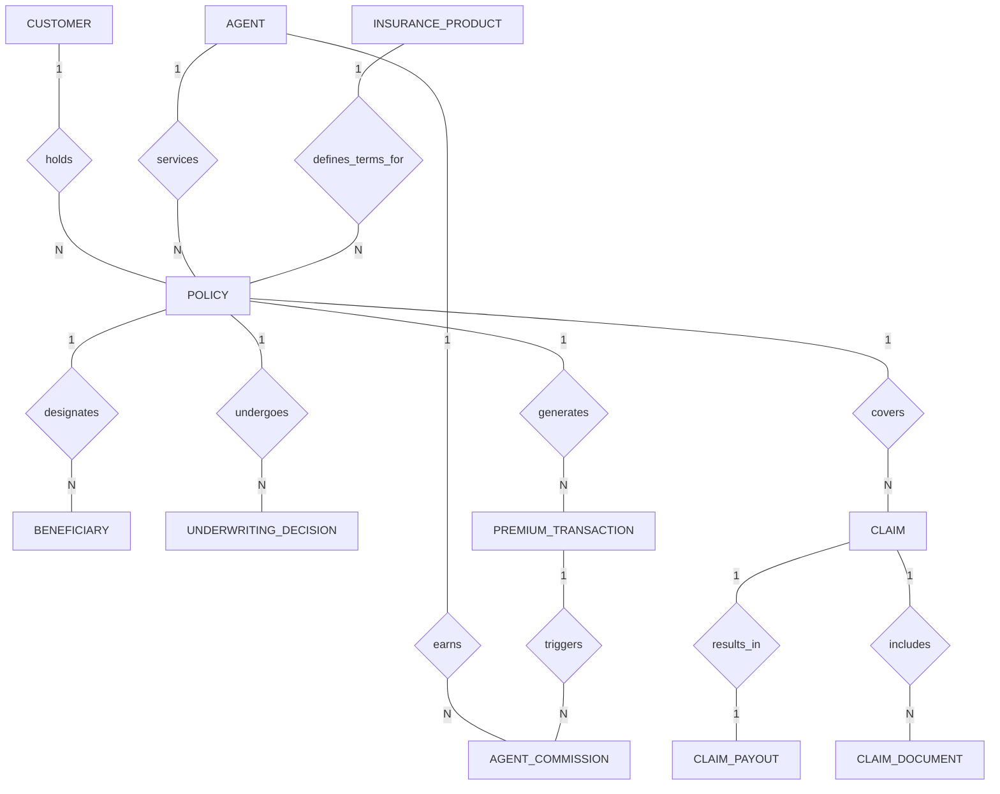

# Conceptual ERD — Life Insurance Management System

## Mermaid Code

## Entity Description Table | Bảng mô tả Entity

| # | Entity Name | Vietnamese Name | Description | Key Attributes | Main Relationships |
|---|-------------|-----------------|-------------|----------------|-------------------|
| 1 | CUSTOMER | Khách hàng | Lưu trữ thông tin cá nhân của người mua bảo hiểm và người được bảo hiểm | customer_id, full_name, national_id, ekyc_status | Holds many POLICY |
| 2 | AGENT | Đại lý bảo hiểm | Lưu trữ thông tin đại lý tư vấn, chứng chỉ hành nghề và đơn vị quản lý | agent_id, agent_code, license_number, status | Services many POLICY, Earns many AGENT_COMMISSION |
| 3 | INSURANCE_PRODUCT | Sản phẩm bảo hiểm | Danh mục các gói sản phẩm bảo hiểm nhân thọ (chính và bổ trợ) | product_id, product_code, min_entry_age, status | Defines terms for many POLICY |
| 4 | POLICY | Hợp đồng bảo hiểm | Dữ liệu cốt lõi lưu trữ thông tin hợp đồng bảo hiểm nhân thọ đã giao kết | policy_id, policy_number, sum_assured, policy_status | Belongs to CUSTOMER, AGENT, PRODUCT; Has many BENEFICIARY, CLAIM... |
| 5 | BENEFICIARY | Người thụ hưởng | Danh sách cá nhân được chỉ định nhận tiền bồi thường khi có sự kiện bảo hiểm | beneficiary_id, policy_id, relationship, allocation_percentage | Belongs to POLICY |
| 6 | UNDERWRITING_DECISION | Quyết định thẩm định | Ghi nhận kết quả đánh giá rủi ro, tăng phí hoặc loại trừ của chuyên viên thẩm định | decision_id, policy_id, risk_category, decision_status | Belongs to POLICY |
| 7 | PREMIUM_TRANSACTION | Giao dịch phí bảo hiểm | Lịch sử các kỳ đóng phí bảo hiểm (đầu tiên và định kỳ) của khách hàng | transaction_id, policy_id, amount, payment_status | Belongs to POLICY; Triggers AGENT_COMMISSION |
| 8 | CLAIM | Hồ sơ bồi thường | Thông tin yêu cầu giải quyết quyền lợi bảo hiểm khi xảy ra sự kiện rủi ro | claim_id, claim_number, event_type, claim_status | Belongs to POLICY; Has many CLAIM_DOCUMENT; Has one CLAIM_PAYOUT |
| 9 | CLAIM_DOCUMENT | Chứng từ bồi thường | Các tệp tài liệu y tế, hóa đơn, giấy chứng tử đính kèm hồ sơ bồi thường | document_id, claim_id, document_type, verification_status | Belongs to CLAIM |
| 10 | CLAIM_PAYOUT | Lệnh chi trả bồi thường | Kết quả phê duyệt chi trả tiền bảo hiểm và giao dịch chuyển khoản ngân hàng | payout_id, claim_id, approved_amount, payout_status | Has one-to-one relationship with CLAIM |
| 11 | AGENT_COMMISSION | Hoa hồng đại lý | Ghi nhận khoản hoa hồng tính toán cho đại lý trên mỗi giao dịch thu phí | commission_id, agent_id, transaction_id, commission_amount | Belongs to AGENT, POLICY, PREMIUM_TRANSACTION |

## Relationship Description | Mô tả Quan hệ

| # | From Entity | Cardinality | To Entity | Relationship Label | Business Explanation |
|---|-------------|-------------|-----------|-------------------|----------------------|
| 1 | CUSTOMER | one-to-many | POLICY | holds | Một khách hàng có thể đứng tên chủ hợp đồng của nhiều hợp đồng bảo hiểm nhân thọ khác nhau. |
| 2 | AGENT | one-to-many | POLICY | services | Một đại lý bảo hiểm có thể khai thác và chăm sóc nhiều hợp đồng bảo hiểm. |
| 3 | INSURANCE_PRODUCT | one-to-many | POLICY | defines_terms_for | Một sản phẩm bảo hiểm chuẩn có thể được áp dụng để phát hành cho nhiều hợp đồng cụ thể. |
| 4 | POLICY | one-to-many | BENEFICIARY | designates | Một hợp đồng bảo hiểm có thể chỉ định một hoặc nhiều người thụ hưởng với tỷ lệ phân bổ cụ thể. |
| 5 | POLICY | one-to-many | UNDERWRITING_DECISION | undergoes | Một hợp đồng trong quá trình thẩm định có thể trải qua một hoặc nhiều lần đánh giá/quyết định thẩm định rủi ro. |
| 6 | POLICY | one-to-many | PREMIUM_TRANSACTION | generates | Một hợp đồng bảo hiểm phát sinh nhiều giao dịch đóng phí định kỳ trong suốt thời hạn hợp đồng. |
| 7 | POLICY | one-to-many | CLAIM | covers | Một hợp đồng bảo hiểm có thể phát sinh nhiều lần yêu cầu bồi thường (nằm viện, tai nạn) trong thời hạn hiệu lực. |
| 8 | CLAIM | one-to-many | CLAIM_DOCUMENT | includes | Một hồ sơ yêu cầu bồi thường chứa nhiều tài liệu chứng từ đính kèm (giấy viện phí, hồ sơ bệnh án). |
| 9 | CLAIM | one-to-one | CLAIM_PAYOUT | results_in | Mỗi hồ sơ bồi thường được phê duyệt sẽ dẫn đến duy nhất một lệnh/kết quả chi trả tiền bồi thường. |
| 10 | AGENT | one-to-many | AGENT_COMMISSION | earns | Một đại lý nhận được nhiều khoản hoa hồng từ các hợp đồng và các kỳ đóng phí tương ứng. |
| 11 | PREMIUM_TRANSACTION | one-to-many | AGENT_COMMISSION | triggers | Mỗi giao dịch đóng phí thành công sẽ kích hoạt việc tính toán một khoản hoa hồng tương ứng cho đại lý. |
