# Swimlane Diagram — Life Insurance Management System

## Mermaid Code

```mermaid
flowchart LR
    Start(["Start Application"])

    subgraph Lane_Customer["Customer / Policyholder"]
        C1["Fill Application & Medical Declaration"]
        C2["Perform eKYC Verification"]
        C3["Select Payment Method & Pay Initial Premium"]
        C4["Receive Policy Contract & Welcome Kit"]
        C5["Submit Claim Application"]
        C6["Receive Payout Confirmation"]
    end

    subgraph Lane_Agent["Insurance Agent"]
        A1["Advise Product & Generate Illustration"]
        A2["Review Draft Application"]
    end

    subgraph Lane_System["Life Insurance System"]
        S1["Validate Data & Auto Scoring"]
        S2{"Auto-Underwrite Eligible?"}
        S3["Generate Payment Invoice"]
        S4["Verify Payment & Issue Policy"]
        S5["Log Claim & Route to Adjuster"]
        S6["Trigger Core Banking Payout"]
    end

    subgraph Lane_Underwriter["Underwriter"]
        U1["Assess Risk & Medical History"]
        U2{"Approve Application?"}
        U3["Issue Counter-Offer / Loading Terms"]
        U4["Decline Application"]
    end

    subgraph Lane_ClaimsAdjuster["Claims Adjuster"]
        J1["Verify Claim Proof & Policy Limits"]
        J2{"Approve Claim?"}
        J3["Reject Claim & Issue Refusal Notice"]
    end

    Finish(["End Process"])

    Start --> C1
    C1 --> A1 --> A2 --> C2
    C2 --> S1 --> S2

    S2 -- "Yes (Clean Health)" --> S3
    S2 -- "No (High Risk / Complex)" --> U1

    U1 --> U2
    U2 -- "Approved" --> S3
    U2 -- "Conditional Approval" --> U3 --> C1
    U2 -- "Rejected" --> U4 --> Finish

    S3 --> C3 --> S4 --> C4

    C4 -. "Event Occurs" .-> C5
    C5 --> S5 --> J1 --> J2

    J2 -- "Approved" --> S6 --> C6 --> Finish
    J2 -- "Rejected" --> J3 --> Finish
```

## Flow Description | Mô tả luồng

| Lane | Actor | Role in Flow |
|------|-------|-------------|
| 1 | Customer / Policyholder | Thực hiện kê khai thông tin đề nghị bảo hiểm, hoàn tất xác thực eKYC, thanh toán phí bảo hiểm đầu tiên, nhận hợp đồng điện tử và gửi yêu cầu giải quyết quyền lợi khi phát sinh sự kiện rủi ro. |
| 2 | Insurance Agent | Tư vấn gói sản phẩm phù hợp, chạy bảng minh họa quyền lợi bảo hiểm, rà soát tính đầy đủ của hồ sơ đề nghị trước khi gửi lên hệ thống. |
| 3 | Life Insurance System | Tự động kiểm tra dữ liệu, thực hiện phân loại rủi ro tự động (Auto-scoring), tạo hóa đơn thanh toán, đối soát tiền thu, phát hành hợp đồng điện tử và kết nối API chi trả bồi thường với ngân hàng. |
| 4 | Underwriter | Thẩm định rủi ro chuyên sâu đối với các hồ sơ có dư địa rủi ro cao hoặc khai báo tiền sử bệnh lý, ra quyết định chấp nhận bảo hiểm, tăng phí rủi ro hoặc từ chối cấp hợp đồng. |
| 5 | Claims Adjuster | Đánh giá tính pháp lý và y khoa của hồ sơ yêu cầu bồi thường, đối soát với các điều khoản loại trừ trong hợp đồng, phê duyệt hạn mức chi trả hoặc phát hành thông báo từ chối bồi thường. |
