# Action Tree — Life Insurance Management System

## Mermaid Code

```mermaid
graph TD
    Root["Life Insurance Management System"]

    Root --> M1["Policy Application & eKYC Module"]
    Root --> M2["Underwriting & Risk Rating Module"]
    Root --> M3["Policy Administration & Renewal Module"]
    Root --> M4["Premium Billing & Payment Module"]
    Root --> M5["Claims Processing & Assessment Module"]
    Root --> M6["Agent & Commission Management Module"]
    Root --> M7["Regulatory Reporting & Analytics Module"]

    M1 --> A11["Submit Proposal Application"]
    M1 --> A12["Verify Identity via eKYC"]
    M1 --> A13["Upload Medical & Income Proof"]
    M1 --> A14["Generate Benefit Illustration"]

    M2 --> A21["Auto-scoring Risk Assessment"]
    M2 --> A22["Manual Underwriter Review"]
    M2 --> A23["Request Medical Checkup"]
    M2 --> A24["Set Premium Loading & Exclusions"]

    M3 --> A31["Issue Digital Policy Contract"]
    M3 --> A32["Process Policy Surrender"]
    M3 --> A33["Manage Beneficiary Updates"]
    M3 --> A34["Process Policy Loan Request"]
    M3 --> A35["Process Annual Renewal"]

    M4 --> A41["Generate Premium Notice Invoice"]
    M4 --> A42["Process Online Payment Gateway"]
    M4 --> A43["Setup Auto-debit Mandate"]
    M4 --> A44["Manage Grace Period & Lapsed Status"]

    M5 --> A51["Submit Claim Notification"]
    M5 --> A52["Verify Claim Proof & Medical History"]
    M5 --> A53["Calculate Covered Payout Amount"]
    M5 --> A54["Execute Banking Payout Transfer"]
    M5 --> A55["Detect Fraud & Flag Risk"]

    M6 --> A61["Manage Agent Profile & License"]
    M6 --> A62["Calculate Tiered Commission Rate"]
    M6 --> A63["Generate Monthly Commission Payout"]
    M6 --> A64["Track Sales Target Performance"]

    M7 --> A71["Generate Solvency Margin Report"]
    M7 --> A72["Export MoF Statutory Financial Statements"]
    M7 --> A73["Analyze Product Profitability & Loss Ratio"]
    M7 --> A74["Audit Trail & System Access Logs"]
```

## Module Description | Mô tả Module

| # | Module | Description | Actions |
|---|--------|-------------|---------|
| 1 | Policy Application & eKYC Module | Tiếp nhận thông tin hồ sơ đề nghị bảo hiểm, xác thực danh tính điện tử và khởi tạo bảng minh họa quyền lợi. | Submit Proposal Application, Verify Identity via eKYC, Upload Medical & Income Proof, Generate Benefit Illustration |
| 2 | Underwriting & Risk Rating Module | Đánh giá rủi ro y khoa và tài chính, tự động phân loại hồ sơ và xử lý các trường hợp tăng phí bảo hiểm hoặc loại trừ rủi ro. | Auto-scoring Risk Assessment, Manual Underwriter Review, Request Medical Checkup, Set Premium Loading & Exclusions |
| 3 | Policy Administration & Renewal Module | Quản lý hợp đồng bảo hiểm chính thức, thay đổi thông tin thụ hưởng, giải quyết vay theo hợp đồng, hủy hợp đồng trước hạn và tái tục hàng năm. | Issue Digital Policy Contract, Process Policy Surrender, Manage Beneficiary Updates, Process Policy Loan Request, Process Annual Renewal |
| 4 | Premium Billing & Payment Module | Thông báo đóng phí bảo hiểm, tích hợp cổng thanh toán trực tuyến, quản lý trích nợ tự động và theo dõi thời gian gia hạn đóng phí (Grace Period). | Generate Premium Notice Invoice, Process Online Payment Gateway, Setup Auto-debit Mandate, Manage Grace Period & Lapsed Status |
| 5 | Claims Processing & Assessment Module | Tiếp nhận và giám định hồ sơ yêu cầu giải quyết quyền lợi bảo hiểm (tử vong, nằm viện, bệnh hiểm nghèo), phòng chống gian lận và thực hiện lệnh chi trả. | Submit Claim Notification, Verify Claim Proof & Medical History, Calculate Covered Payout Amount, Execute Banking Payout Transfer, Detect Fraud & Flag Risk |
| 6 | Agent & Commission Management Module | Quản lý mã số đại lý, hợp đồng đại lý, tính toán tự động hoa hồng khai thác mới và hoa hồng tái tục, theo dõi chỉ số doanh số. | Manage Agent Profile & License, Calculate Tiered Commission Rate, Generate Monthly Commission Payout, Track Sales Target Performance |
| 7 | Regulatory Reporting & Analytics Module | Xuất các báo cáo tuân thủ quy định cho Cục Quản lý Bảo hiểm (Bộ Tài chính), báo cáo biên khả năng thanh toán (Solvency margin) và phân tích hiệu quả kinh doanh. | Generate Solvency Margin Report, Export MoF Statutory Financial Statements, Analyze Product Profitability & Loss Ratio, Audit Trail & System Access Logs |
