# Action Tree — Reinsurance Management System

## Mermaid Code

```mermaid
graph TD
    Root["Reinsurance Management System"]

    Root --> M1["Policy Proposal & eKYC Module"]
    Root --> M2["Risk Underwriting & Rating Module"]
    Root --> M3["Policy Administration & Endorsement Module"]
    Root --> M4["Billing & Premium Collection Module"]
    Root --> M5["Claims & Loss Adjustment Module"]
    Root --> M6["Agent & Distribution Channel Module"]
    Root --> M7["Regulatory Reporting & Analytics Module"]

    M1 --> A11["Register Application Proposal"]
    M1 --> A12["Verify Identity via eKYC"]
    M1 --> A13["Upload Supporting Asset Documents"]
    M1 --> A14["Generate Premium Quotation"]

    M2 --> A21["Auto-scoring Risk Rating"]
    M2 --> A22["Manual Underwriter Review"]
    M2 --> A23["Apply Risk Loading Rates"]
    M2 --> A24["Set Special Policy Exclusions"]

    M3 --> A31["Issue Electronic Policy Certificate"]
    M3 --> A32["Process Policy Endorsement Changes"]
    M3 --> A33["Process Annual Renewal Notice"]
    M3 --> A34["Process Cancellation & Premium Refund"]

    M4 --> A41["Generate Premium Payment Invoice"]
    M4 --> A42["Process Online Payment Gateway Integration"]
    M4 --> A43["Auto Debt Reconciliation"]
    M4 --> A44["Manage Grace Period & Policy Status"]

    M5 --> A51["Submit Loss Event Notification"]
    M5 --> A52["Conduct Field Loss Survey"]
    M5 --> A53["Assess Damage & Deductible"]
    M5 --> A54["Execute Claim Payout Transfer"]
    M5 --> A55["Detect Claim Fraud Flags"]

    M6 --> A61["Manage Agent Profiles & Badges"]
    M6 --> A62["Calculate Tiered Commission Rate"]
    M6 --> A63["Generate Monthly Commission Payouts"]
    M6 --> A64["Track Sales Channel Performance"]

    M7 --> A71["Generate Solvency & Reserve Reports"]
    M7 --> A72["Export Statutory Regulatory Statements"]
    M7 --> A73["Analyze Loss Ratio & Underwriting Profit"]
    M7 --> A74["Audit Trail & System Access Logs"]
```

## Module Description | Mô tả Module

| # | Module | Description | Actions |
|---|--------|-------------|---------|
| 1 | Policy Proposal & eKYC Module | Tiếp nhận hồ sơ đăng ký bảo hiểm Quản Lý Tái Bảo Hiểm, xác thực eKYC và khởi tạo báo giá phí bảo hiểm. | Register Application Proposal, Verify Identity via eKYC, Upload Supporting Asset Documents, Generate Premium Quotation |
| 2 | Risk Underwriting & Rating Module | Phân tích rủi ro nghiệp vụ, thẩm định điều khoản, tính phí rủi ro bổ sung và phê duyệt hợp đồng. | Auto-scoring Risk Rating, Manual Underwriter Review, Apply Risk Loading Rates, Set Special Policy Exclusions |
| 3 | Policy Administration & Endorsement Module | Quản lý vòng đời hợp đồng bảo hiểm, thực hiện sửa đổi bổ sung phụ lục hợp đồng, tái tục và hủy hợp đồng. | Issue Electronic Policy Certificate, Process Policy Endorsement Changes, Process Annual Renewal Notice, Process Cancellation & Premium Refund |
| 4 | Billing & Premium Collection Module | Phát hành thông báo đóng phí, tích hợp cổng thanh toán trực tuyến, gạch nợ tự động và quản lý trạng thái hiệu lực. | Generate Premium Payment Invoice, Process Online Payment Gateway Integration, Auto Debt Reconciliation, Manage Grace Period & Policy Status |
| 5 | Claims & Loss Adjustment Module | Tiếp nhận khai báo tổn thất, giám định hiện trường thiệt hại, phê duyệt hạn mức bồi thường và chi trả tài chính. | Submit Loss Event Notification, Conduct Field Loss Survey, Assess Damage & Deductible, Execute Claim Payout Transfer, Detect Claim Fraud Flags |
| 6 | Agent & Distribution Channel Module | Quản lý danh mục đại lý, tính toán tự động hoa hồng kinh doanh và theo dõi chỉ số doanh số bán hàng. | Manage Agent Profiles & Badges, Calculate Tiered Commission Rate, Generate Monthly Commission Payouts, Track Sales Channel Performance |
| 7 | Regulatory Reporting & Analytics Module | Xuất các báo cáo tuân thủ theo quy định Cục Quản lý Bảo hiểm, phân tích tỷ lệ bồi thường (Loss Ratio) và nhật ký hệ thống. | Generate Solvency & Reserve Reports, Export Statutory Regulatory Statements, Analyze Loss Ratio & Underwriting Profit, Audit Trail & System Access Logs |
