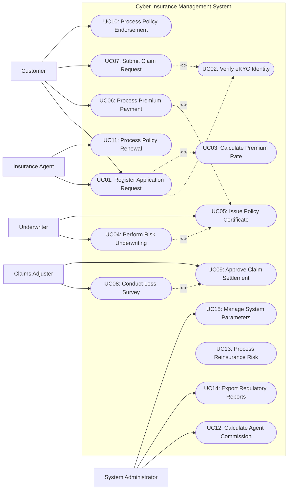

# Use Case Diagram — Cyber Insurance Management System

## Mermaid Code

## Actor Table | Bảng Actor

| # | Actor | Actor Type | Role Description | Related Use Cases |
|---|-------|------------|------------------|-------------------|
| 1 | Customer | Primary | Nộp đề nghị bảo hiểm, đóng phí, nộp hồ sơ bồi thường và yêu cầu điều chỉnh hợp đồng | UC01, UC06, UC07, UC10 |
| 2 | Insurance Agent | Primary | Tư vấn khách hàng, nộp hồ sơ và hỗ trợ tái tục hợp đồng khi đến hạn | UC01, UC11 |
| 3 | Underwriter | Primary | Đánh giá rủi ro nghiệp vụ, thẩm định điều khoản và phê duyệt cấp hợp đồng | UC04, UC05 |
| 4 | Claims Adjuster | Primary | Giám định tổn thất hiện trường, đối soát hồ sơ và đề xuất phương án bồi thường | UC08, UC09 |
| 5 | System Administrator | Primary | Quản trị tài khoản, cấu hình hệ thống, tính toán hoa hồng và xuất báo cáo regulatory | UC12, UC14, UC15 |

## Use Case Table | Bảng Use Case

| # | UC ID | Use Case Name | Primary Actor | Secondary Actor | Description | Priority |
|---|-------|---------------|---------------|-----------------|-------------|----------|
| 1 | UC01 | Register Application Request | Customer | Insurance Agent | Khởi tạo đề nghị bảo hiểm và đăng ký thông tin ban đầu | High |
| 2 | UC02 | Verify eKYC Identity | System | eKYC Provider | Xác thực danh tính điện tử người nộp hồ sơ | High |
| 3 | UC03 | Calculate Premium Rate | System | None | Tự động tính toán biểu phí bảo hiểm dựa trên tham số rủi ro | High |
| 4 | UC04 | Perform Risk Underwriting | Underwriter | System | Thẩm định rủi ro nghiệp vụ và đưa ra quyết định chấp nhận bảo hiểm | High |
| 5 | UC05 | Issue Policy Certificate | Underwriter | Customer | Phê duyệt và phát hành chứng nhận hợp đồng bảo hiểm điện tử | High |
| 6 | UC06 | Process Premium Payment | Customer | Payment Gateway | Thanh toán phí bảo hiểm trực tuyến qua cổng thanh toán liên kết | High |
| 7 | UC07 | Submit Claim Request | Customer | Claims Adjuster | Khách hàng khai báo sự cố và nộp yêu cầu bồi thường | High |
| 8 | UC08 | Conduct Loss Survey | Claims Adjuster | External Partner | Giám định tổn thất và xác định giá trị thiệt hại thực tế | High |
| 9 | UC09 | Approve Claim Settlement | Claims Adjuster | Payment Gateway | Phê duyệt bồi thường và thực hiện chuyển tiền chi trả | High |
| 10 | UC10 | Process Policy Endorsement | Customer | Underwriter | Điều chỉnh, bổ sung hoặc thay đổi thông tin trên hợp đồng bảo hiểm | Medium |
| 11 | UC11 | Process Policy Renewal | Insurance Agent | Customer | Nhắc nhở và thực hiện tái tục hợp đồng bảo hiểm khi hết hạn | Medium |
| 12 | UC12 | Calculate Agent Commission | System Administrator | Insurance Agent | Tính toán tự động hoa hồng cho đại lý bán hàng | Medium |
| 13 | UC13 | Process Reinsurance Risk | System | Reinsurance System | Phân bổ nhượng tái bảo hiểm theo tỷ lệ hợp đồng | Medium |
| 14 | UC14 | Export Regulatory Reports | System Administrator | Regulatory Authority | Xuất báo cáo tuân thủ định kỳ cho cơ quan quản lý bảo hiểm | High |
| 15 | UC15 | Manage System Parameters | System Administrator | None | Cấu hình quy tắc nghiệp vụ, biểu phí và phân quyền tài khoản | Low |

## Use Case Specification | Đặc tả Use Case

---

### UC01 — Register Application Request

| Field | Detail |
|-------|--------|
| **UC ID** | UC01 |
| **Use Case Name** | Register Application Request |
| **Actor(s)** | Primary: Customer / Insurance Agent   Secondary: eKYC Provider |
| **Description** | Khởi tạo hồ sơ đề nghị bảo hiểm cho nghiệp vụ Quản Lý Bảo Hiểm An Ninh Mạng, kê khai thông tin chi tiết và gửi lên hệ thống thẩm định. |
| **Precondition** | 1. Người dùng đã truy cập thành công vào hệ thống.   2. Gói sản phẩm bảo hiểm đang ở trạng thái hoạt động (Active). |
| **Main Flow** | 1. Người dùng chọn sản phẩm bảo hiểm Cyber Insurance Management System.   2. Hệ thống hiển thị biểu mẫu kê khai thông tin tương ứng.   3. Người dùng nhập thông tin đối tượng được bảo hiểm và thông tin liên hệ.   4. Hệ thống gọi dịch vụ eKYC xác thực danh tính người đăng ký (UC02).   5. Hệ thống tự động tính toán phí bảo hiểm dự kiến (UC03).   6. Người dùng xác nhận điều khoản và chọn "Nộp hồ sơ đề nghị".   7. Hệ thống cấp mã hồ sơ (Application ID) và chuyển trạng thái "Pending Underwriting". |
| **Alternative Flow** | **AF1** — Đại lý nhập thay: Đại lý nhập dữ liệu thay khách hàng và gửi link xác nhận eKYC qua tin nhắn SMS cho khách hàng.   **AF2** — Lưu nháp: Người dùng chọn "Lưu nháp" để tiếp tục hoàn thiện sau. |
| **Exception Flow** | **EX1** — eKYC không thành công: Hệ thống báo lỗi xác thực và yêu cầu chụp lại tệp CCCD/hộ chiếu rõ nét.   **EX2** — Thiếu thông tin bắt buộc: Hệ thống đánh dấu đỏ trường thiếu và chặn nộp hồ sơ. |
| **Postcondition** | Hồ sơ đề nghị bảo hiểm được tạo thành công với trạng thái chờ thẩm định. |
| **Business Rule** | **BR1**: Thông tin đối tượng bảo hiểm phải nằm trong phạm vi được chấp nhận của biểu phí.   **BR2**: Mọi thông tin kê khai phải được ký xác nhận điện tử trước khi chuyển thẩm định. |

---

### UC04 — Perform Risk Underwriting

| Field | Detail |
|-------|--------|
| **UC ID** | UC04 |
| **Use Case Name** | Perform Risk Underwriting |
| **Actor(s)** | Primary: Underwriter   Secondary: System |
| **Description** | Chuyên viên thẩm định xem xét mức độ rủi ro nghiệp vụ Quản Lý Bảo Hiểm An Ninh Mạng và đưa ra quyết định duyệt cấp đơn, tăng phí hoặc từ chối. |
| **Precondition** | 1. Hồ sơ đang ở trạng thái "Pending Underwriting".   2. Quá trình eKYC xác thực danh tính hoàn tất hợp lệ. |
| **Main Flow** | 1. Underwriter chọn hồ sơ cần xử lý từ danh sách chờ.   2. Hệ thống hiển thị chi tiết khai báo rủi ro và điểm đánh giá tự động (Auto-scoring).   3. Underwriter rà soát dữ liệu lịch sử và các yếu tố rủi ro đặc thù.   4. Underwriter nhập tỷ lệ tăng phí rủi ro (Loading rate) hoặc điều khoản bổ sung nếu cần.   5. Underwriter chọn quyết định: Approved, Conditional Approval, hoặc Declined.   6. Hệ thống cập nhật trạng thái hồ sơ và gửi thông báo kết quả cho khách hàng/đại lý. |
| **Alternative Flow** | **AF1** — Tự động thẩm định (Auto-underwriting): Hệ thống tự động phê duyệt các hồ sơ có mức rủi ro chuẩn mà không cần Underwriter thao tác tay.   **AF2** — Từ chối bảo hiểm: Underwriter chọn Declined và nhập lý do từ chối chính thức. |
| **Exception Flow** | **EX1** — Cần bổ sung khảo sát hiện trường: Underwriter chuyển trạng thái hồ sơ sang "Survey Required" để yêu cầu giám định thêm.   **EX2** — Vượt hạn mức phê duyệt: Hệ thống yêu cầu trình duyệt cấp quản lý cao hơn. |
| **Postcondition** | Hồ sơ được phê duyệt thẩm định sẵn sàng cho bước thu phí phát hành. |
| **Business Rule** | **BR1**: Tỷ lệ phí phụ trội rủi ro không vượt quá mức tối đa theo quy định biểu phí.   **BR2**: Mọi quyết định từ chối cấp bảo hiểm phải lưu vết lý do nghiệp vụ cụ thể. |

---

### UC06 — Process Premium Payment

| Field | Detail |
|-------|--------|
| **UC ID** | UC06 |
| **Use Case Name** | Process Premium Payment |
| **Actor(s)** | Primary: Customer   Secondary: Payment Gateway |
| **Description** | Thực hiện thanh toán phí bảo hiểm trực tuyến để kích hoạt hoặc duy trì hiệu lực chứng nhận bảo hiểm. |
| **Precondition** | 1. Hồ sơ bảo hiểm đã được phê duyệt thẩm định hoặc đến kỳ thanh toán.   2. Cổng thanh toán trực tuyến hoạt động bình thường. |
| **Main Flow** | 1. Khách hàng xem thông báo số tiền phí bảo hiểm cần đóng.   2. Khách hàng lựa chọn phương thức thanh toán trực tuyến thích hợp.   3. Hệ thống kết nối API sang Cổng thanh toán (Payment Gateway).   4. Khách hàng xác thực thông tin thẻ/ví/OTP và hoàn tất giao dịch.   5. Cổng thanh toán gửi mã phản hồi giao dịch thành công (Success Code).   6. Hệ thống ghi nhận khoản thu, kích hoạt trạng thái hợp đồng "Active" và phát hành hóa đơn điện tử. |
| **Alternative Flow** | **AF1** — Thanh toán chuyển khoản ngân hàng: Khách hàng chuyển khoản theo cú pháp mã hợp đồng, hệ thống tự động gạch nợ sau khi nhận báo có (Auto-reconciliation).   **AF2** — Gia hạn thanh toán: Áp dụng thời gian gia hạn đóng phí (Grace period) theo quy định. |
| **Exception Flow** | **EX1** — Thanh toán thất bại: Hệ thống thông báo lỗi từ cổng thanh toán và giữ nguyên trạng thái chờ đóng phí.   **EX2** — Lỗi kết nối Timeout: Hệ thống lưu giao dịch ở trạng thái nghi vấn để đối soát sau 30 phút. |
| **Postcondition** | Phí bảo hiểm được ghi nhận thành công, hợp đồng chuyển sang trạng thái Active. |
| **Business Rule** | **BR1**: Phí bảo hiểm lần đầu phải nộp đủ trong vòng 30 ngày kể từ ngày duyệt thẩm định.   **BR2**: Hóa đơn tài chính điện tử phải được xuất tự động sau khi giao dịch thành công. |

---

### UC08 — Conduct Loss Survey

| Field | Detail |
|-------|--------|
| **UC ID** | UC08 |
| **Use Case Name** | Conduct Loss Survey |
| **Actor(s)** | Primary: Claims Adjuster   Secondary: External Partner |
| **Description** | Khảo sát hiện trường sự cố tổn thất, kiểm tra nguyên nhân và lập báo cáo giám định thiệt hại thực tế. |
| **Precondition** | 1. Khách hàng đã nộp thông báo tổn thất và tạo hồ sơ bồi thường (UC07).   2. Hồ sơ bồi thường ở trạng thái "Under Inspection". |
| **Main Flow** | 1. Claims Adjuster tiếp nhận phân công hồ sơ bồi thường.   2. Adjuster thực hiện khảo sát hiện trường tổn thất hoặc kiểm tra tài liệu kỹ thuật đính kèm.   3. Adjuster đối soát nguyên nhân tổn thất với phạm vi bảo hiểm của hợp đồng.   4. Adjuster nhập số liệu tổn thất thực tế và tỷ lệ bồi thường được đề xuất.   5. Adjuster tải lên báo cáo giám định hiện trường và các bức ảnh chụp tổn thất.   6. Hệ thống lưu báo cáo giám định và chuyển hồ sơ sang trạng thái "Pending Approval" (UC09). |
| **Alternative Flow** | **AF1** — Giám định qua ứng dụng di động: Khách hàng tự chụp ảnh/video hiện trường gửi qua mobile app cho Adjuster duyệt từ xa.   **AF2** — Thuê đơn vị giám định độc lập: Phân công hồ sơ cho công ty giám định bên thứ ba xử lý. |
| **Exception Flow** | **EX1** — Tổn thất thuộc điều khoản loại trừ: Adjuster lập biên bản xác định nguyên nhân loại trừ và đề xuất từ chối bồi thường.   **EX2** — Nghi vấn gian lận: Adjuster đánh dấu cờ gian lận (Fraud Flag) để chuyển bộ phận điều tra chuyên sâu. |
| **Postcondition** | Báo cáo giám định tổn thất được tạo hoàn chỉnh làm căn cứ duyệt bồi thường. |
| **Business Rule** | **BR1**: Giám định hiện trường phải khởi công trong vòng 24h kể từ khi nhận thông báo sự cố.   **BR2**: Báo cáo giám định bắt buộc phải có chữ ký xác nhận của các bên liên quan. |

---

### UC09 — Approve Claim Settlement

| Field | Detail |
|-------|--------|
| **UC ID** | UC09 |
| **Use Case Name** | Approve Claim Settlement |
| **Actor(s)** | Primary: Claims Adjuster   Secondary: Payment Gateway |
| **Description** | Phê duyệt phương án bồi thường cuối cùng và thực hiện chi trả tiền bảo hiểm cho người thụ hưởng. |
| **Precondition** | 1. Báo cáo giám định tổn thất đã hoàn thành (UC08).   2. Hồ sơ bồi thường ở trạng thái "Pending Approval". |
| **Main Flow** | 1. Cấp có thẩm quyền phê duyệt mở hồ sơ bồi thường chi tiết.   2. Hệ thống hiển thị số tiền đề xuất bồi thường, khấu trừ miễn thường và thông tin tài khoản nhận tiền.   3. Cấp thẩm quyền kiểm tra báo cáo giám định và phê duyệt phương án chi trả.   4. Hệ thống phát hành lệnh chi trả tiền bồi thường đến Payment Gateway/Core Banking.   5. Ngân hàng xử lý chuyển tiền trực tiếp vào tài khoản người thụ hưởng.   6. Hệ thống gửi thư thông báo bồi thường chính thức qua SMS/Email cho khách hàng và đóng hồ sơ bồi thường. |
| **Alternative Flow** | **AF1** — Từ chối bồi thường: Cấp thẩm quyền chọn "Decline Settlement", nhập lý do từ chối theo điều khoản hợp đồng và hệ thống phát hành thông báo từ chối.   **AF2** — Chi trả bảo lãnh trực tiếp: Hệ thống thanh toán thẳng chi phí cho cơ sở đối tác cung cấp dịch vụ. |
| **Exception Flow** | **EX1** — Sai thông tin tài khoản nhận: Chuyển khoản thất bại, hệ thống báo cờ và yêu cầu cập nhật lại tài khoản thụ hưởng.   **EX2** — Số tiền vượt hạn mức thẩm quyền: Hệ thống yêu cầu trình phê duyệt cấp Hội đồng bồi thường. |
| **Postcondition** | Tiền bồi thường được chi trả thành công và hồ sơ bồi thường được đóng. |
| **Business Rule** | **BR1**: Số tiền bồi thường không vượt quá hạn mức trách nhiệm bảo hiểm trên hợp đồng.   **BR2**: Mọi khoản miễn thường (Deductible) phải được tự động khấu trừ trước khi chi trả. |
