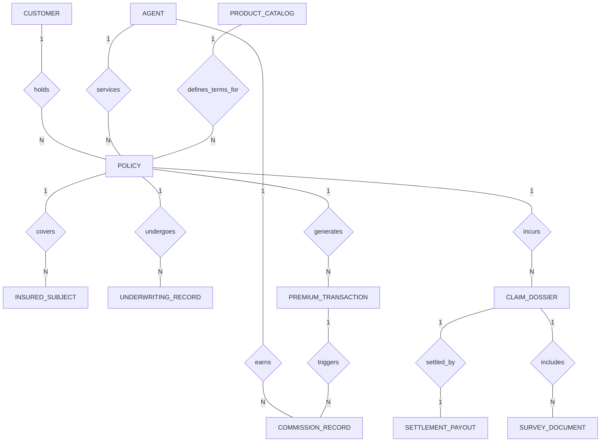

# Conceptual ERD — Parametric Insurance System

## Mermaid Code

## Entity Description Table | Bảng mô tả Entity

| # | Entity Name | Vietnamese Name | Description | Key Attributes | Main Relationships |
|---|-------------|-----------------|-------------|----------------|-------------------|
| 1 | CUSTOMER | Khách hàng | Lưu trữ thông tin định danh người mua bảo hiểm | customer_id, full_name, national_id, ekyc_status | Holds many POLICY |
| 2 | AGENT | Đại lý bảo hiểm | Quản lý mã đại lý và thông tin người tư vấn sản phẩm | agent_id, agent_code, license_number, status | Services many POLICY, Earns COMMISSION_RECORD |
| 3 | PRODUCT_CATALOG | Danh mục sản phẩm | Định nghĩa các gói sản phẩm và quy tắc biểu phí chuẩn | product_id, product_code, base_premium_rate | Defines terms for many POLICY |
| 4 | POLICY | Hợp đồng bảo hiểm | Dữ liệu chính của chứng nhận/hợp đồng bảo hiểm | policy_id, policy_number, sum_insured, policy_status | Belongs to CUSTOMER, AGENT, PRODUCT; Has many SUBJECT... |
| 5 | INSURED_SUBJECT | Đối tượng bảo hiểm | Thông tin tài sản/đối tượng cụ thể được bảo vệ | subject_id, policy_id, subject_type, estimated_value | Belongs to POLICY |
| 6 | UNDERWRITING_RECORD | Hồ sơ thẩm định | Ghi nhận đánh giá rủi ro và quyết định của Underwriter | record_id, policy_id, risk_rating, decision_status | Belongs to POLICY |
| 7 | PREMIUM_TRANSACTION | Giao dịch phí | Lịch sử thu phí bảo hiểm từ khách hàng | transaction_id, policy_id, amount, payment_status | Belongs to POLICY; Triggers COMMISSION_RECORD |
| 8 | CLAIM_DOSSIER | Hồ sơ bồi thường | Thông tin yêu cầu bồi thường sự cố tổn thất | claim_id, claim_number, estimated_loss, claim_status | Belongs to POLICY; Has SURVEY_DOCUMENT, SETTLEMENT_PAYOUT |
| 9 | SURVEY_DOCUMENT | Tài liệu giám định | Bằng chứng hình ảnh, báo cáo hiện trường tổn thất | document_id, claim_id, document_type, file_path | Belongs to CLAIM_DOSSIER |
| 10 | SETTLEMENT_PAYOUT | Lệnh chi trả | Phương án bồi thường và chi trả tài chính cuối cùng | payout_id, claim_id, approved_amount, payout_status | Has one-to-one with CLAIM_DOSSIER |
| 11 | COMMISSION_RECORD | Hoa hồng đại lý | Khoản hoa hồng đại lý được hưởng theo giao dịch | commission_id, agent_id, transaction_id, commission_amount | Belongs to AGENT, POLICY, TRANSACTION |

## Relationship Description | Mô tả Quan hệ

| # | From Entity | Cardinality | To Entity | Relationship Label | Business Explanation |
|---|-------------|-------------|-----------|-------------------|----------------------|
| 1 | CUSTOMER | one-to-many | POLICY | holds | Một khách hàng sở hữu một hoặc nhiều hợp đồng bảo hiểm. |
| 2 | AGENT | one-to-many | POLICY | services | Một đại lý tư vấn và phục vụ nhiều hợp đồng bảo hiểm. |
| 3 | PRODUCT_CATALOG | one-to-many | POLICY | defines_terms_for | Một gói sản phẩm tiêu chuẩn quy định điều khoản cho nhiều hợp đồng. |
| 4 | POLICY | one-to-many | INSURED_SUBJECT | covers | Một hợp đồng bảo vệ một hoặc nhiều đối tượng/tài sản bảo hiểm. |
| 5 | POLICY | one-to-many | UNDERWRITING_RECORD | undergoes | Một hợp đồng trải qua quá trình đánh giá thẩm định rủi ro. |
| 6 | POLICY | one-to-many | PREMIUM_TRANSACTION | generates | Một hợp đồng phát sinh các giao dịch thu phí định kỳ. |
| 7 | POLICY | one-to-many | CLAIM_DOSSIER | incurs | Một hợp đồng có thể phát sinh các vụ việc yêu cầu bồi thường. |
| 8 | CLAIM_DOSSIER | one-to-many | SURVEY_DOCUMENT | includes | Một hồ sơ bồi thường chứa nhiều chứng từ và báo cáo giám định. |
| 9 | CLAIM_DOSSIER | one-to-one | SETTLEMENT_PAYOUT | settled_by | Mỗi hồ sơ bồi thường được giải quyết bằng duy nhất một phương án chi trả. |
| 10 | AGENT | one-to-many | COMMISSION_RECORD | earns | Một đại lý nhận nhiều khoản hoa hồng từ doanh số bán hàng. |
| 11 | PREMIUM_TRANSACTION | one-to-many | COMMISSION_RECORD | triggers | Mỗi giao dịch thu phí thành công kích hoạt tính toán hoa hồng tương ứng. |
