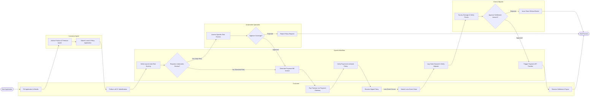

# Swimlane Diagram — Parametric Insurance System

## Mermaid Code

## Flow Description | Mô tả luồng

| Lane | Actor | Role in Flow |
|------|-------|-------------|
| 1 | Customer | Khai báo thông tin đề nghị, thực hiện xác thực eKYC, thanh toán phí bảo hiểm, nhận đơn điện tử và nộp yêu cầu bồi thường khi tổn thất xảy ra. |
| 2 | Insurance Agent | Tư vấn gói sản phẩm, tính toán phí bảo hiểm sơ bộ và hỗ trợ nộp hồ sơ đăng ký lên hệ thống. |
| 3 | System Workflow | Kiểm tra dữ liệu tự động, tính điểm rủi ro, phát hành chứng nhận hợp đồng, tạo hóa đơn thu phí và kết nối API chi trả bồi thường với ngân hàng. |
| 4 | Underwriter Specialist | Thẩm định chi tiết các trường hợp rủi ro cao, đưa ra quyết định chấp thuận bảo hiểm, tăng phí hoặc từ chối cấp đơn. |
| 5 | Claims Adjuster | Giám định hiện trường tổn thất, xác định mức độ thiệt hại thực tế, đối soát với điều khoản hợp đồng và phê duyệt phương án chi trả bồi thường. |
