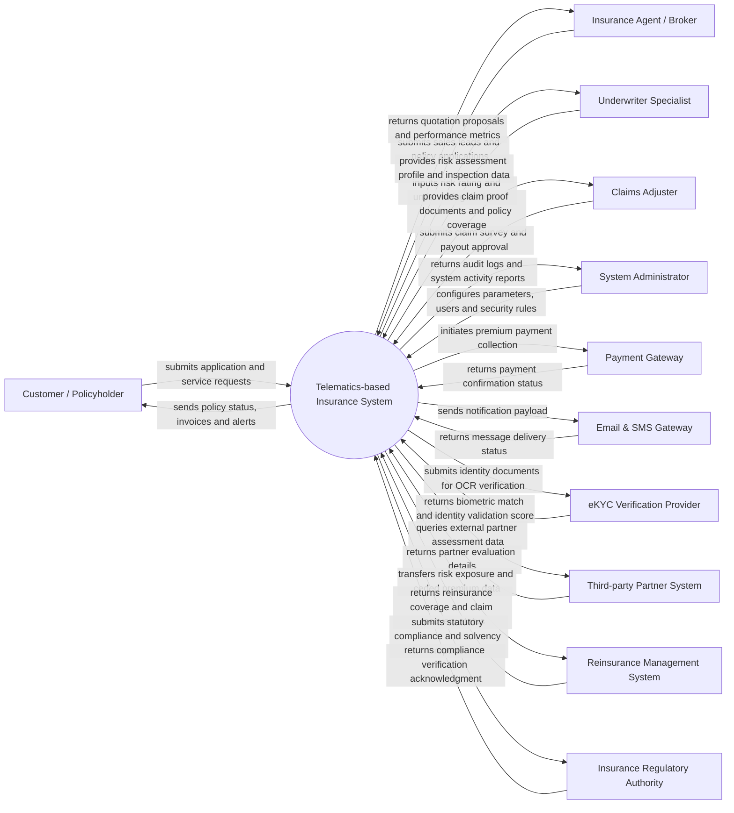

# Context Diagram — Telematics-based Insurance System

## Mermaid Code

## Actor & Interaction Table | Bảng Actor & Tương tác

| # | Actor | Actor Type | Data Sent TO System | Data Received FROM System | Ghi chú / Notes |
|---|-------|------------|---------------------|---------------------------|-----------------|
| 1 | Customer / Policyholder | Primary | Policy application, personal details, payment info, claim notifications | Policy certificates, payment invoices, claim status, renewal reminders | Khách hàng cá nhân hoặc doanh nghiệp tham gia Bảo Hiểm Dựa Trên Telematics |
| 2 | Insurance Agent / Broker | Primary | Lead information, policy applications, renewal tracking requests | Quotation tools, sales targets, commission statements, policy status | Đại lý hoặc đơn vị môi giới phân phối sản phẩm |
| 3 | Underwriter Specialist | Primary | Risk evaluation rating, premium loading, policy approval/rejection | Risk profiles, asset details, historical claim records | Chuyên viên thẩm định rủi ro và phê duyệt điều khoản |
| 4 | Claims Adjuster | Primary | Loss survey report, claim assessment, payout recommendation | Claim files, policy limits, coverage scope, beneficiary details | Chuyên viên giám định tổn thất và xử lý bồi thường |
| 5 | System Administrator | Primary | User management, permission configs, tariff rules, system settings | System audit logs, security alerts, operational metrics | Quản trị viên hệ thống vận hành và cấu hình |
| 6 | Payment Gateway | Supporting | Payment confirmation, bank reference ID, transaction status | Billing invoice request, customer payment token, bill amount | Cổng thanh toán trực tuyến (VNPay, Momo, Banking API) |
| 7 | Email & SMS Gateway | Supporting | Delivery status, bounce logs, transmission acknowledgment | Message content, template ID, recipient phone/email | Hệ thống gửi email/tin nhắn thông báo tự động |
| 8 | eKYC Verification Provider | Supporting | OCR extracted data, liveness check score, face match result | National ID card images, selfie verification payload | Dịch vụ xác thực danh tính điện tử trực tuyến |
| 9 | Third-party Partner System | Supporting | Partner assessment data, external evaluation scores | Verification query payload, reference ID | Hệ thống đối tác kỹ thuật/giám định bên thứ ba |
| 10 | Reinsurance Management System | Supporting | Treaty acceptance, reinsurance claim recovery status | Ceded risk details, premium share allocation, treaty data | Hệ thống quản lý và chia sẻ rủi ro tái bảo hiểm |
| 11 | Insurance Regulatory Authority | Regulatory | Regulatory directives, compliance inspection standards | Solvency reports, statutory financial statements, fraud alerts | Cơ quan quản lý nhà nước (Cục QLBH - Bộ Tài chính) |

## System Boundary Description | Mô tả Phạm vi Hệ thống

Hệ thống Telematics-based Insurance System (Bảo Hiểm Dựa Trên Telematics) chịu trách nhiệm tự động hóa và quản lý chuyên sâu quy trình bảo hiểm UBI (Usage-Based Insurance) theo hành vi lái xe. Hệ thống trực tiếp thực hiện các chức năng tiếp nhận dữ liệu, xử lý nghiệp vụ trung tâm, lưu trữ thông tin hợp đồng/bồi thường và kết xuất báo cáo quản trị.

Hệ thống **KHÔNG** trực tiếp xử lý giao dịch tài chính liên ngân hàng (ủy quyền cho Payment Gateway), **KHÔNG** tự thực hiện hạ tầng viễn thông gửi SMS/Email (giao tiếp qua Notification Gateway API), và **KHÔNG** thay thế phần mềm kế toán doanh nghiệp tổng thể mà chỉ cung cấp dữ liệu tài chính định kỳ.
