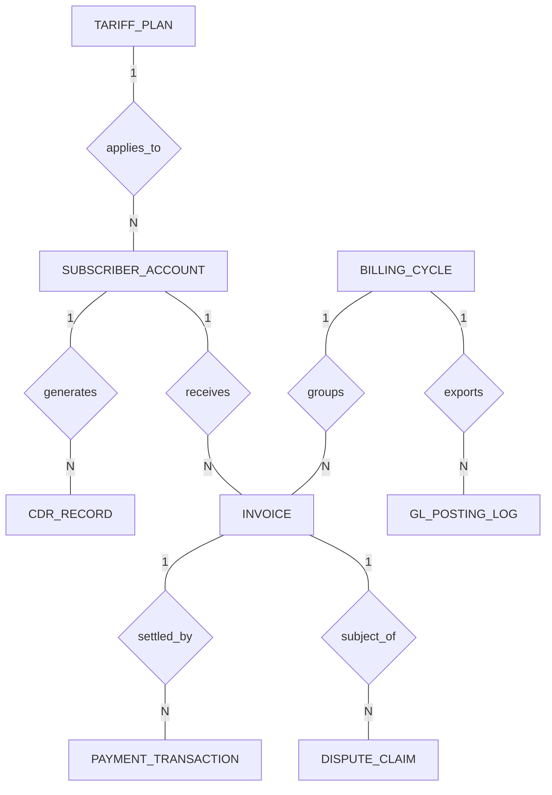

# Conceptual ERD — Telecom Billing & Revenue Management System

## Mermaid Code

## Entity Description Table | Bảng mô tả Entity

| # | Entity Name | Vietnamese Name | Description | Key Attributes | Main Relationships |
|---|-------------|-----------------|-------------|----------------|-------------------|
| 1 | SUBSCRIBER_ACCOUNT | Tài khoản Thuê bao | Main customer telecom account | account_id PK, customer_name string, account_status string | generates, receives, applies_to |
| 2 | BILLING_CYCLE | Chu kỳ Tính cước | Defines recurring monthly billing periods | cycle_id PK, cycle_name string, start_date date | groups, exports |
| 3 | TARIFF_PLAN | Gói Cước | Pricing rules for voice, data, and SMS | tariff_id PK, tariff_name string, voice_rate decimal | applies_to |
| 4 | CDR_RECORD | Bản ghi CDR | Call Detail Record for usage charging | cdr_id PK, account_id FK, call_type string | generates |
| 5 | INVOICE | Hóa đơn Viễn thông | Monthly subscriber bill statement | invoice_id PK, account_id FK, cycle_id FK | receives, groups, settled_by, subject_of |
| 6 | PAYMENT_TRANSACTION | Giao dịch Thanh toán | Payment details collected against invoices | payment_id PK, invoice_id FK, payment_method string | settled_by |
| 7 | DISPUTE_CLAIM | Khiếu nại Cước | Customer bill dispute records | dispute_id PK, invoice_id FK, dispute_reason string | subject_of |
| 8 | GL_POSTING_LOG | Nhật ký Sổ kế toán | Audit log of financial journal postings | posting_id PK, cycle_id FK, total_revenue decimal | exports |

## Relationship Description | Mô tả Quan hệ

| # | From Entity | Cardinality | To Entity | Relationship Label | Business Explanation |
|---|-------------|-------------|-----------|-------------------|----------------------|
| 1 | SUBSCRIBER_ACCOUNT | one-to-many | CDR_RECORD | generates | One subscriber generates multiple CDR records |
| 2 | SUBSCRIBER_ACCOUNT | one-to-many | INVOICE | receives | One subscriber receives multiple monthly invoices |
| 3 | BILLING_CYCLE | one-to-many | INVOICE | groups | One billing cycle generates multiple invoices |
| 4 | TARIFF_PLAN | one-to-many | SUBSCRIBER_ACCOUNT | applies_to | One tariff plan is applied to subscriber accounts |
| 5 | INVOICE | one-to-many | PAYMENT_TRANSACTION | settled_by | An invoice is settled by payment transactions |
| 6 | INVOICE | one-to-many | DISPUTE_CLAIM | subject_of | An invoice can be the subject of a dispute claim |
| 7 | BILLING_CYCLE | one-to-many | GL_POSTING_LOG | exports | A billing cycle exports data to GL posting logs |
