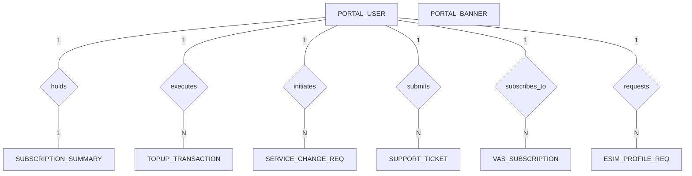

# Conceptual ERD — Customer Self-Care Portal (Telecom)

## Mermaid Code

## Entity Description Table | Bảng mô tả Entity

| # | Entity Name | Vietnamese Name | Description | Key Attributes | Main Relationships |
|---|-------------|-----------------|-------------|----------------|-------------------|
| 1 | PORTAL_USER | Người dùng Cổng | Customer account credential entity | user_id PK, phone_number string, email string | holds, executes, initiates, submits, subscribes_to, requests |
| 2 | SUBSCRIPTION_SUMMARY | Tóm tắt Gói cước | Snapshot of active subscriber plans and quotas | summary_id PK, user_id FK, plan_name string | holds |
| 3 | TOPUP_TRANSACTION | Giao dịch Nạp tiền | Prepaid top-up transaction history | topup_id PK, user_id FK, amount decimal | executes |
| 4 | SERVICE_CHANGE_REQ | Yêu cầu Đổi Gói | Plan upgrade or modification request log | req_id PK, user_id FK, old_plan_id string | initiates |
| 5 | SUPPORT_TICKET | Vé Hỗ trợ Khách hàng | Customer support inquiry ticket | ticket_id PK, user_id FK, category string | submits |
| 6 | VAS_SUBSCRIPTION | Đăng ký Dịch vụ Gia tăng | Active Value-Added Services attached to user | vas_sub_id PK, user_id FK, vas_code string | subscribes_to |
| 7 | ESIM_PROFILE_REQ | Yêu cầu Hồ sơ eSIM | eSIM profile generation and QR requests | esim_req_id PK, user_id FK, eid_number string | requests |
| 8 | PORTAL_BANNER | Banner Quảng cáo Cổng | Marketing banner configuration data | banner_id PK, title string, image_url string | manages |

## Relationship Description | Mô tả Quan hệ

| # | From Entity | Cardinality | To Entity | Relationship Label | Business Explanation |
|---|-------------|-------------|-----------|-------------------|----------------------|
| 1 | PORTAL_USER | one-to-one | SUBSCRIPTION_SUMMARY | holds | One portal user holds active subscription summary |
| 2 | PORTAL_USER | one-to-many | TOPUP_TRANSACTION | executes | One portal user executes top-up transactions |
| 3 | PORTAL_USER | one-to-many | SERVICE_CHANGE_REQ | initiates | One portal user initiates plan change requests |
| 4 | PORTAL_USER | one-to-many | SUPPORT_TICKET | submits | One portal user submits support tickets |
| 5 | PORTAL_USER | one-to-many | VAS_SUBSCRIPTION | subscribes_to | One portal user subscribes to VAS features |
| 6 | PORTAL_USER | one-to-many | ESIM_PROFILE_REQ | requests | One portal user requests eSIM profile downloads |
