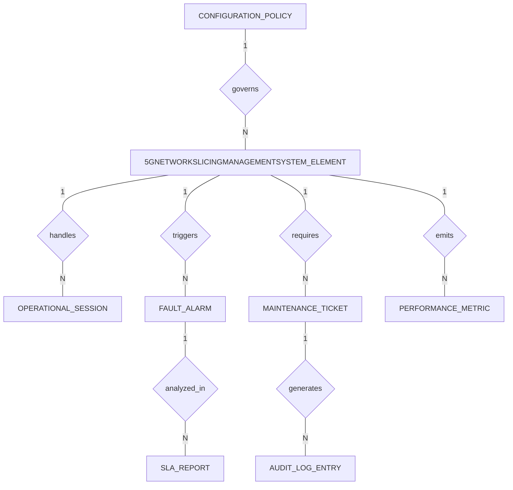

# Conceptual ERD — 5G Network Slicing Management System

## Mermaid Code

## Entity Description Table | Bảng mô tả Entity

| # | Entity Name | Vietnamese Name | Description | Key Attributes | Main Relationships |
|---|-------------|-----------------|-------------|----------------|-------------------|
| 1 | 5GNETWORKSLICINGMANAGEMENTSYSTEM_ELEMENT | Phần tử Hệ Thống Quản Lý Phân Đoạn Mạng 5G (Network Slicing) | Main operational unit in 5G Network Slicing Management System | element_id PK, element_name string, serial_number string | handles, triggers, requires, emits, governs |
| 2 | OPERATIONAL_SESSION | Phiên Hoạt động | Active processing or monitoring session | session_id PK, element_id FK, start_time datetime | handles |
| 3 | FAULT_ALARM | Cảnh báo Lỗi | Incident and fault alarm alerts | alarm_id PK, element_id FK, severity string | triggers, analyzed_in |
| 4 | MAINTENANCE_TICKET | Phiếu Bảo trì | Field engineer work ticket | ticket_id PK, element_id FK, assigned_engineer string | requires, generates |
| 5 | CONFIGURATION_POLICY | Chính sách Cấu hình | System policy configuration rules | policy_id PK, policy_name string, threshold_value string | governs |
| 6 | PERFORMANCE_METRIC | Chỉ số Hiệu năng | Time-series telemetry performance data | metric_id PK, element_id FK, cpu_load decimal | emits |
| 7 | AUDIT_LOG_ENTRY | Nhật ký Kiểm toán | System access and transaction audit trail | log_id PK, user_id string, action_type string | generates |
| 8 | SLA_REPORT | Báo cáo SLA | Statutory compliance report record | report_id PK, period_name string, availability_pct decimal | analyzed_in |

## Relationship Description | Mô tả Quan hệ

| # | From Entity | Cardinality | To Entity | Relationship Label | Business Explanation |
|---|-------------|-------------|-----------|-------------------|----------------------|
| 1 | 5GNETWORKSLICINGMANAGEMENTSYSTEM_ELEMENT | one-to-many | OPERATIONAL_SESSION | handles | One element handles multiple operational sessions |
| 2 | 5GNETWORKSLICINGMANAGEMENTSYSTEM_ELEMENT | one-to-many | FAULT_ALARM | triggers | One element triggers multiple fault alarms |
| 3 | 5GNETWORKSLICINGMANAGEMENTSYSTEM_ELEMENT | one-to-many | MAINTENANCE_TICKET | requires | One element may require multiple maintenance tickets |
| 4 | 5GNETWORKSLICINGMANAGEMENTSYSTEM_ELEMENT | one-to-many | PERFORMANCE_METRIC | emits | One element emits time-series performance metrics |
| 5 | CONFIGURATION_POLICY | one-to-many | 5GNETWORKSLICINGMANAGEMENTSYSTEM_ELEMENT | governs | One policy governs multiple network elements |
| 6 | MAINTENANCE_TICKET | one-to-many | AUDIT_LOG_ENTRY | generates | Maintenance ticket activities generate audit entries |
| 7 | FAULT_ALARM | one-to-many | SLA_REPORT | analyzed_in | Fault alarms are analyzed in periodic SLA compliance reports |
