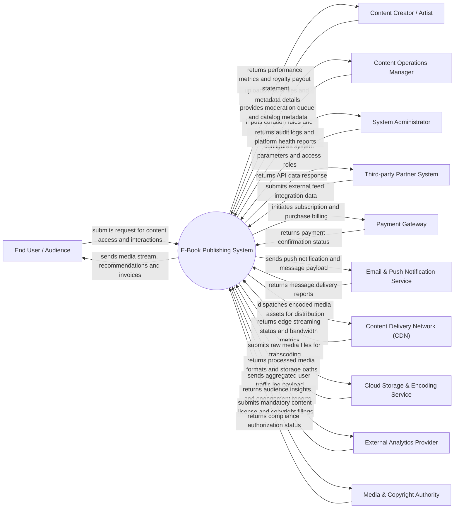

# Context Diagram — E-Book Publishing System

## Mermaid Code

## Actor & Interaction Table | Bảng Actor & Tương tác

| # | Actor | Actor Type | Data Sent TO System | Data Received FROM System | Ghi chú / Notes |
|---|-------|------------|---------------------|---------------------------|-----------------|
| 1 | End User / Audience | Primary | Content search queries, playback requests, payment info, ratings | Media stream data, personalized feeds, billing receipts, notifications | Người dùng cuối xem/nghe/tiêu dùng nội dung truyền thông |
| 2 | Content Creator / Artist | Primary | Media uploads, title metadata, pricing options, payout requests | Royalty statements, audience analytics, content approval status | Tác giả, nghệ sĩ hoặc nhà sản xuất nội dung số |
| 3 | Content Operations Manager | Primary | Moderation decisions, curation tags, feature placement, editorial approval | Moderation backlog, content queue, copyright flag alerts | Quản lý biên tập và kiểm duyệt nội dung |
| 4 | Platform Administrator | Primary | System settings, security policy, user permissions, tariff config | System status logs, error alerts, administrative metrics | Quản trị viên kỹ thuật vận hành nền tảng |
| 5 | Third-party Partner System | Primary | External metadata feeds, syndicated content, API integration requests | API status codes, data sync logs, content catalog feeds | Hệ thống đối tác phân phối hoặc liên kết dữ liệu |
| 6 | Payment Gateway | Supporting | Payment validation, transaction ID, account status | Billing transaction request, amount, payment method | Cổng thanh toán trực tuyến (VNPay, Momo, Stripe, Bank) |
| 7 | Email & Push Notification Service | Supporting | Delivery logs, push failure alerts, bounce notices | Notification title, message body, user device tokens | Hệ thống gửi thông báo đẩy (Firebase FCM, SendGrid) |
| 8 | Content Delivery Network (CDN) | Supporting | Edge cache status, streaming metrics, bandwidth usage | Encoded video/audio segments, distribution manifests | Mạng lưới phân phối nội dung tốc độ cao (Cloudflare, AWS CloudFront) |
| 9 | Cloud Storage & Encoding Service | Supporting | Transcoded asset paths, video resolution variants, encoding completion | Raw source file, target bitrate rules, resolution presets | Dịch vụ mã hóa và lưu trữ tệp tin truyền thông |
| 10 | External Analytics Provider | Supporting | Traffic trends, audience demographic reports, engagement scores | Raw event telemetry, user clickstream logs | Hệ thống phân tích dữ liệu thị hiếu người dùng |
| 11 | Media & Copyright Authority | Regulatory | Regulatory directives, license approvals, censorship orders | Statutory content filings, copyright compliance reports | Cơ quan quản lý báo chí, xuất bản và bản quyền truyền thông |

## System Boundary Description | Mô tả Phạm vi Hệ thống

Hệ thống E-Book Publishing System (Xuất Bản Sách Điện Tử) chịu trách nhiệm tự động hóa và quản lý chuyên sâu quy trình quản lý kho sách số, đọc sách ePub/PDF, bản quyền tác giả và bảo vệ mã hóa DRM. Hệ thống trực tiếp thực hiện các chức năng tiếp nhận dữ liệu, xử lý nghiệp vụ trung tâm, lưu trữ thông tin nội dung/bản quyền và kết xuất báo cáo quản trị.

Hệ thống **KHÔNG** trực tiếp xử lý hạ tầng mạng phân phối CDN băng thông vật lý (ủy quyền cho CDN Provider), **KHÔNG** tự thực hiện hạ tầng giao dịch thanh toán ngân hàng (ủy quyền cho Payment Gateway), và **KHÔNG** thay thế phần mềm kế toán doanh nghiệp tổng thể mà chỉ cung cấp dữ liệu doanh thu/nhuận bút định kỳ.
