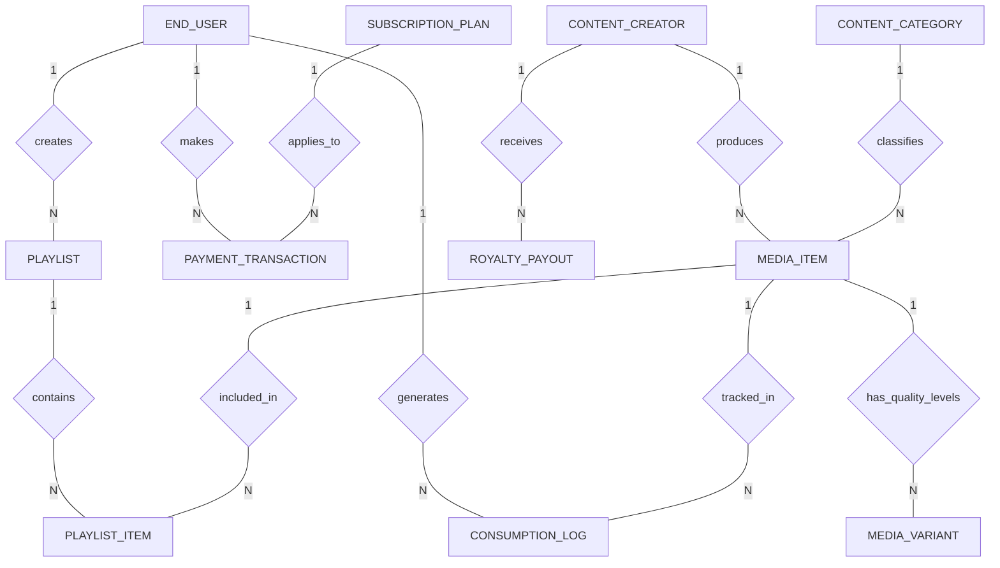

# Conceptual ERD — Talent & Artist Management System

## Mermaid Code

## Entity Description Table | Bảng mô tả Entity

| # | Entity Name | Vietnamese Name | Description | Key Attributes | Main Relationships |
|---|-------------|-----------------|-------------|----------------|-------------------|
| 1 | END_USER | Người dùng cuối | Lưu trữ thông tin cá nhân và trạng thái tài khoản người xem/nghe | user_id, full_name, email, subscription_status | Makes TRANSACTION, Creates PLAYLIST, Generates LOG |
| 2 | CONTENT_CREATOR | Nhà sáng tạo | Thông tin tác giả, tài khoản ngân hàng và trạng thái xác minh | creator_id, creator_name, bank_account_number | Produces MEDIA_ITEM, Receives ROYALTY_PAYOUT |
| 3 | CONTENT_CATEGORY | Danh mục nội dung | Phân loại các thể loại truyền thông trong hệ thống | category_id, category_name, slug | Classifies many MEDIA_ITEM |
| 4 | MEDIA_ITEM | Tệp truyền thông gốc | Dữ liệu chính về bài hát, video, sách hoặc tin tức | media_id, media_title, media_type, approval_status | Belongs to CREATOR, CATEGORY; Has VARIANTS |
| 5 | MEDIA_VARIANT | Định dạng phân phối | Các phiên bản chất lượng hình ảnh/âm thanh khác nhau phục vụ CDN | variant_id, media_id, resolution_quality, cdn_url | Belongs to MEDIA_ITEM |
| 6 | SUBSCRIPTION_PLAN | Gói cước dịch vụ | Định nghĩa các gói thuê bao trả phí trên nền tảng | plan_id, plan_name, price_amount, billing_cycle_days | Applies to many PAYMENT_TRANSACTION |
| 7 | PAYMENT_TRANSACTION | Giao dịch thanh toán | Lịch sử thanh toán mua gói cước hoặc mua sản phẩm của người dùng | transaction_id, user_id, amount, payment_status | Belongs to END_USER, SUBSCRIPTION_PLAN |
| 8 | PLAYLIST | Danh sách phát | Bộ sưu tập các nội dung do người dùng tự tạo | playlist_id, user_id, playlist_name, is_public | Belongs to END_USER; Contains PLAYLIST_ITEM |
| 9 | PLAYLIST_ITEM | Chi tiết danh sách | Liên kết từng tệp media vào danh sách phát | item_id, playlist_id, media_id, sort_order | Belongs to PLAYLIST, MEDIA_ITEM |
| 10 | CONSUMPTION_LOG | Nhật ký tiêu dùng | Ghi nhận thời lượng xem/nghe thực tế của người dùng | log_id, user_id, media_id, watch_time_seconds | Belongs to END_USER, MEDIA_ITEM |
| 11 | ROYALTY_PAYOUT | Lệnh chi trả nhuận bút | Kết quả tổng hợp doanh thu và thanh toán cho Creator | payout_id, creator_id, payout_amount, payout_status | Belongs to CONTENT_CREATOR |

## Relationship Description | Mô tả Quan hệ

| # | From Entity | Cardinality | To Entity | Relationship Label | Business Explanation |
|---|-------------|-------------|-----------|-------------------|----------------------|
| 1 | END_USER | one-to-many | PAYMENT_TRANSACTION | makes | Một người dùng thực hiện nhiều giao dịch thanh toán gói cước. |
| 2 | SUBSCRIPTION_PLAN | one-to-many | PAYMENT_TRANSACTION | applies_to | Một gói cước được áp dụng cho nhiều giao dịch thanh toán. |
| 3 | END_USER | one-to-many | PLAYLIST | creates | Một người dùng có thể tạo nhiều danh sách phát cá nhân. |
| 4 | PLAYLIST | one-to-many | PLAYLIST_ITEM | contains | Một danh sách phát chứa nhiều mục nội dung. |
| 5 | MEDIA_ITEM | one-to-many | PLAYLIST_ITEM | included_in | Một tệp media có thể được lưu vào nhiều danh sách phát khác nhau. |
| 6 | CONTENT_CREATOR | one-to-many | MEDIA_ITEM | produces | Một Creator xuất bản nhiều tệp sản phẩm truyền thông. |
| 7 | CONTENT_CATEGORY | one-to-many | MEDIA_ITEM | classifies | Một danh mục chứa nhiều sản phẩm truyền thông cùng thể loại. |
| 8 | MEDIA_ITEM | one-to-many | MEDIA_VARIANT | has_quality_levels | Một tệp gốc được mã hóa thành nhiều định dạng độ phân giải (4K, 1080p, 720p). |
| 9 | END_USER | one-to-many | CONSUMPTION_LOG | generates | Một người dùng phát sinh nhiều nhật ký lượt xem/nghe trong quá trình sử dụng. |
| 10 | MEDIA_ITEM | one-to-many | CONSUMPTION_LOG | tracked_in | Một tệp media ghi nhận nhiều lượt xem từ các người dùng khác nhau. |
| 11 | CONTENT_CREATOR | one-to-many | ROYALTY_PAYOUT | receives | Một Creator nhận các đợt chi trả nhuận bút định kỳ theo tháng. |
