# Action Tree — Streaming Analytics Platform

## Mermaid Code

```mermaid
graph TD
    Root["Streaming Analytics Platform"]

    Root --> M1["User Management & Authentication Module"]
    Root --> M2["Content Upload & Transcoding Module"]
    Root --> M3["Catalog Management & Moderation Module"]
    Root --> M4["Streaming & CDN Distribution Module"]
    Root --> M5["Subscription & Payment Processing Module"]
    Root --> M6["Royalty & Creator Monetization Module"]
    Root --> M7["Analytics & Compliance Reporting Module"]

    M1 --> A11["Register User Account"]
    M1 --> A12["Authenticate via Single Sign-On"]
    M1 --> A13["Manage User Profile & Preferences"]
    M1 --> A14["Manage Subscription Membership"]

    M2 --> A21["Upload Raw Media File"]
    M2 --> A22["Transcode Bitrate Quality Variants"]
    M2 --> A23["Extract Auto Thumbnail & Metadata"]
    M2 --> A24["Apply DRM Encryption License"]

    M3 --> A31["Moderate Content Quality & Standards"]
    M3 --> A32["Approve or Reject Publication"]
    M3 --> A33["Manage Categories & Tagging"]
    M3 --> A34["Manage Featured Recommendations"]

    M4 --> A41["Deliver Adaptive Bitrate Streaming"]
    M4 --> A42["Cache Content Segments on CDN"]
    M4 --> A43["Manage Offline Download DRM"]
    M4 --> A44["Monitor Quality of Service (QoS)"]

    M5 --> A51["Process Online Subscription Billing"]
    M5 --> A52["Process In-app Purchases"]
    M5 --> A53["Auto-renew Membership Mandate"]
    M5 --> A54["Issue Digital Billing Invoices"]

    M6 --> A61["Aggregate Ad & Stream Revenue"]
    M6 --> A62["Calculate Creator Revenue Share"]
    M6 --> A63["Generate Monthly Royalty Statements"]
    M6 --> A64["Execute Banking Payout Transfer"]

    M7 --> A71["Track Real-time Traffic Telemetry"]
    M7 --> A72["Analyze Audience Engagement Metrics"]
    M7 --> A73["Export Statutory Copyright Reports"]
    M7 --> A74["Audit System Security & Access Logs"]
```

## Module Description | Mô tả Module

| # | Module | Description | Actions |
|---|--------|-------------|---------|
| 1 | User Management & Authentication Module | Quản lý đăng ký, đăng nhập tài khoản, bảo mật sso và thông tin người dùng. | Register User Account, Authenticate via Single Sign-On, Manage User Profile & Preferences, Manage Subscription Membership |
| 2 | Content Upload & Transcoding Module | Tiếp nhận tệp media gốc, mã hóa đa định dạng resolution và áp dụng mã hóa DRM. | Upload Raw Media File, Transcode Bitrate Quality Variants, Extract Auto Thumbnail & Metadata, Apply DRM Encryption License |
| 3 | Catalog Management & Moderation Module | Kiểm duyệt nội dung xuất bản, phân loại danh mục thể loại và quản lý danh sách gợi ý. | Moderate Content Quality & Standards, Approve or Reject Publication, Manage Categories & Tagging, Manage Featured Recommendations |
| 4 | Streaming & CDN Distribution Module | Phân phối luồng streaming thích ứng (ABR), định tuyến CDN và kiểm soát chất lượng dịch vụ QoS. | Deliver Adaptive Bitrate Streaming, Cache Content Segments on CDN, Manage Offline Download DRM, Monitor Quality of Service (QoS) |
| 5 | Subscription & Payment Processing Module | Xử lý thanh toán các gói dịch vụ trả phí, gia hạn tự động và xuất hóa đơn giao dịch. | Process Online Subscription Billing, Process In-app Purchases, Auto-renew Membership Mandate, Issue Digital Billing Invoices |
| 6 | Royalty & Creator Monetization Module | Tổng hợp doanh thu, tính toán nhuận bút cho Creator và thực hiện chuyển tiền chi trả. | Aggregate Ad & Stream Revenue, Calculate Creator Revenue Share, Generate Monthly Royalty Statements, Execute Banking Payout Transfer |
| 7 | Analytics & Compliance Reporting Module | Thống kê lưu lượng thời gian thực, phân tích hành vi độc giả/khán giả và xuất báo cáo tuân thủ. | Track Real-time Traffic Telemetry, Analyze Audience Engagement Metrics, Export Statutory Copyright Reports, Audit System Security & Access Logs |
