# Swimlane Diagram — Fan Community & Engagement Platform

## Mermaid Code

```mermaid
flowchart LR
    Start(["Start Interaction"])

    subgraph Lane_User["End User"]
        C1["Browse Catalog & Select Content"]
        C2["Subscribe / Pay Content Fee"]
        C3["Stream & Enjoy Media Asset"]
        C4["Rate & Review Content"]
    end

    subgraph Lane_Creator["Content Creator"]
        A1["Upload Source Media File"]
        A2["Input Metadata & Set Price"]
        A3["Review Royalty Statement"]
    end

    subgraph Lane_System["System Workflow"]
        S1["Validate Media & Initiate Transcoding"]
        S2{{"Transcoding Completed?"}}
        S3["Publish Content & Update Catalog"]
        S4["Verify Payment & Issue License"]
        S5["Log Traffic Telemetry & Metrics"]
        S6["Calculate Revenue & Trigger Payout"]
    end

    subgraph Lane_Manager["Content Manager"]
        U1["Review Content & Moderate Rules"]
        U2{{"Approve Publication?"}}
        U3["Reject & Send Violation Notice"]
    end

    subgraph Lane_Services["External Services (CDN/Payment)"]
        P1["Process Payment Transaction"]
        P2["Distribute Stream Segments via CDN"]
        P3["Transfer Royalty Payout to Bank"]
    end

    Finish(["End Process"])

    Start --> A1
    A1 --> A2 --> S1 --> S2

    S2 -- "Yes" --> U1
    S2 -- "No (Encoding Error)" --> A1

    U1 --> U2
    U2 -- "Approved" --> S3
    U2 -- "Rejected" --> U3 --> Finish

    S3 --> C1 --> C2 --> P1 --> S4 --> C3

    C3 --> P2 --> S5 --> C4

    S5 --> S6 --> P3 --> A3 --> Finish
```

## Flow Description | Mô tả luồng

| Lane | Actor | Role in Flow |
|------|-------|-------------|
| 1 | End User | Duyệt kho nội dung, chọn gói thuê bao hoặc mua nội dung, trải nghiệm stream media, đánh giá và tương tác với nền tảng. |
| 2 | Content Creator | Tải lên tệp truyền thông gốc, khai báo siêu dữ liệu (Metadata), thiết lập biểu phí và nhận báo cáo doanh thu nhuận bút. |
| 3 | System Workflow | Tự động kiểm tra dữ liệu, mã hóa video/audio sang nhiều định dạng, phát hành license truy cập, lưu nhật ký tiêu dùng và tính toán nhuận bút. |
| 4 | Content Manager | Biên tập viên rà soát quy chuẩn nội dung, kiểm tra vi phạm bản quyền và phê duyệt xuất bản công khai lên hệ thống. |
| 5 | External Services | Cổng thanh toán xử lý giao dịch mua cước, mạng CDN phân phối luồng dữ liệu tốc độ cao và API ngân hàng thực hiện chi trả nhuận bút. |
