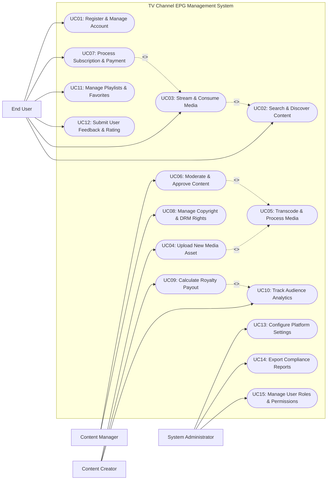

# Use Case Diagram — TV Channel EPG Management System

## Mermaid Code

## Actor Table | Bảng Actor

| # | Actor | Actor Type | Role Description | Related Use Cases |
|---|-------|------------|------------------|-------------------|
| 1 | End User | Primary | Tìm kiếm, xem/nghe nội dung, thanh toán thuê bao và tạo danh sách yêu thích | UC01, UC02, UC03, UC07, UC11, UC12 |
| 2 | Content Creator | Primary | Tải lên sản phẩm truyền thông, theo dõi báo cáo doanh thu và nhận thanh toán nhuận bút | UC04, UC09, UC10 |
| 3 | Content Manager | Primary | Duyệt nội dung xuất bản, kiểm tra vi phạm bản quyền DRM và gán danh mục bài viết | UC06, UC08 |
| 4 | System Administrator | Primary | Quản trị hệ thống, cấu hình tham số kỹ thuật, quản lý tài khoản và xuất báo cáo tuân thủ | UC13, UC14, UC15 |

## Use Case Table | Bảng Use Case

| # | UC ID | Use Case Name | Primary Actor | Secondary Actor | Description | Priority |
|---|-------|---------------|---------------|-----------------|-------------|----------|
| 1 | UC01 | Register & Manage Account | End User | System | Đăng ký tài khoản mới và cập nhật thông tin cá nhân | High |
| 2 | UC02 | Search & Discover Content | End User | System | Tìm kiếm nội dung theo từ khóa, danh mục hoặc gợi ý AI | High |
| 3 | UC03 | Stream & Consume Media | End User | CDN Service | Phát truyền trực tiếp nội dung video/âm thanh trên thiết bị | High |
| 4 | UC04 | Upload New Media Asset | Content Creator | Storage Service | Tải tệp truyền thông gốc và nhập thông tin tiêu đề, mô tả | High |
| 5 | UC05 | Transcode & Process Media | System | Storage Service | Mã hóa tệp tin sang các định dạng độ phân giải chuẩn | High |
| 6 | UC06 | Moderate & Approve Content | Content Manager | System | Phê duyệt hoặc từ chối xuất bản nội dung số | High |
| 7 | UC07 | Process Subscription & Payment | End User | Payment Gateway | Thanh toán gói cước sử dụng dịch vụ nội dung trả phí | High |
| 8 | UC08 | Manage Copyright & DRM Rights | Content Manager | DRM System | Gán mã khóa bảo vệ DRM và kiểm tra bản quyền số | High |
| 9 | UC09 | Calculate Royalty Payout | Content Creator | Payment Gateway | Tự động tính toán nhuận bút và thực hiện lệnh chi trả | High |
| 10 | UC10 | Track Audience Analytics | Content Creator | Analytics Provider | Thống kê lượt xem, thời gian xem và chỉ số tương tác | Medium |
| 11 | UC11 | Manage Playlists & Favorites | End User | System | Tạo danh sách phát cá nhân và lưu nội dung yêu thích | Medium |
| 12 | UC12 | Submit User Feedback & Rating | End User | System | Đánh giá sao và viết bình luận trải nghiệm nội dung | Medium |
| 13 | UC13 | Configure Platform Settings | System Administrator | None | Cấu hình tham số hệ thống, giới hạn băng thông và dịch vụ | Medium |
| 14 | UC14 | Export Compliance Reports | System Administrator | Regulatory Authority | Kết xuất báo cáo tuân thủ bản quyền và quy định báo chí | High |
| 15 | UC15 | Manage User Roles & Permissions | System Administrator | None | Phân quyền tài khoản người dùng và quản trị viên | Low |

## Use Case Specification | Đặc tả Use Case

---

### UC01 — Register & Manage Account

| Field | Detail |
|-------|--------|
| **UC ID** | UC01 |
| **Use Case Name** | Register & Manage Account |
| **Actor(s)** | Primary: End User   Secondary: Notification Service |
| **Description** | Cho phép người dùng đăng ký tài khoản mới trên hệ thống {vn_short}, xác thực Email/OTP và cập nhật thông tin cá nhân. |
| **Precondition** | 1. Người dùng đã truy cập vào giao diện ứng dụng/website.   2. Hệ thống tạo tài khoản hoạt động bình thường. |
| **Main Flow** | 1. Người dùng chọn "Đăng ký tài khoản".   2. Hệ thống hiển thị biểu mẫu điền thông tin (Email, Mật khẩu, Số điện thoại).   3. Người dùng nhập đầy đủ thông tin và đồng ý điều khoản dịch vụ.   4. Hệ thống tạo mã xác thực OTP và gửi qua Email/SMS (Notification Service).   5. Người dùng nhập mã OTP để xác nhận.   6. Hệ thống khởi tạo tài khoản thành công, thiết lập trạng thái "Active" và tự động đăng nhập. |
| **Alternative Flow** | **AF1** — Đăng nhập bằng Mạng xã hội (SSO): Khách hàng chọn đăng nhập nhanh qua Google/Facebook/Apple ID, hệ thống xác thực OAuth2 và tạo tài khoản tự động.   **AF2** — Quên mật khẩu: Người dùng chọn khôi phục mật khẩu qua link xác nhận email. |
| **Exception Flow** | **EX1** — Email/SĐT đã tồn tại: Hệ thống hiển thị lỗi trùng lặp và gợi ý người dùng đăng nhập hoặc đổi email khác.   **EX2** — Mã OTP hết hạn hoặc sai: Hệ thống báo lỗi và cho phép gửi lại mã OTP tối đa 3 lần. |
| **Postcondition** | Tài khoản người dùng mới được tạo thành công trên hệ thống. |
| **Business Rule** | **BR1**: Mật khẩu phải chứa tối thiểu 8 ký tự bao gồm chữ hoa, chữ thường và số.   **BR2**: Mã xác thực OTP chỉ có hiệu lực trong vòng 5 phút. |

---

### UC04 — Upload New Media Asset

| Field | Detail |
|-------|--------|
| **UC ID** | UC04 |
| **Use Case Name** | Upload New Media Asset |
| **Actor(s)** | Primary: Content Creator   Secondary: Cloud Storage Service |
| **Description** | Cho phép nhà sáng tạo nội dung tải tệp truyền thông gốc lên hệ thống, nhập siêu dữ liệu (Metadata) và gửi yêu cầu phê duyệt. |
| **Precondition** | 1. Creator đã đăng nhập tài khoản verified trên hệ thống.   2. Dịch vụ lưu trữ Cloud Storage khả dụng. |
| **Main Flow** | 1. Creator truy cập giao diện Creator Studio và chọn "Upload Content".   2. Creator chọn tệp tin media (video, audio, hình ảnh) từ thiết bị.   3. Hệ thống tải tệp tin lên hạ tầng lưu trữ tạm thời (Storage Service).   4. Creator nhập thông tin tiêu đề, mô tả, thẻ tag, danh mục và chọn ảnh đại diện (Thumbnail).   5. Creator thiết lập chế độ hiển thị (Công khai, Riêng tư, Trả phí) và mức phí (nếu có).   6. Creator chọn "Nộp kiểm duyệt".   7. Hệ thống kích hoạt quy trình mã hóa tự động (UC05) và chuyển hồ sơ sang hàng chờ kiểm duyệt (UC06). |
| **Alternative Flow** | **AF1** — Tải lên nhiều tệp cùng lúc (Bulk Upload): Creator tải lên danh sách tệp và nhập chung bảng thông số metadata.   **AF2** — Đặt lịch xuất bản: Creator chọn ngày giờ xuất bản tự động trong tương lai. |
| **Exception Flow** | **EX1** — Tệp vượt quá dung lượng cho phép: Hệ thống chặn tải lên và hiển thị giới hạn dung lượng tối đa.   **EX2** — Định dạng tệp không hỗ trợ: Hệ thống yêu cầu nộp định dạng chuẩn (MP4, MP3, ePub, PNG). |
| **Postcondition** | Tệp nội dung mới được tải lên lưu trữ an toàn và sẵn sàng cho bước mã hóa/kiểm duyệt. |
| **Business Rule** | **BR1**: Dung lượng tệp tải lên tối đa không vượt quá 10GB đối với tài khoản chuẩn.   **BR2**: Mọi nội dung tải lên phải thuộc quyền sở hữu hợp pháp của Creator. |

---

### UC06 — Moderate & Approve Content

| Field | Detail |
|-------|--------|
| **UC ID** | UC06 |
| **Use Case Name** | Moderate & Approve Content |
| **Actor(s)** | Primary: Content Manager   Secondary: System |
| **Description** | Biên tập viên xem xét nội dung truyền thông mới tải lên, kiểm tra quy chuẩn cộng đồng/bản quyền và ra quyết định phê duyệt xuất bản. |
| **Precondition** | 1. Tệp media đã được mã hóa xong (UC05) và ở trạng thái "Pending Approval".   2. Manager có quyền kiểm duyệt nội dung. |
| **Main Flow** | 1. Content Manager mở danh sách nội dung chờ duyệt trong trang quản trị.   2. Hệ thống hiển thị xem trước media, bảng khai báo metadata và kết quả quét bản quyền tự động.   3. Manager kiểm tra tính tuân thủ quy chuẩn nội dung (không vi phạm thuần phong mỹ tục, bạo lực, bản quyền).   4. Manager chọn quyết định "Approve" (Phê duyệt).   5. Hệ thống đổi trạng thái nội dung thành "Published", phân phối lên CDN và gửi thông báo cho Creator. |
| **Alternative Flow** | **AF1** — Từ chối nội dung: Manager chọn "Reject", nhập lý do vi phạm cụ thể, hệ thống chuyển nội dung sang trạng thái "Rejected" và gửi thư thông báo lý do cho Creator.   **AF2** — Yêu cầu chỉnh sửa: Manager yêu cầu Creator sửa lại thông tin tiêu đề/thumbnail trước khi duyệt lại. |
| **Exception Flow** | **EX1** — Phát hiện vi phạm bản quyền nghiêm trọng: Hệ thống tự động khóa tài khoản Creator và đánh dấu cờ vi phạm (Copyright Strike).   **EX2** — Lỗi hệ thống khi phân phối CDN: Hệ thống thử lại đẩy file lên CDN sau 5 phút. |
| **Postcondition** | Nội dung được xuất bản công khai trên nền tảng hoặc bị từ chối với lý do rõ ràng. |
| **Business Rule** | **BR1**: Thời gian xử lý kiểm duyệt nội dung không được vượt quá 24h kể từ khi tải lên.   **BR2**: Mọi quyết định từ chối bắt buộc phải đính kèm điều khoản quy chuẩn bị vi phạm. |

---

### UC07 — Process Subscription & Payment

| Field | Detail |
|-------|--------|
| **UC ID** | UC07 |
| **Use Case Name** | Process Subscription & Payment |
| **Actor(s)** | Primary: End User   Secondary: Payment Gateway |
| **Description** | Cho phép người dùng thanh toán mua gói thuê bao Premium hoặc thanh toán giao dịch mua lẻ nội dung số. |
| **Precondition** | 1. Người dùng đã đăng nhập tài khoản hợp lệ.   2. Gói cước/nội dung đang được niêm yết bán trên hệ thống. |
| **Main Flow** | 1. Người dùng chọn gói thuê bao (Tháng/Năm) hoặc chọn nội dung cần mua.   2. Hệ thống hiển thị bảng tổng hợp chi phí và phương thức thanh toán.   3. Người dùng chọn phương thức thanh toán (Ví điện tử, Thẻ Visa/Mastercard, Chuyển khoản).   4. Hệ thống chuyển hướng giao dịch sang Cổng thanh toán (Payment Gateway).   5. Người dùng hoàn tất xác thực thanh toán trên cổng.   6. Payment Gateway trả về kết quả giao dịch thành công.   7. Hệ thống kích hoạt quyền truy cập gói cước/mở khóa nội dung và gửi hóa đơn điện tử cho người dùng. |
| **Alternative Flow** | **AF1** — Gia hạn tự động (Auto-renewal): Hệ thống tự động trích nợ định kỳ hàng tháng từ phương thức thanh toán đã lưu.   **AF2** — Áp dụng mã giảm giá (Voucher): Người dùng nhập mã khuyến mãi để trừ số tiền thanh toán trước khi xác nhận. |
| **Exception Flow** | **EX1** — Thanh toán bị từ chối / Không đủ số dư: Hệ thống thông báo lỗi và yêu cầu đổi thẻ/phương thức khác.   **EX2** — Lỗi nghẽn kết quả thanh toán: Hệ thống lưu giao dịch ở trạng thái "Pending" và đối soát sau 15 phút. |
| **Postcondition** | Quyền truy cập nội dung được cấp cho người dùng và doanh thu được ghi nhận. |
| **Business Rule** | **BR1**: Quyền truy cập Premium phải được kích hoạt tức thì sau khi cổng thanh toán xác nhận thành công.   **BR2**: Người dùng có thể hủy gia hạn tự động bất kỳ lúc nào trước kỳ thanh toán tiếp theo. |

---

### UC09 — Calculate Royalty Payout

| Field | Detail |
|-------|--------|
| **UC ID** | UC09 |
| **Use Case Name** | Calculate Royalty Payout |
| **Actor(s)** | Primary: Content Creator   Secondary: Payment Gateway / Banking API |
| **Description** | Tự động tính toán doanh thu nhuận bút cho Creator dựa trên lượt xem/lượt nghe/doanh số bán và chuyển tiền chi trả định kỳ. |
| **Precondition** | 1. Kỳ đối soát doanh thu hàng tháng đến hạn.   2. Creator đã liên kết tài khoản ngân hàng nhận tiền hợp lệ. |
| **Main Flow** | 1. Hệ thống chạy tiến trình tổng hợp dữ liệu lưu lượng xem/nghe và doanh thu phát sinh trong tháng.   2. Hệ thống áp dụng công thức chia sẻ doanh thu (Revenue Share Ratio) để tính số tiền nhuận bút cho từng Creator.   3. Hệ thống tạo bảng kê chi tiết nhuận bút (Royalty Statement) và gửi thông báo cho Creator.   4. Creator kiểm tra bảng kê và chọn "Yêu cầu rút tiền" (hoặc tự động chuyển tiền theo lịch).   5. Hệ thống khởi tạo lệnh chi trả đến Payment Gateway / Banking API.   6. Ngân hàng chuyển tiền thành công vào tài khoản Creator.   7. Hệ thống cập nhật trạng thái chi trả thành "Paid" và lưu lịch sử giao dịch. |
| **Alternative Flow** | **AF1** — Khiếu nại số liệu nhuận bút: Creator gửi yêu cầu đối soát lại số liệu lượt xem trước khi nhận tiền.   **AF2** — Tích lũy số dư: Số tiền nhuận bút chưa đạt hạn mức tối thiểu sẽ được cộng dồn sang tháng sau. |
| **Exception Flow** | **EX1** — Tài khoản ngân hàng Creator bị lỗi/sai: Lệnh chuyển tiền thất bại, hệ thống báo cờ và yêu cầu Creator cập nhật lại thông tin tài khoản.   **EX2** — Tài khoản Creator bị đóng băng do vi phạm: Hệ thống tạm giữ khoản nhuận bút cho đến khi giải quyết tranh chấp. |
| **Postcondition** | Tiền nhuận bút được chuyển thành công tới Creator và dữ liệu tài chính được lưu trữ. |
| **Business Rule** | **BR1**: Hạn mức rút tiền tối thiểu là 500.000 VNĐ (hoặc 50 USD) mỗi kỳ thanh toán.   **BR2**: Tỷ lệ khấu trừ thuế thu nhập cá nhân được tự động áp dụng theo luật định trước khi chi trả. |
