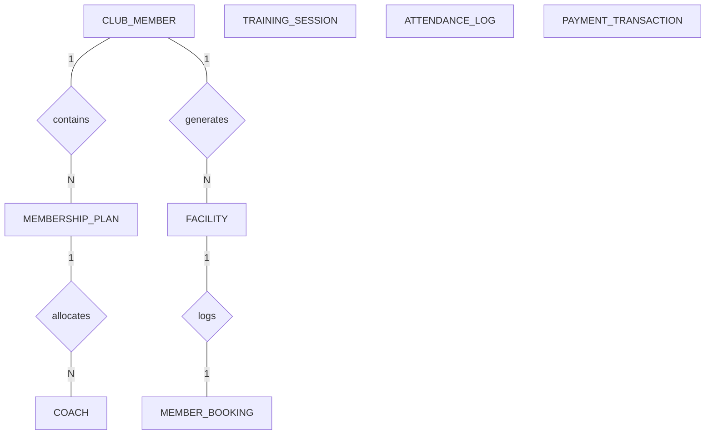

# Conceptual ERD — Sports Club Management System

## Mermaid Code

## Entity Description Table | Bảng mô tả Entity

| # | Entity Name | Vietnamese Name | Description | Key Attributes | Main Relationships |
|---|-------------|-----------------|-------------|----------------|--------------------|
| 1 | CLUB_MEMBER | Thành viên CLB | Stores profile and contact information of club members | member_id PK, full_name string, email string | has one MEMBERSHIP_PLAN, places MEMBER_BOOKING |
| 2 | MEMBERSHIP_PLAN | Gói thành viên | Defines membership tiers, monthly pricing, and perks | plan_id PK, plan_name string, monthly_fee decimal | assigned to CLUB_MEMBER |
| 3 | COACH | Huấn luyện viên | Stores personal trainer and coach credentials and specialty | coach_id PK, full_name string, specialty string | conducts TRAINING_SESSION |
| 4 | FACILITY | Cơ sở vật chất | Represents courts, fields, pools, and gym spaces | facility_id PK, facility_name string, type string | has many MEMBER_BOOKING |
| 5 | MEMBER_BOOKING | Đặt chỗ cơ sở | Tracks facility reservations made by club members | booking_id PK, member_id FK, facility_id FK | belongs to CLUB_MEMBER, FACILITY |
| 6 | TRAINING_SESSION | Buổi huấn luyện | Scheduled group or 1-on-1 training classes | session_id PK, coach_id FK, facility_id FK | conducted by COACH |
| 7 | ATTENDANCE_LOG | Nhật ký điểm danh | Logs gate check-in attempts and class attendance | log_id PK, member_id FK, checkin_time datetime | tracks CLUB_MEMBER |
| 8 | PAYMENT_TRANSACTION | Giao dịch thanh toán | Records dues, bookings, and merchandise payments | transaction_id PK, member_id FK, amount decimal | generated for CLUB_MEMBER |

## Relationship Description | Mô tả Quan hệ

| # | From Entity | Cardinality | To Entity | Relationship Label | Business Explanation |
|---|-------------|-------------|-----------|-------------------|----------------------|
| 1 | CLUB_MEMBER | one-to-many | MEMBERSHIP_PLAN | contains | Single entity parent relates to multiple child records |
| 2 | CLUB_MEMBER | one-to-many | FACILITY | generates | Creates financial logs for processing |
| 3 | MEMBERSHIP_PLAN | one-to-many | COACH | allocates | Assigns physical resources for events |
| 4 | FACILITY | one-to-one | MEMBER_BOOKING | logs | Links audit entry with detailed metric log |

