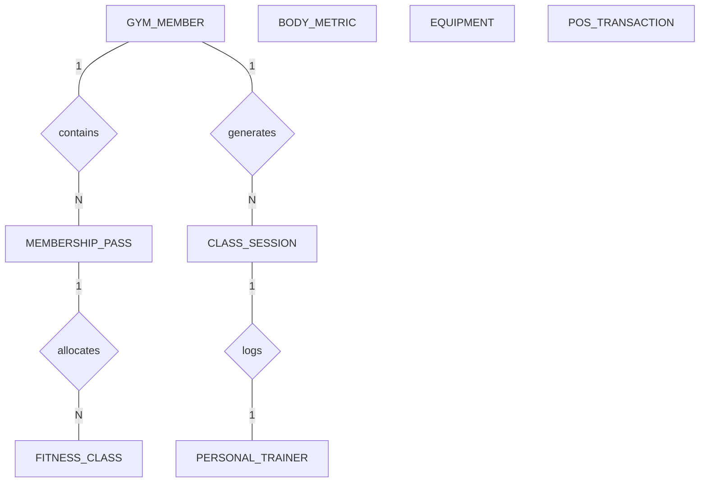

# Conceptual ERD — Gym & Fitness Center Management System

## Mermaid Code

## Entity Description Table | Bảng mô tả Entity

| # | Entity Name | Vietnamese Name | Description | Key Attributes | Main Relationships |
|---|-------------|-----------------|-------------|----------------|--------------------|
| 1 | GYM_MEMBER | Hội viên phòng Gym | Contains profile data and subscription status of fitness members | member_id PK, full_name string, phone string | purchases MEMBERSHIP_PASS, books CLASS_SESSION |
| 2 | MEMBERSHIP_PASS | Thẻ tập Gym | Represents specific active gym subscriptions and passes | pass_id PK, member_id FK, pass_type string | belongs to GYM_MEMBER |
| 3 | FITNESS_CLASS | Lớp học Fitness | Catalog of group exercise classes offered by the center | class_id PK, class_name string, instructor_id FK | conducted by PERSONAL_TRAINER |
| 4 | CLASS_SESSION | Buổi tập lớp | Scheduled instances of group fitness classes | session_id PK, class_id FK, session_date datetime | booked by GYM_MEMBER |
| 5 | PERSONAL_TRAINER | Huấn luyện viên cá nhân | Trainer records, certifications, and availability slots | trainer_id PK, full_name string, certification string | manages BODY_METRIC |
| 6 | BODY_METRIC | Chỉ số cơ thể | InBody composition logs for tracking fitness progress | metric_id PK, member_id FK, trainer_id FK | belongs to GYM_MEMBER |
| 7 | EQUIPMENT | Thiết bị phòng tập | Tracks gym machines, weights, and maintenance status | equipment_id PK, name string, category string | maintained by FitnessCenterManager |
| 8 | POS_TRANSACTION | Giao dịch bán hàng POS | Counter sales of supplements, merchandise, and lockers | transaction_id PK, member_id FK, item_summary string | associated with GYM_MEMBER |

## Relationship Description | Mô tả Quan hệ

| # | From Entity | Cardinality | To Entity | Relationship Label | Business Explanation |
|---|-------------|-------------|-----------|-------------------|----------------------|
| 1 | GYM_MEMBER | one-to-many | MEMBERSHIP_PASS | contains | Single entity parent relates to multiple child records |
| 2 | GYM_MEMBER | one-to-many | CLASS_SESSION | generates | Creates financial logs for processing |
| 3 | MEMBERSHIP_PASS | one-to-many | FITNESS_CLASS | allocates | Assigns physical resources for events |
| 4 | CLASS_SESSION | one-to-one | PERSONAL_TRAINER | logs | Links audit entry with detailed metric log |

