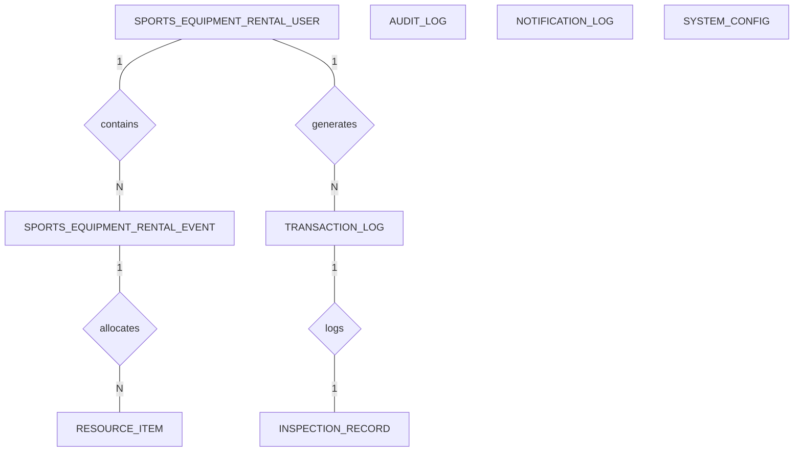

# Conceptual ERD — Sports Equipment Rental System

## Mermaid Code

## Entity Description Table | Bảng mô tả Entity

| # | Entity Name | Vietnamese Name | Description | Key Attributes | Main Relationships |
|---|-------------|-----------------|-------------|----------------|--------------------|
| 1 | SPORTS_EQUIPMENT_RENTAL_USER | Người dùng chính | Stores user profiles and login details for Sports Equipment Rental System | user_id PK, full_name string, email string | places REQUEST, receives NOTIFICATION |
| 2 | SPORTS_EQUIPMENT_RENTAL_EVENT | Sự kiện / Giải đấu | Tracks scheduled events, matches, or sessions in Sports Equipment Rental System | event_id PK, title string, event_date datetime | has many SESSION, manages RESOURCE |
| 3 | RESOURCE_ITEM | Tài nguyên / Thiết bị | Represents venues, courts, tools, or physical equipment | resource_id PK, resource_name string, type string | allocated to EVENT |
| 4 | TRANSACTION_LOG | Nhật ký giao dịch | Records financial transactions, entry fees, or rentals | transaction_id PK, user_id FK, amount decimal | belongs to USER |
| 5 | INSPECTION_RECORD | Hồ sơ kiểm tra / Trận đấu | Logs live scores, telemetry data, or inspection notes | record_id PK, event_id FK, inspector_id string | linked to EVENT |
| 6 | AUDIT_LOG | Nhật ký kiểm toán | Tracks system audit trails and compliance reports | audit_id PK, admin_id string, action string | generated by DomainAdmin |
| 7 | NOTIFICATION_LOG | Nhật ký thông báo | Tracks dispatched SMS, emails, and push alerts | notification_id PK, user_id FK, message string | sent to USER |
| 8 | SYSTEM_CONFIG | Cấu hình hệ thống | Stores global system settings and operational parameters | config_id PK, key string, value string | maintained by DomainAdmin |

## Relationship Description | Mô tả Quan hệ

| # | From Entity | Cardinality | To Entity | Relationship Label | Business Explanation |
|---|-------------|-------------|-----------|-------------------|----------------------|
| 1 | SPORTS_EQUIPMENT_RENTAL_USER | one-to-many | SPORTS_EQUIPMENT_RENTAL_EVENT | contains | Single entity parent relates to multiple child records |
| 2 | SPORTS_EQUIPMENT_RENTAL_USER | one-to-many | TRANSACTION_LOG | generates | Creates financial logs for processing |
| 3 | SPORTS_EQUIPMENT_RENTAL_EVENT | one-to-many | RESOURCE_ITEM | allocates | Assigns physical resources for events |
| 4 | TRANSACTION_LOG | one-to-one | INSPECTION_RECORD | logs | Links audit entry with detailed metric log |

