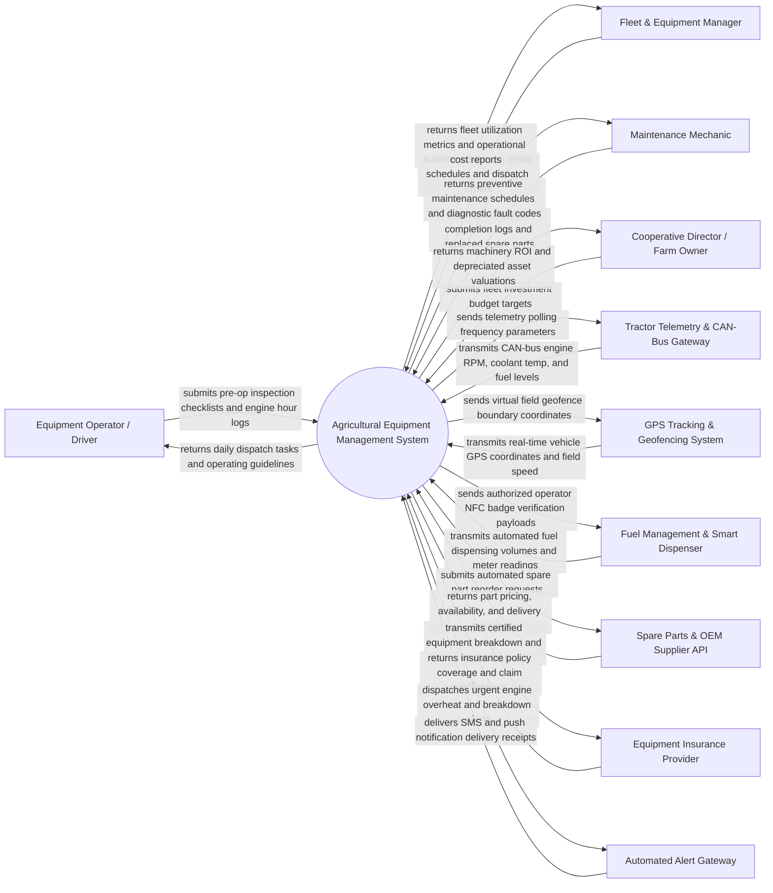

# Context Diagram — Agricultural Equipment Management System

## Mermaid Code

## Actor & Interaction Table | Bang Actor & Tuong tac

| # | Actor | Actor Type | Data Sent TO System | Data Received FROM System | Notes |
|---|-------|------------|---------------------|---------------------------|-------|
| 1 | Equipment Operator / Driver | Primary | Pre-operation safety checklists, daily task completion logs, odometer/hour readings, field breakdown alerts | Daily work dispatch assignments, field operation boundaries, safety warnings, fuel authorization tokens | Primary operator driving tractors, combine harvesters, and sprayers in field conditions |
| 2 | Fleet & Equipment Manager | Primary | Equipment allocation schedules, rental contracts, driver assignments, maintenance approvals | Fleet utilization dashboards, fuel consumption efficiency metrics, equipment operating costs | Asset manager overseeing machinery allocation, operator scheduling, and fleet profitability |
| 3 | Maintenance Mechanic | Primary | Completed work order details, replaced spare parts list, labor hours spent, diagnostic notes | Preventive maintenance work orders, CAN-bus fault codes (DTC), OEM service manuals | Service technician executing scheduled servicing, oil changes, and emergency field repairs |
| 4 | Cooperative Director / Farm Owner | Primary | Capital budget targets, fleet expansion plans, machinery rental rate policies | Equipment ROI analysis, fleet asset depreciation tables, seasonal fuel expenditure reports | Executive stakeholder evaluating fleet capital expenditure, equipment leasing, and total cost of ownership |
| 5 | Tractor Telemetry & CAN-Bus Gateway | Supporting System | Real-time CAN-bus metrics: engine RPM, coolant temperature, hydraulic oil pressure, fuel consumption rate, Diagnostic Trouble Codes (DTC) | Telemetry sampling rates, CAN-bus PID query configurations, remote diagnostic triggers | Onboard IoT telematics unit (ISOBUS / J1939 protocol) reading engine ecu data |
| 6 | GPS Tracking & Geofencing System | Supporting System | Live GPS latitude/longitude, travel speed, heading, field area covered, geofence enter/exit events | Field parcel boundary polygons, speed limit alerts, geofence trigger parameters | Vehicle GPS tracker tracking real-time field position, operating speed, and parcel coverage |
| 7 | Fuel Management & Smart Dispenser | Supporting System | Fuel volume dispensed (liters), dispenser ID, fuel type, vehicle NFC tag code, timestamp | Fueling authorization approval, maximum allowed fill limit, operator verification token | Automated farm fuel station or mobile fuel bowser tracking diesel distribution |
| 8 | Spare Parts & OEM Supplier API | Supporting System | Part availability, unit pricing, order status, shipment tracking numbers, OEM part catalogs | Automated purchase orders, part number queries, reorder trigger payloads | Commercial parts vendor or manufacturer API (e.g., John Deere, Case IH, Kubota) for reordering |
| 9 | Equipment Insurance Provider | Supporting System | Insurance policy terms, claim processing status, deductible terms | Certified equipment operating logs, telemetry crash data, stolen equipment GPS history | Financial institution providing machinery insurance coverage against damage, fire, or theft |
| 10 | Automated Alert Gateway | Supporting System | SMS delivery logs, mobile notification receipts | High-priority engine overheat alerts, oil pressure drops, geofence breaches, maintenance due warnings | Multi-channel messaging gateway alerting managers and mechanics immediately during critical failures |

## System Boundary Description | Mo ta Pham vi He thong

The **Agricultural Equipment Management System** is an enterprise asset management platform designed to track the operational lifecycle, real-time telemetry, preventive maintenance, fuel consumption, and financial costs of farm machinery fleets (tractors, harvesters, sprayers, implements).

The **system boundary** encompasses equipment asset registration, operator dispatching, CAN-bus telemetry ingestion, GPS location and geofence tracking, preventive maintenance scheduling, work order management, fuel inventory logging, spare parts inventory control, and fleet financial ROI reporting.

**External to the system boundary** are physical engine mechanical combustion processes, physical fuel refinery supply chains, physical wrench turning during mechanic repairs, civil insurance legal claim underwriting, and satellite GPS constellation operation. System interfaces connect via ISOBUS / SAE J1939 CAN-bus protocols, RESTful cloud APIs, and cellular/satellite telematics streams.
