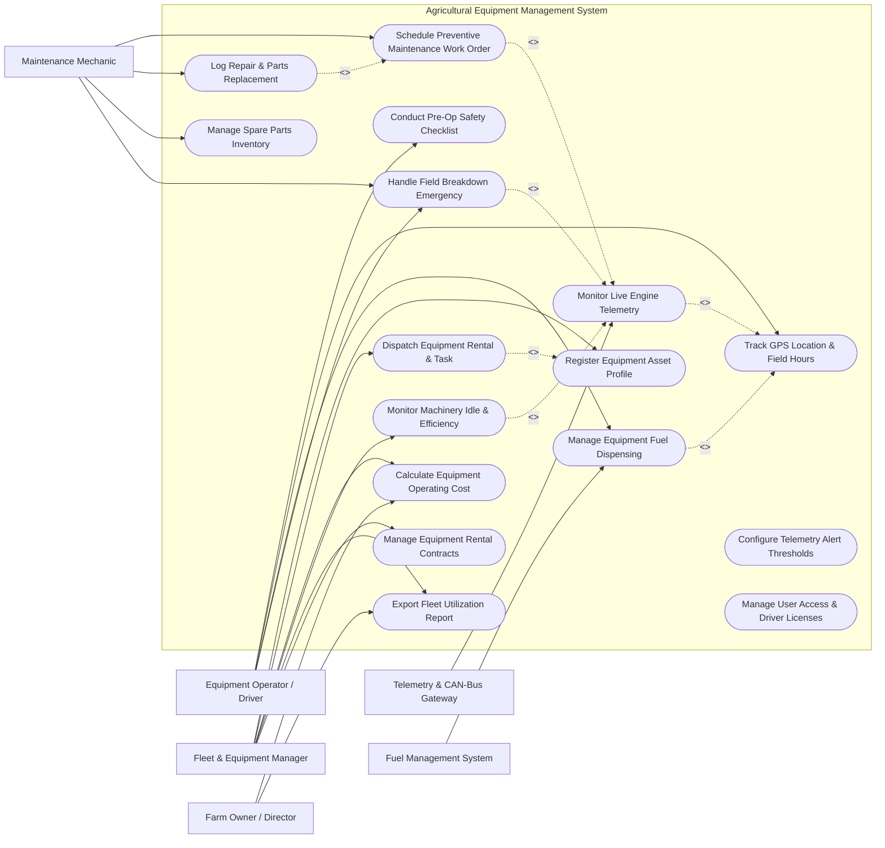

# Use Case Diagram — Agricultural Equipment Management System

## Mermaid Code

## Actor Table | Bang Actor

| # | Actor | Actor Type | Role Description | Related Use Cases |
|---|-------|------------|------------------|-------------------|
| 1 | Equipment Operator / Driver | Primary | Farm machinery driver conducting daily operations, safety checks, and logging field hours | UC04, UC07, UC10, UC11 |
| 2 | Fleet & Equipment Manager | Primary | Asset manager assigning machinery tasks, overseeing rental contracts, and monitoring costs | UC01, UC02, UC08, UC12, UC13, UC14 |
| 3 | Maintenance Mechanic | Primary | Technician servicing machinery, resolving CAN-bus engine faults, and managing spare parts | UC05, UC06, UC09, UC11 |
| 4 | Farm Owner / Director | Primary | Executive reviewing total cost of ownership, fleet utilization, and machinery ROI | UC08, UC13 |
| 5 | Telemetry & CAN-Bus Gateway | Secondary / System | Onboard IoT gateway streaming engine RPM, coolant temp, fuel rate, and DTC fault codes | UC03 |
| 6 | Fuel Management System | Secondary / System | Automated fuel station reader logging dispensed diesel liters and driver NFC tags | UC07 |

## Use Case Table | Bang Use Case

| # | UC ID | Use Case Name | Primary Actor | Secondary Actor | Description | Priority |
|---|-------|---------------|---------------|-----------------|-------------|----------|
| 1 | UC01 | Register Equipment Asset Profile | Fleet Manager | None | Creates machinery master record (serial, make, model, year, attachments, initial hours) | High |
| 2 | UC02 | Dispatch Equipment Rental & Task | Fleet Manager | None | Assigns machinery and qualified driver to field parcel work orders or external rentals | High |
| 3 | UC03 | Monitor Live Engine Telemetry | System | Telemetry Gateway | Ingests CAN-bus metrics (RPM, oil pressure, coolant temp, fuel burn rate) in real time | High |
| 4 | UC04 | Track GPS Location & Field Hours | Operator | System | Tracks real-time GPS coordinates, operating speed, field boundary, and engine hours | High |
| 5 | UC05 | Schedule Preventive Maintenance Work Order | Mechanic | System | Auto-generates work orders based on engine hours (e.g., 250h oil change) or calendar intervals | High |
| 6 | UC06 | Log Repair & Parts Replacement | Mechanic | None | Records repair activities, labor hours spent, diagnostic notes, and replaced spare parts | High |
| 7 | UC07 | Manage Equipment Fuel Dispensing | Operator | Fuel System | Logs diesel fuel refuel transactions, fuel cost, and calculates fuel efficiency ($L/\text{ha}$) | High |
| 8 | UC08 | Calculate Equipment Operating Cost | Fleet Manager | Farm Owner | Computes total operating cost per hour/hectare including fuel, labor, maintenance, and depreciation | High |
| 9 | UC09 | Manage Spare Parts Inventory | Mechanic | OEM Supplier | Tracks spare part stock levels, reorder thresholds, and generates supplier POs | Medium |
| 10 | UC10 | Conduct Pre-Op Safety Checklist | Operator | None | Requires driver to complete digital safety checklist (brakes, tires, fluids) before starting engine | High |
| 11 | UC11 | Handle Field Breakdown Emergency | Operator | Mechanic | Logs unexpected field breakdown, captures fault codes, and dispatches mobile repair unit | High |
| 12 | UC12 | Monitor Machinery Idle & Efficiency | Fleet Manager | Telemetry Gateway | Analyzes engine idle vs operating hours to identify fuel waste and driver habits | Medium |
| 13 | UC13 | Export Fleet Utilization Report | Fleet Manager | Farm Owner | Generates seasonal fleet utilization charts, machine downtime rates, and cost benchmarks | Medium |
| 14 | UC14 | Manage Equipment Rental Contracts | Fleet Manager | None | Manages external machinery rental agreements, hourly rates, deposits, and billing invoices | Medium |
| 15 | UC15 | Configure Telemetry Alert Thresholds | System Admin | Telemetry Gateway | Sets warning thresholds for engine overheating, low oil pressure, and overspeeding | Low |
| 16 | UC16 | Manage User Access & Driver Licenses | System Admin | None | Manages user accounts, driver heavy equipment operator licenses, and safety certifications | Low |

## Use Case Specification | Dac ta Use Case

---

### UC01 — Register Equipment Asset Profile

| Field | Detail |
|-------|--------|
| **UC ID** | UC01 |
| **Use Case Name** | Register Equipment Asset Profile |
| **Actor(s)** | Primary: Fleet & Equipment Manager   Secondary: None |
| **Description** | Enables the fleet manager to create a master equipment asset record in the system, detailing technical specifications, engine capacity, serial numbers, attachment compatibility, initial operating hours, and purchase valuation. |
| **Precondition** | 1. Fleet Manager is authenticated with asset management permissions.   2. Machinery invoice and technical specification documents are available. |
| **Main Flow** | 1. Fleet Manager navigates to "Fleet Asset Registry" and selects "Register New Equipment".   2. Manager inputs asset identification: Asset Tag ID, Serial Number (VIN), Make (e.g., John Deere), Model (e.g., 6155M), Model Year, and Category (Tractor, Combine, Sprayer, Implement).   3. Manager enters engine specifications: Horsepower (HP), Fuel Tank Capacity (Liters), Engine Serial Number, and Transmission Type.   4. Manager links compatible implements/attachments (e.g., 4-Row Planter, Heavy Disc Harrow).   5. Manager inputs acquisition data: Purchase Date, Purchase Price, Warranty Expiry Date, and Initial Engine Odometer Hours.   6. Manager assigns primary farm depot location and default telemetry CAN-bus device ID.   7. System validates serial number uniqueness and calculates initial baseline asset depreciation schedule.   8. System saves equipment profile and sets status to `AVAILABLE`. |
| **Alternative Flow** | **AF1** — Implement Non-Powered Registration: Manager registers non-engine agricultural implements (plows, trailers, tillers) attaching maintenance specs without CAN-bus telematics.   **AF2** — Leased Asset Registration: Manager flags equipment as "Leased/Rented", attaching lease contract terms and monthly payment schedules. |
| **Exception Flow** | **EX1** — Duplicate Serial Number: System detects an existing asset record with the same VIN/Serial number, blocking registration and displaying collision error. |
| **Postcondition** | Equipment profile created in database with status `AVAILABLE` and scheduled for initial preventive maintenance baseline. |
| **Business Rule** | **BR1**: Every powered machinery asset must have a unique 17-character VIN/Serial Number.   **BR2**: Initial engine hours cannot be less than zero. |

---

### UC02 — Dispatch Equipment Rental & Task

| Field | Detail |
|-------|--------|
| **UC ID** | UC02 |
| **Use Case Name** | Dispatch Equipment Rental & Task |
| **Actor(s)** | Primary: Fleet & Equipment Manager   Secondary: Equipment Operator / Driver |
| **Description** | Assigns a specific machinery asset and qualified driver to a farm field task order or external rental contract, specifying target parcel, task type, scheduled start/end dates, and operating parameters. |
| **Precondition** | 1. Equipment status is `AVAILABLE` with no conflicting dispatch schedules.   2. Assigned driver holds valid operator license for the equipment category. |
| **Main Flow** | 1. Fleet Manager opens "Dispatch & Scheduling" workspace.   2. Manager selects target task order (e.g., Plowing Field Parcel 12, Wheat Harvesting) or external rental booking.   3. System displays eligible, available machinery filtered by category, horsepower, and location.   4. Manager selects target machinery asset (e.g., Tractor #TR-04).   5. System displays available qualified operators holding active heavy machinery certifications.   6. Manager selects assigned driver, inputs target start/end dates, target engine hours, and target field parcel.   7. System checks for scheduling conflicts and verifies maintenance due status.   8. Manager clicks "Confirm Dispatch".   9. System updates equipment status to `DISPATCHED` and sends dispatch notification ticket to driver's mobile app. |
| **Alternative Flow** | **AF1** — Emergency Re-dispatch: If assigned tractor breaks down, manager re-dispatches work order to an alternate available unit, transferring target field coordinates. |
| **Exception Flow** | **EX1** — Maintenance Overdue Warning: System detects target equipment has exceeded preventive maintenance hours ($>10\%$ overdue), blocking dispatch until mechanic signoff.   **EX2** — Unqualified Operator Block: System blocks dispatch if selected driver's heavy machinery license has expired. |
| **Postcondition** | Dispatch assignment recorded in database, equipment status set to `DISPATCHED`, and task pushed to driver mobile app. |
| **Business Rule** | **BR1**: Driver must possess active certification for target equipment category (e.g., Combine Harvester Class B). |

---

### UC03 — Monitor Live Engine Telemetry

| Field | Detail |
|-------|--------|
| **UC ID** | UC03 |
| **Use Case Name** | Monitor Live Engine Telemetry |
| **Actor(s)** | Primary: System   Secondary: Telemetry & CAN-Bus Gateway |
| **Description** | Continuously streams, parses, and evaluates CAN-bus telematics data (ISOBUS / SAE J1939) from operating machinery to track real-time engine health, fuel consumption rate, operating speed, and diagnostic trouble codes (DTC). |
| **Precondition** | 1. Equipment telematics CAN-bus IoT gateway is powered on and connected to cellular/satellite network. |
| **Main Flow** | 1. Onboard CAN-bus gateway reads ECU parameters at 10-second sampling intervals.   2. Gateway transmits encrypted telemetry packet (Engine RPM, Coolant Temp, Oil Pressure, Fuel Rate L/h, Fuel Tank Level %, Battery Voltage, Operating Speed km/h, GPS position) to System.   3. System ingests packet, parses SAE J1939 PGN parameter groups, and validates payload integrity.   4. System updates live fleet dashboard with current engine status, location, and fuel metrics.   5. System calculates cumulative engine operating hours and idle hours.   6. System checks incoming metrics against safety threshold limits (e.g., Coolant Temp $>105^\circ\text{C}$, Oil Pressure $< 1.5\text{ bar}$).   7. If all metrics are within normal parameters, System records telemetry log entry. |
| **Alternative Flow** | **AF1** — Diagnostic Trouble Code (DTC) Ingestion: If ECU broadcasts a fault code (e.g., SPN 110 FMI 0 - High Engine Coolant Temperature), System logs active fault code and alerts mechanic.   **AF2** — Offline Telemetry Buffering: If machine operates in a cellular dead zone, gateway buffers telemetry locally and batch-uploads when signal restores. |
| **Exception Flow** | **EX1** — Critical Overheat Threshold Exceeded: Coolant temp exceeds $110^\circ\text{C}$, System triggers immediate high-priority alarm on driver dashboard and dispatches SMS alert to fleet manager. |
| **Postcondition** | Real-time telemetry recorded in database, live fleet dashboard updated, and maintenance counters incremented. |
| **Business Rule** | **BR1**: Telemetry packets must be timestamped using UTC time with sub-second precision. |

---

### UC05 — Schedule Preventive Maintenance Work Order

| Field | Detail |
|-------|--------|
| **UC ID** | UC05 |
| **Use Case Name** | Schedule Preventive Maintenance Work Order |
| **Actor(s)** | Primary: Maintenance Mechanic   Secondary: System |
| **Description** | Automatically generates or manually schedules preventive maintenance (PM) work orders based on accumulated engine operating hours (e.g., 250-hour oil service) or calendar intervals, reserving required spare parts and shop time. |
| **Precondition** | 1. Maintenance interval schedules (e.g., 250h, 500h, 1000h service rules) are configured for equipment category. |
| **Main Flow** | 1. System continuously tracks accumulated engine hours from telemetry logs (UC03).   2. System detects equipment engine hours approaching PM interval threshold (e.g., Current: 492h, Target: 500h Service).   3. System automatically generates pending Preventive Maintenance Work Order specifying required service tasks (e.g., Replace Engine Oil & Filter, Replace Hydraulic Filter, Grease Fittings).   4. System queries Spare Parts Inventory (UC09) to verify availability of required filter kits and oil volume.   5. System reserves required spare parts in inventory.   6. Maintenance Mechanic reviews work order, confirms scheduled service date, and assigns shop bay.   7. System updates equipment maintenance status to `MAINTENANCE_DUE`.   8. Mechanic completes service tasks, logs labor hours, records used spare parts, and clicks "Complete Work Order".   9. System resets PM hour counter, updates equipment status to `AVAILABLE`, and records service history. |
| **Alternative Flow** | **AF1** — Calendar-Based PM: System triggers PM work order based on calendar time (e.g., Annual Pre-Harvest Inspection) regardless of engine hours.   **AF2** — Manual Work Order Creation: Mechanic manually creates a non-scheduled repair work order following an unexpected component failure. |
| **Exception Flow** | **EX1** — Spare Parts Out of Stock: Required oil filter kit is out of stock, system flags work order as `PARTS_HOLD` and generates urgent purchase order to supplier (UC09). |
| **Postcondition** | PM work order executed, spare parts deducted from inventory, maintenance log updated, and next PM interval counter reset. |
| **Business Rule** | **BR1**: PM work orders must be generated when equipment reaches 90% of its target service hour interval. |

---

### UC07 — Manage Equipment Fuel Dispensing

| Field | Detail |
|-------|--------|
| **UC ID** | UC07 |
| **Use Case Name** | Manage Equipment Fuel Dispensing |
| **Actor(s)** | Primary: Equipment Operator / Driver   Secondary: Fuel Management System |
| **Description** | Controls and logs diesel fuel dispensing transactions at farm fuel stations or mobile fuel bowsers, linking fuel volume, cost, and machine hour readings to calculate fuel efficiency metrics ($L/\text{hour}$ and $L/\text{hectare}$). |
| **Precondition** | 1. Farm fuel station / mobile bowser is equipped with smart meter dispenser reader.   2. Machinery asset is fitted with an RFID/NFC fuel tag and operator has valid driver badge. |
| **Main Flow** | 1. Driver drives machinery (e.g., Tractor #TR-04) to farm fuel station.   2. Driver scans driver NFC badge and holds fuel nozzle against vehicle RFID fuel tag.   3. Smart dispenser reader transmits vehicle RFID code, driver ID, and fuel type query to System.   4. System verifies vehicle authorization and current engine hour reading.   5. System sends fueling authorization signal to dispenser pump.   6. Driver dispenses diesel fuel into tank.   7. Dispenser meter measures exact fuel volume (e.g., 185.4 Liters) and transmits transaction payload to System.   8. System logs fuel transaction: Equipment ID, Driver ID, Liters Dispensed, Unit Price, Total Fuel Cost, Engine Hours, and Timestamp.   9. System calculates fuel efficiency metric ($L/\text{hour}$) since last refuel and updates fuel tank level database. |
| **Alternative Flow** | **AF1** — Mobile Bowser Refueling in Field: Fuel bowser driver logs field refuel transaction using mobile handheld terminal when refueling machinery directly in the field. |
| **Exception Flow** | **EX1** — Fuel Theft / Anomalous Refuel Alert: System detects dispensed fuel volume exceeds physical fuel tank capacity, or fuel rate indicates rapid drain, triggering immediate security alert.   **EX2** — Unauthorized Vehicle: RFID tag is unrecognized, pump blocks fuel flow and logs unauthorized attempt. |
| **Postcondition** | Fuel transaction logged, farm fuel storage inventory deducted, equipment operating cost updated, and fuel efficiency metrics computed. |
| **Business Rule** | **BR1**: Dispensed fuel volume cannot exceed the registered maximum fuel tank capacity of the target equipment. |
