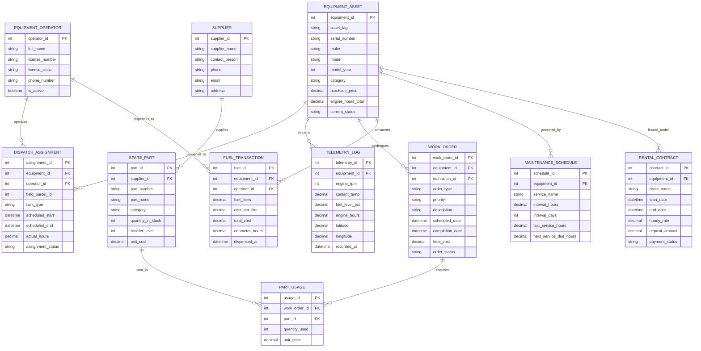

# Conceptual ERD — Agricultural Equipment Management System

## Mermaid Code

## Entity Description Table | Bang mo ta Entity

| # | Entity Name | Vietnamese Name | Description | Key Attributes | Main Relationships |
|---|-------------|-----------------|-------------|----------------|-------------------|
| 1 | EQUIPMENT_ASSET | Thiết Bị / Máy Móc | Stores master profile, technical specs, engine hours, category, valuation, and current status of machinery | equipment_id, asset_tag, serial_number, make, model, engine_hours_total, current_status | Has many DISPATCH_ASSIGNMENT, TELEMETRY_LOG, WORK_ORDER, FUEL_TRANSACTION |
| 2 | EQUIPMENT_OPERATOR | Người Điều Khiển | Stores driver profiles, heavy equipment operator licenses, certifications, and active status | operator_id, full_name, license_number, license_class, phone_number | Operates DISPATCH_ASSIGNMENT, dispenses to FUEL_TRANSACTION |
| 3 | DISPATCH_ASSIGNMENT | Lịch Phân Công Vận Hành | Tracks operational scheduling, field parcel assignments, driver tasks, scheduled dates, and actual hours | assignment_id, equipment_id, operator_id, field_parcel_id, task_type, assignment_status | Belongs to EQUIPMENT_ASSET and EQUIPMENT_OPERATOR |
| 4 | TELEMETRY_LOG | Nhật Ký Telemetry CAN-Bus | High-frequency telemetry storing CAN-bus engine RPM, coolant temperature, fuel rate, and GPS location | telemetry_id, equipment_id, engine_rpm, coolant_temp, fuel_level_pct, recorded_at | Belongs to EQUIPMENT_ASSET |
| 5 | WORK_ORDER | Lệnh Bảo Trì & Sửa Chữa | Captures preventive maintenance and corrective repair work orders, labor hours, technician IDs, and costs | work_order_id, equipment_id, technician_id, order_type, total_cost, order_status | Belongs to EQUIPMENT_ASSET, requires PART_USAGE |
| 6 | SPARE_PART | Phụ Tùng Thay Thế | Inventory catalog of spare parts, filters, belts, oil types, stock quantities, and reorder levels | part_id, supplier_id, part_number, part_name, quantity_in_stock, reorder_level | Supplied by SUPPLIER, used in PART_USAGE |
| 7 | PART_USAGE | Chi Tiết Sử Dụng Phụ Tùng | Records specific spare parts and quantities consumed during the execution of a repair work order | usage_id, work_order_id, part_id, quantity_used, unit_price | Belongs to WORK_ORDER and SPARE_PART |
| 8 | FUEL_TRANSACTION | Giao Dịch Cấp Nhiên Liệu | Records diesel refuel transactions, liters dispensed, cost per liter, and engine hour readings | fuel_id, equipment_id, operator_id, fuel_liters, total_cost, dispensed_at | Belongs to EQUIPMENT_ASSET and EQUIPMENT_OPERATOR |
| 9 | MAINTENANCE_SCHEDULE | Lịch Bảo Trì Định Kỳ | Configures preventive maintenance rules (e.g., 250h oil change) and tracks next due engine hours | schedule_id, equipment_id, service_name, interval_hours, next_service_due_hours | Governs EQUIPMENT_ASSET |
| 10 | RENTAL_CONTRACT | Hợp Đồng Cho Thuê Máy | Manages external machinery rental contracts, client details, billing rates, deposits, and payment status | contract_id, equipment_id, client_name, hourly_rate, deposit_amount, payment_status | Leases EQUIPMENT_ASSET |
| 11 | SUPPLIER | Nhà Cung Cấp Phụ Tùng | Stores OEM parts suppliers, dealer contacts, phone numbers, and address details | supplier_id, supplier_name, contact_person, phone, email | Supplies SPARE_PART |

## Relationship Description | Mo ta Quan he

| # | From Entity | Cardinality | To Entity | Relationship Label | Business Explanation |
|---|-------------|-------------|-----------|-------------------|----------------------|
| 1 | EQUIPMENT_ASSET | one-to-many | DISPATCH_ASSIGNMENT | assigned_to | Equipment asset can be assigned to multiple field operation tasks or rental bookings over time |
| 2 | EQUIPMENT_OPERATOR | one-to-many | DISPATCH_ASSIGNMENT | operates | A certified driver operator can be assigned to operate multiple machinery dispatch tasks |
| 3 | EQUIPMENT_ASSET | one-to-many | TELEMETRY_LOG | streams | An equipment asset streams thousands of real-time CAN-bus engine and GPS telemetry log records |
| 4 | EQUIPMENT_ASSET | one-to-many | WORK_ORDER | undergoes | An equipment asset undergoes multiple preventive maintenance and repair work orders over its lifecycle |
| 5 | EQUIPMENT_ASSET | one-to-many | FUEL_TRANSACTION | consumes | An equipment asset consumes fuel across multiple logged refuel transactions |
| 6 | EQUIPMENT_OPERATOR | one-to-many | FUEL_TRANSACTION | dispenses_to | A driver operator receives fuel across multiple authorized refueling transactions |
| 7 | EQUIPMENT_ASSET | one-to-many | MAINTENANCE_SCHEDULE | governed_by | Equipment asset is governed by defined preventive maintenance service schedules (e.g., 250h, 500h) |
| 8 | EQUIPMENT_ASSET | one-to-many | RENTAL_CONTRACT | leased_under | An equipment asset can be leased to third parties under multiple rental contracts over time |
| 9 | WORK_ORDER | one-to-many | PART_USAGE | requires | A maintenance work order can require multiple spare parts and materials during repair execution |
| 10 | SPARE_PART | one-to-many | PART_USAGE | used_in | A spare part item in inventory can be used across multiple maintenance work order repairs |
| 11 | SUPPLIER | one-to-many | SPARE_PART | supplies | An OEM spare parts supplier supplies multiple part catalog items to the farm inventory |
