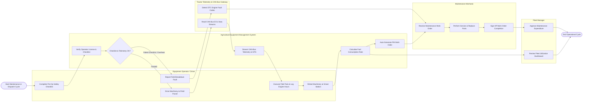

# Swimlane Diagram — Agricultural Equipment Management System

## Mermaid Code

## Flow Description | Mo ta luong

| Lane | Actor | Role in Flow |
|------|-------|-------------|
| 1 | Equipment Operator / Driver | Conducts mandatory digital pre-operation safety checklists, operates machinery in assigned field parcels, monitors dashboard warnings, refuels at smart dispensers, and reports field breakdown issues |
| 2 | Agricultural Equipment Management System | Validates driver credentials and safety checklists, ingests real-time CAN-bus telemetry, tracks GPS field parcel boundaries, calculates fuel efficiency ($L/\text{ha}$), and auto-generates preventive maintenance work orders |
| 3 | Tractor Telemetry & CAN-Bus Gateway | Reads onboard ECU data via ISOBUS / J1939 protocols, monitors engine RPM, coolant temperature, and fuel rate, and broadcasts Diagnostic Trouble Codes (DTC) upon sensor anomalies |
| 4 | Maintenance Mechanic | Receives scheduled PM work orders or breakdown alerts, conducts physical servicing, replaces filters and spare parts, logs labor hours, and clears fault codes to restore equipment to `AVAILABLE` status |
| 5 | Fleet Manager | Oversees fleet dispatch assignments, monitors real-time fleet utilization dashboards, approves major maintenance expenditures, and analyzes total cost of ownership |
