# Action Tree — Agricultural Equipment Management System

## Mermaid Code

```mermaid
graph TD
    Root["Agricultural Equipment Management System"]

    Root --> M1["Equipment Asset & Fleet Registry"]
    Root --> M2["Dispatch & Field Task Operations"]
    Root --> M3["Telemetry, GPS & Fuel Monitoring"]
    Root --> M4["Preventive Maintenance & Repair Work Orders"]
    Root --> M5["Spare Parts Inventory & Procurement"]
    Root --> M6["Equipment Rental & Cost Accounting"]
    Root --> M7["System Configuration & Fleet Analytics"]

    M1 --> A11["Register Machinery Asset Master Record"]
    M1 --> A12["Link Compatible Implements & Attachments"]
    M1 --> A13["Track Asset Depreciation & Book Value"]
    M1 --> A14["Manage Equipment Warranty & Insurance Policies"]

    M2 --> A21["Schedule Equipment Field Task Assignments"]
    M2 --> A22["Assign Qualified Operator to Machinery"]
    M2 --> A23["Verify Pre-Operation Safety Checklist"]
    M2 --> A24["Track Real-Time Dispatch Status"]

    M3 --> A31["Stream CAN-Bus Engine RPM & Temperature"]
    M3 --> A32["Track Real-Time GPS & Field Geofences"]
    M3 --> A33["Log Smart Fuel Dispensing Transactions"]
    M3 --> A34["Calculate Fuel Consumption Rate per Hectare"]

    M4 --> A41["Configure Hour-Based Maintenance Schedules"]
    M4 --> A42["Auto-Generate Preventive Work Orders"]
    M4 --> A43["Log Mechanic Repair & Diagnostic Notes"]
    M4 --> A44["Handle Field Breakdown Emergency Dispatch"]

    M5 --> A51["Manage Spare Parts Inventory Stock"]
    M5 --> A52["Deduct Replaced Parts from Work Orders"]
    M5 --> A53["Auto-Generate Supplier Purchase Orders"]
    M5 --> A54["Track OEM Parts Delivery Status"]

    M6 --> A61["Create Third-Party Machinery Rental Contracts"]
    M6 --> A62["Calculate Hourly & Daily Rental Rates"]
    M6 --> A63["Compute Total Operating Cost per Hour"]
    M6 --> A64["Generate Equipment Invoices & Receipts"]

    M7 --> A71["Configure Telemetry Overheat Alert Limits"]
    M7 --> A72["Generate Fleet Utilization Dashboards"]
    M7 --> A73["Track Engine Idle vs Operating Efficiency"]
    M7 --> A74["Manage Operator Licenses & System Roles"]
```

## Module Description | Mo ta Module

| # | Module | Description | Actions |
|---|--------|-------------|---------|
| 1 | Equipment Asset & Fleet Registry | Manages machinery asset master records, serial/VIN numbers, implement compatibility, warranty coverage, asset depreciation, and insurance policies | Register Machinery Asset Master Record, Link Compatible Implements & Attachments, Track Asset Depreciation & Book Value, Manage Equipment Warranty & Insurance Policies |
| 2 | Dispatch & Field Task Operations | Handles operational dispatch scheduling, qualified driver assignments, pre-operation digital safety checklist verification, and task progress tracking | Schedule Equipment Field Task Assignments, Assign Qualified Operator to Machinery, Verify Pre-Operation Safety Checklist, Track Real-Time Dispatch Status |
| 3 | Telemetry, GPS & Fuel Monitoring | Streams real-time CAN-bus engine metrics, tracks GPS vehicle position and geofences, logs smart dispenser refuel transactions, and computes fuel efficiency ($L/\text{ha}$) | Stream CAN-Bus Engine RPM & Temperature, Track Real-Time GPS & Field Geofences, Log Smart Fuel Dispensing Transactions, Calculate Fuel Consumption Rate per Hectare |
| 4 | Preventive Maintenance & Repair Work Orders | Sets up 250h/500h maintenance service schedules, auto-generates PM work orders, tracks mechanic labor hours, records repairs, and handles field breakdown emergencies | Configure Hour-Based Maintenance Schedules, Auto-Generate Preventive Work Orders, Log Mechanic Repair & Diagnostic Notes, Handle Field Breakdown Emergency Dispatch |
| 5 | Spare Parts Inventory & Procurement | Tracks spare parts, filters, and lubricants inventory levels, deducts used items from work orders, and auto-generates supplier purchase orders when reorder points are reached | Manage Spare Parts Inventory Stock, Deduct Replaced Parts from Work Orders, Auto-Generate Supplier Purchase Orders, Track OEM Parts Delivery Status |
| 6 | Equipment Rental & Cost Accounting | Manages external machinery rental contracts, calculates hourly/daily billing rates, computes total cost of ownership (TCO) per hour, and generates billing invoices | Create Third-Party Machinery Rental Contracts, Calculate Hourly & Daily Rental Rates, Compute Total Operating Cost per Hour, Generate Equipment Invoices & Receipts |
| 7 | System Configuration & Fleet Analytics | Configures CAN-bus alert threshold parameters, generates seasonal fleet utilization reports, analyzes engine idle efficiency, and manages driver license certifications | Configure Telemetry Overheat Alert Limits, Generate Fleet Utilization Dashboards, Track Engine Idle vs Operating Efficiency, Manage Operator Licenses & System Roles |
