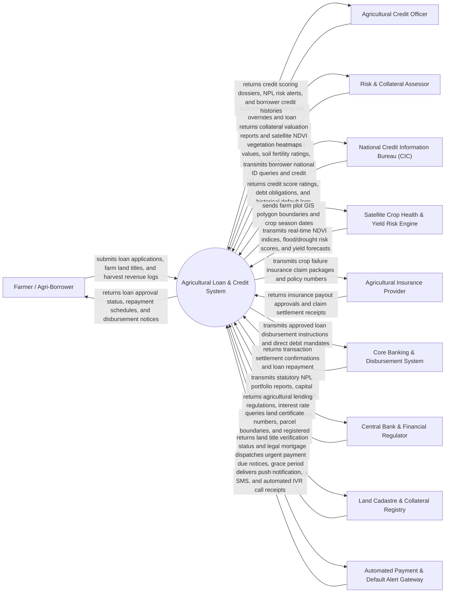

# Context Diagram — Agricultural Loan & Credit System

## Mermaid Code

## Actor & Interaction Table | Bang Actor & Tuong tac

| # | Actor | Actor Type | Data Sent TO System | Data Received FROM System | Notes |
|---|-------|------------|---------------------|---------------------------|-------|
| 1 | Farmer / Agri-Borrower | Primary | Loan applications, land certificate photos, crop planting history, bank account details | Loan approval status, seasonal repayment schedules, disbursement notices, debt statements | Smallholder farmer, cooperative manager, or agri-business owner seeking agricultural credit |
| 2 | Agricultural Credit Officer / Underwriter | Primary | Manual underwriting overrides, loan approval/rejection decisions, restructuring approvals | Automated credit scoring dossiers, NPL risk alerts, portfolio performance metrics | Bank credit officer evaluating agricultural creditworthiness and managing loan portfolios |
| 3 | Risk & Collateral Assessor | Primary | On-site land appraisal values, soil fertility scores, crop yield estimates, collateral photos | Collateral valuation scorecards, satellite NDVI vegetation heatmaps, historical flood risks | Certified land appraiser evaluating farmland value and agricultural yield risks |
| 4 | National Credit Information Bureau (CIC) | Supporting System | Credit score ratings ($300-850$), active debt balances, past 5-year default history, inquiry logs | Borrower national ID numbers, tax IDs, credit inquiry authorization payloads | Central credit registry (e.g., Vietnam Credit Information Center - CIC / Experian) |
| 5 | Satellite Crop Health & Yield Risk Engine | Supporting System | Multi-temporal NDVI vegetation indices, Synthetic Aperture Radar (SAR) soil moisture, flood/drought risk | Farm parcel GIS polygon coordinates, crop species, planting dates, harvest windows | Remote sensing AI service assessing real-time crop health and predicting harvest yield risks |
| 6 | Agricultural Insurance Provider | Supporting System | Crop insurance policy approvals, index-based insurance payout settlements, claim status | Insurance claim packages, satellite crop loss evidence, damaged plot coordinates | Insurance company providing parametric or yield-based agricultural crop insurance |
| 7 | Core Banking & Disbursement System | Supporting System | Payment settlement confirmations, direct debit repayment receipts, account balance checks | Approved loan principal disbursement orders, automated repayment direct debit mandates | Central core banking system executing electronic fund transfers and account debits |
| 8 | Central Bank & Financial Regulator | Regulatory System | Statutory lending regulations, priority sector quotas, maximum interest rate caps, NPL limits | Statutory agricultural credit portfolio disclosures, NPL ratios, capital adequacy reports | Central bank overseeing agricultural credit institutions and financial inclusion policies |
| 9 | Land Cadastre & Collateral Registry Portal | Supporting System | Official land ownership verification, parcel acreage, registered mortgage encumbrances | Land certificate numbers, parcel GIS shapefiles, mortgage lien registration requests | Government land registry verifying land rights (Red Books / Land Certificates) and registering liens |
| 10 | Automated Payment & Default Alert Gateway | Supporting System | SMS delivery receipts, automated IVR call logs, push alert receipts | Payment installment due reminders, grace period notifications, default warning notices | Multi-channel communication service sending payment reminders and debt collection alerts |

## System Boundary Description | Mo ta Pham vi He thong

The **Agricultural Loan & Credit System** is a specialized financial technology platform designed to automate agricultural credit scoring, streamline loan application processing, assess farmland collateral using satellite remote sensing, manage flexible crop-cycle aligned repayment schedules, integrate agricultural insurance, and ensure regulatory compliance.

The **system boundary** encompasses digital loan application submission, credit scoring engines (fusing traditional financial data with satellite crop yield risk), farmland GIS collateral appraisal, automated loan approval workflows, seasonal repayment schedule generation (balloon payments aligned with harvest months), loan restructuring, and Central Bank NPL reporting.

**External to the system boundary** are physical cash currency printing, physical plant crop growth in fields, legal court foreclosures of mortgaged land, physical weather catastrophes, and core banking interbank clearing networks. System interfaces operate via secure HTTPS REST APIs, ISO 20022 banking messages, OGC spatial GIS services, and encrypted credit bureau query protocols.
