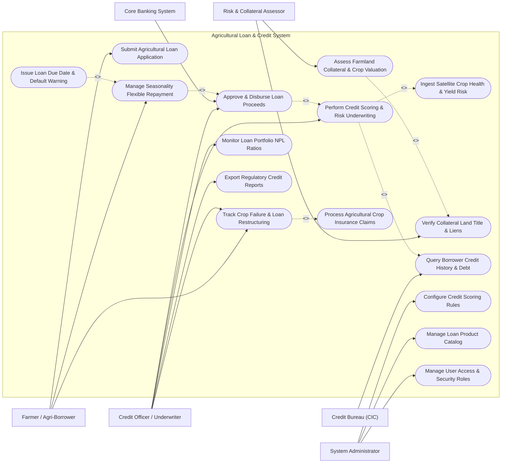

# Use Case Diagram — Agricultural Loan & Credit System

## Mermaid Code

## Actor Table | Bang Actor

| # | Actor | Actor Type | Role Description | Related Use Cases |
|---|-------|------------|------------------|-------------------|
| 1 | Farmer / Agri-Borrower | Primary | Agricultural producer submitting loan applications, viewing crop repayment schedules, and applying for restructuring | UC01, UC06, UC07 |
| 2 | Credit Officer / Underwriter | Primary | Bank credit specialist underwriting agricultural loans, evaluating satellite risk scores, and managing portfolios | UC02, UC05, UC07, UC09, UC13 |
| 3 | Risk & Collateral Assessor | Primary | Certified land and crop appraiser verifying farmland land titles, assessing soil quality, and calculating collateral LTV | UC03, UC11 |
| 4 | System Administrator | Primary | Technical admin managing credit scoring rule engines, loan product catalogs, and user access security | UC14, UC15, UC16 |
| 5 | Credit Bureau (CIC) | Secondary / System | National credit information bureau providing historical credit scores, debt obligations, and default records | UC12 |
| 6 | Core Banking System | Secondary / System | Central banking engine executing automated loan principal disbursements and direct debit repayments | UC05 |

## Use Case Table | Bang Use Case

| # | UC ID | Use Case Name | Primary Actor | Secondary Actor | Description | Priority |
|---|-------|---------------|---------------|-----------------|-------------|----------|
| 1 | UC01 | Submit Agricultural Loan Application | Farmer | None | Submits digital loan application, farm GIS plot polygons, crop types, and requested credit amount | High |
| 2 | UC02 | Perform Credit Scoring & Risk Underwriting | Credit Officer | Credit Bureau | Computes hybrid credit score combining traditional financial history with satellite crop yield risk scores | High |
| 3 | UC03 | Assess Farmland Collateral & Crop Valuation | Risk Assessor | System | Evaluates farmland market value ($USD/ha$), crop harvest value, and calculates Loan-to-Value (LTV) ratios | High |
| 4 | UC04 | Ingest Satellite Crop Health & Yield Risk | System | Satellite Engine | Ingests multi-temporal NDVI vegetation indices, flood/drought risk scores, and projected crop yields | High |
| 5 | UC05 | Approve & Disburse Loan Proceeds | Credit Officer | Core Banking | Finalizes underwriting approvals and triggers automated principal disbursement via core banking APIs | High |
| 6 | UC06 | Manage Seasonality Flexible Repayment | Farmer | System | Generates flexible repayment schedules aligned with harvest cycles (bullet payments post-harvest) | High |
| 7 | UC07 | Track Crop Failure & Loan Restructuring | Credit Officer | Farmer | Restructures loan tenures or extends grace periods upon verified natural disaster or crop failure events | High |
| 8 | UC08 | Process Agricultural Crop Insurance Claims | Credit Officer | Insurance Provider | Submits satellite-verified crop damage evidence to insurance providers for loan offset payouts | Medium |
| 9 | UC09 | Monitor Loan Portfolio NPL Ratios | Credit Officer | System | Monitors Non-Performing Loan (NPL) ratios, early warning indicator triggers, and default risk trends | High |
| 10 | UC10 | Issue Loan Due Date & Default Warning | System | Notification Gateway | Dispatches automated SMS/IVR notices for upcoming installment due dates and grace period breaches | High |
| 11 | UC11 | Verify Collateral Land Title & Liens | Risk Assessor | Land Cadastre | Validates land certificate numbers, parcel acreage, ownership rights, and registers mortgage liens | High |
| 12 | UC12 | Query Borrower Credit History & Debt | Credit Officer | Credit Bureau | Fetches credit bureau (CIC) credit ratings, active loan balances, and past repayment delinquency logs | High |
| 13 | UC13 | Export Regulatory Credit Reports | Credit Officer | Central Bank | Generates statutory Central Bank disclosures: agricultural credit volume, NPL ratios, and capital reserves | High |
| 14 | UC14 | Configure Credit Scoring Rules | System Admin | System | Configures weightings for satellite NDVI score, CIC credit score, LTV limits, and interest rate tiers | Medium |
| 15 | UC15 | Manage Loan Product Catalog | System Admin | None | Configures loan products (Short-term Crop Input Loan, Equipment Lease, Livestock Farm Expansion) | Medium |
| 16 | UC16 | Manage User Access & Security Roles | System Admin | None | Configures user accounts, roles (Farmer, Underwriter, Assessor, Admin), and security permissions | Low |

## Use Case Specification | Dac ta Use Case

---

### UC02 — Perform Credit Scoring & Risk Underwriting

| Field | Detail |
|-------|--------|
| **UC ID** | UC02 |
| **Use Case Name** | Perform Credit Scoring & Risk Underwriting |
| **Actor(s)** | Primary: Agricultural Credit Officer / Underwriter   Secondary: National Credit Information Bureau (CIC) |
| **Description** | Computes a hybrid credit score ($300-850$) by combining traditional financial credit history from CIC bureau with satellite-derived crop yield risk metrics (NDVI, historical flood/drought risk), generating automated underwriting recommendations. |
| **Precondition** | 1. Borrower has submitted a complete loan application (UC01).   2. CIC Credit Bureau API and Satellite Crop Risk Engine are connected. |
| **Main Flow** | 1. Underwriter opens pending loan application in the Underwriting Dashboard.   2. System automatically queries CIC Credit Bureau (UC12) using borrower's National ID.   3. System receives CIC credit rating (e.g., $680$), active debt obligations, and historical delinquency logs.   4. System retrieves Satellite Crop Health & Yield Risk metrics (UC04) for borrower's farm parcel.   5. System calculates **Hybrid Agricultural Credit Score ($S_{hybrid}$)** using weighted scoring algorithm:   &nbsp;&nbsp;&nbsp;&nbsp;$$S_{hybrid} = 0.40(S_{CIC}) + 0.35(S_{Satellite\_Yield}) + 0.15(S_{LTV}) + 0.10(S_{Farmer\_Experience})$$   6. System evaluates calculated score against risk tier boundaries:   &nbsp;&nbsp;&nbsp;&nbsp;a. **Score $\ge 720$**: `LOW_RISK` $\rightarrow$ Automated Approval Recommendation (Base Interest Rate $+2.5\%$).   &nbsp;&nbsp;&nbsp;&nbsp;b. **Score $600 - 719$**: `MODERATE_RISK` $\rightarrow$ Manual Underwriter Review Required (Interest Rate $+4.0\%$).   &nbsp;&nbsp;&nbsp;&nbsp;c. **Score $< 600$**: `HIGH_RISK` $\rightarrow$ Automated Rejection Recommendation.   7. System displays Underwriting Dossier summarizing debt service coverage ratio (DSCR), projected harvest revenue, and risk tier.   8. Underwriter reviews dossier, validates details, and clicks "Approve Underwriting" or "Reject Application". |
| **Alternative Flow** | **AF1** — First-Time Farmer Scoring (No Financial History): If borrower lacks CIC credit history ($S_{CIC} = \text{null}$), system applies alternative scoring model weighting satellite yield history at $60\%$ and farming experience at $25\%$. |
| **Exception Flow** | **EX1** — Active CIC Default Fraud Flag: CIC bureau returns active severe default status (`CIC_BAD_DEBT_GROUP_5`); system immediately halts underwriting and sets application status to `REJECTED_CREDIT_DEFAULT`. |
| **Postcondition** | Hybrid agricultural credit score calculated, risk tier assigned, and underwriting decision logged in database. |
| **Business Rule** | **BR1**: Debt Service Coverage Ratio ($\text{DSCR} = \frac{\text{Net Harvest Revenue}}{\text{Annual Debt Service}}$) must equal or exceed $1.25$ for loan approval. |

---

### UC03 — Assess Farmland Collateral & Crop Valuation

| Field | Detail |
|-------|--------|
| **UC ID** | UC03 |
| **Use Case Name** | Assess Farmland Collateral & Crop Valuation |
| **Actor(s)** | Primary: Risk & Collateral Assessor   Secondary: System |
| **Description** | Evaluates the market value of farmland collateral ($USD/ha$), verifies land certificate ownership (Red Book), assesses standing crop commercial value, and calculates maximum Loan-to-Value (LTV) credit limits. |
| **Precondition** | 1. Borrower uploaded farmland land certificate number and GIS plot boundary polygon.   2. Land Cadastre Registry integration is active (UC11). |
| **Main Flow** | 1. Assessor opens "Collateral Valuation Workspace" for target loan application.   2. System queries Land Cadastre Registry (UC11) to verify land certificate authenticity, acreage, and existing mortgage encumbrances.   3. Assessor reviews verified land parcel GIS polygon, soil texture classification, and road access metrics.   4. Assessor inputs comparable market transactions ($USD/ha$) for adjacent agricultural land in the district.   5. System calculates **Assessed Farmland Collateral Value ($V_{land}$)**:   &nbsp;&nbsp;&nbsp;&nbsp;$$V_{land} = \text{Acreage (ha)} \times \text{Market Rate (USD/ha)} \times \text{Location Factor}$$   6. System calculates projected **Standing Crop Commercial Value ($V_{crop}$)** based on expected harvest yield ($\text{tons/ha}$) and current market commodity prices ($USD/\text{ton}$).   7. System computes maximum allowable loan principal using regulatory **Loan-to-Value (LTV)** cap ($70\%$ for titled land):   &nbsp;&nbsp;&nbsp;&nbsp;$$\text{Max Loan Amount} = 0.70 \times V_{land} + 0.30 \times V_{crop}$$   8. Assessor signs collateral valuation report and registers pending mortgage lien tag in system. |
| **Alternative Flow** | **AF1** — Leasehold Farmland Valuation: If land is leased (no Red Book title), collateral valuation is based strictly on standing crop value and crop insurance policy assignment (max LTV $40\%$). |
| **Exception Flow** | **EX1** — Pre-existing Mortgage Encumbrance Found: Land Cadastre returns active primary mortgage lien held by another bank; system flags `PRIOR_LIEN_EXISTS` and caps allowable LTV to net remaining equity. |
| **Postcondition** | Farmland collateral valuation established, LTV limit calculated, and collateral appraisal dossier attached to loan file. |
| **Business Rule** | **BR1**: Total approved loan principal must not exceed $70\%$ of the appraised market value of titled farmland collateral. |

---

### UC05 — Approve & Disburse Loan Proceeds

| Field | Detail |
|-------|--------|
| **UC ID** | UC05 |
| **Use Case Name** | Approve & Disburse Loan Proceeds |
| **Actor(s)** | Primary: Agricultural Credit Officer / Underwriter   Secondary: Core Banking System |
| **Description** | Finalizes credit approval, generates digital loan contract agreements, collects digital signatures, and executes automated principal disbursement to borrower bank account via Core Banking APIs. |
| **Precondition** | 1. Credit scoring underwriting (UC02) and collateral valuation (UC03) are approved.   2. Borrower has agreed to loan terms, interest rates, and repayment schedule. |
| **Main Flow** | 1. Credit Officer opens approved loan dossier and clicks "Generate Loan Contract".   2. System compiles formal digital Loan Contract detailing principal amount ($USD$), annual interest rate ($\%$), tenure ($months$), seasonal repayment schedule (UC06), and collateral mortgage terms.   3. System sends contract link to Farmer's mobile app for electronic signature (e-KYC & digital OTP verification).   4. Farmer signs loan contract via mobile app using OTP authentication.   5. Credit Officer conducts final verification and clicks "Execute Disbursement".   6. System generates API disbursement payload: Borrower Bank Account Number, Clearing House Code, Disbursed Amount ($USD$), and Loan Contract Reference.   7. System transmits disbursement payload to Core Banking System via secure REST API.   8. Core Banking System transfers funds to borrower's account and returns `DISBURSEMENT_SUCCESS` settlement receipt.   9. System updates loan contract status to `DISBURSED_ACTIVE` and activates interest accrual engine. |
| **Alternative Flow** | **AF1** — Tranche-Based Input Disbursement: Loan is disbursed in 3 seasonal tranches (Tranche 1: Seeds & Fertilizer at planting, Tranche 2: Pesticides at mid-season, Tranche 3: Harvest labor). |
| **Exception Flow** | **EX1** — Core Banking API Settlement Failure: Core banking returns transaction error (invalid account number); system holds loan status as `PENDING_DISBURSEMENT_FIX` and alerts credit officer. |
| **Postcondition** | Loan funds disbursed to borrower account, active loan contract created, and repayment schedule activated. |
| **Business Rule** | **BR1**: Loan disbursement is strictly prohibited until collateral mortgage lien registration is confirmed by the land registry. |

---

### UC06 — Manage Seasonality Flexible Repayment

| Field | Detail |
|-------|--------|
| **UC ID** | UC06 |
| **Use Case Name** | Manage Seasonality Flexible Repayment |
| **Actor(s)** | Primary: Farmer / Agri-Borrower   Secondary: System |
| **Description** | Generates flexible, crop-cycle aligned repayment schedules that allow monthly interest-only payments during crop growth months and principal bullet repayments immediately following harvest months. |
| **Precondition** | 1. Loan contract is active and disbursed (UC05).   2. Crop planting date, growth duration (e.g., 4 months for rice, 6 months for corn), and harvest window are recorded. |
| **Main Flow** | 1. System retrieves crop cycle parameters for approved loan: Planting Month (e.g., May), Harvest Month (e.g., September), Total Loan Principal ($10,000\text{ USD}$), Interest Rate ($12\% \text{ per annum}$).   2. System generates **Crop-Cycle Aligned Repayment Schedule**:   &nbsp;&nbsp;&nbsp;&nbsp;a. **Months 1 to 3** (Growth Period): Interest-only monthly installments ($100\text{ USD/month}$).   &nbsp;&nbsp;&nbsp;&nbsp;b. **Month 4** (Harvest Month): Principal bullet installment ($10,000\text{ USD}$) $+$ final monthly interest ($100\text{ USD}$).   3. Farmer views interactive repayment calendar on mobile app, displaying installment due dates and amounts.   4. As installment due dates approach, system dispatches automated payment reminders (UC10).   5. On due date, system sends direct debit instruction to Core Banking System to execute electronic account payment.   6. System ingests payment settlement confirmation, applies funds to interest and principal balances, and updates loan statement. |
| **Alternative Flow** | **AF1** — Multi-Harvest Perennial Crop Schedule: For perennial crops (coffee, rubber, fruit trees), system configures bi-annual repayment installments aligned with peak harvest seasons. |
| **Exception Flow** | **EX1** — Harvest Delay Extension Request: Farmer submits request for 30-day principal repayment extension due to rainy season harvest delays; system evaluates satellite crop status and grants grace period. |
| **Postcondition** | Seasonal repayment schedule generated, monthly installments processed, and loan principal balance reduced. |
| **Business Rule** | **BR1**: Principal repayment due dates must align within 30 days post-harvest to ensure borrower liquidity from crop sales. |

---

### UC07 — Track Crop Failure & Loan Restructuring

| Field | Detail |
|-------|--------|
| **UC ID** | UC07 |
| **Use Case Name** | Track Crop Failure & Loan Restructuring |
| **Actor(s)** | Primary: Agricultural Credit Officer / Underwriter   Secondary: Farmer / Agri-Borrower |
| **Description** | Evaluates crop failure events caused by natural disasters (typhoon, drought, flood) using satellite damage verification, initiates loan restructuring (tenure extension, interest rate reduction), and processes crop insurance claim offsets. |
| **Precondition** | 1. Active loan contract is in default or at risk of default due to crop loss.   2. Official natural disaster declaration or satellite crop damage report is logged. |
| **Main Flow** | 1. Farmer or Credit Officer submits "Loan Restructuring Application" citing severe crop failure event.   2. System retrieves Satellite Crop Health & Yield Risk feed (UC04) for borrower's farm parcel, comparing pre-disaster vs post-disaster NDVI vegetation loss ($>60\%$ vegetation drop).   3. System verifies natural disaster declaration (e.g., Government Typhoon Flood Declaration).   4. Credit Officer verifies crop loss severity level (`MODERATE_LOSS` 30-50%, `TOTAL_LOSS` >50%).   5. If crop is insured, System initiates Agricultural Crop Insurance Claim (UC08) to apply insurance payout directly against outstanding loan principal.   6. For remaining unpaid loan balance, Credit Officer configures **Restructuring Terms**:   &nbsp;&nbsp;&nbsp;&nbsp;a. Extend loan tenure by 12 additional months to cover next crop season.   &nbsp;&nbsp;&nbsp;&nbsp;b. Grant 6-month principal and interest grace period.   &nbsp;&nbsp;&nbsp;&nbsp;c. Freeze penalty interest fees.   7. Credit Officer submits restructuring plan for committee approval.   8. Upon approval, System updates loan contract status to `RESTRUCTURED_ACTIVE` and generates revised repayment schedule. |
| **Alternative Flow** | **AF1** — Re-planting Capital Top-Up Loan: System approves an emergency micro-credit top-up loan ($1,000\text{ USD}$) to allow farmer to purchase seeds and fertilizer to re-plant immediately. |
| **Exception Flow** | **EX1** — Unsubstantiated Crop Failure Claim: Satellite NDVI shows normal healthy vegetation ($NDVI > 0.75$) and no disaster declared; system flags potential moral hazard fraud and rejects restructuring. |
| **Postcondition** | Loan contract restructured, tenure extended, penalty fees frozen, and revised repayment schedule activated. |
| **Business Rule** | **BR1**: Restructuring due to natural disaster must not cause the loan to be classified as Non-Performing (NPL) if supported by verified satellite damage evidence. |
