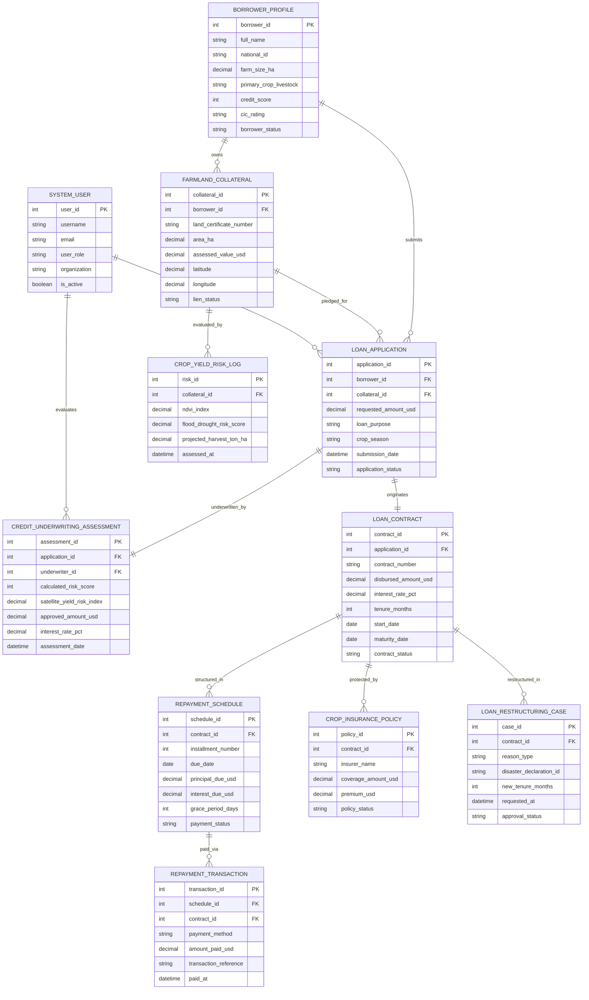

# Conceptual ERD — Agricultural Loan & Credit System

## Mermaid Code

## Entity Description Table | Bang mo ta Entity

| # | Entity Name | Vietnamese Name | Description | Key Attributes | Main Relationships |
|---|-------------|-----------------|-------------|----------------|-------------------|
| 1 | BORROWER_PROFILE | Hồ Sơ Nông Dân Vay Vốn | Master borrower profile: national ID, farm acreage, crop/livestock type, credit score, and CIC bureau rating | borrower_id, full_name, national_id, farm_size_ha, credit_score, cic_rating, borrower_status | Owns FARMLAND_COLLATERAL, submits LOAN_APPLICATION |
| 2 | FARMLAND_COLLATERAL | Tài Sản Thế Chấp Đất Nông Nghiệp | Farmland collateral master: Red Book certificate number, parcel area ($ha$), appraised market value ($USD$), and lien status | collateral_id, borrower_id, land_certificate_number, area_ha, assessed_value_usd, lien_status | Owned by BORROWER_PROFILE, pledged for LOAN_APPLICATION |
| 3 | LOAN_APPLICATION | Đơn Xin Vay Vốn Nông Nghiệp | Loan application details: requested amount ($USD$), loan purpose (inputs/equipment), crop season, and status | application_id, borrower_id, collateral_id, requested_amount_usd, loan_purpose, application_status | Submitted by BORROWER, underwritten by ASSESSMENT, originates CONTRACT |
| 4 | CREDIT_UNDERWRITING_ASSESSMENT | Báo Cáo Thẩm Định Tín Dụng | Underwriting record: calculated hybrid credit score, satellite crop yield index, approved amount, and interest rate | assessment_id, application_id, underwriter_id, calculated_risk_score, approved_amount_usd, assessment_date | Underwrites LOAN_APPLICATION, evaluated by SYSTEM_USER |
| 5 | LOAN_CONTRACT | Hợp Đồng Vay Vốn Nông Nghiệp | Formally executed loan contract: contract number, disbursed amount, interest rate ($\%$), tenure ($months$), and maturity | contract_id, application_id, contract_number, disbursed_amount_usd, tenure_months, contract_status | Originated from LOAN_APPLICATION, structured in REPAYMENT_SCHEDULE |
| 6 | REPAYMENT_SCHEDULE | Lịch Trả Nợ Theo Mùa Vụ | Seasonal repayment installment schedule: due date, principal due ($USD$), interest due, grace period, and status | schedule_id, contract_id, installment_number, due_date, principal_due_usd, interest_due_usd, payment_status | Structured from LOAN_CONTRACT, paid via REPAYMENT_TRANSACTION |
| 7 | REPAYMENT_TRANSACTION | Giao Dịch Thanh Toán Nợ | Electronic repayment transactions: payment method (Direct Debit/App), amount paid ($USD$), transaction reference, timestamp | transaction_id, schedule_id, contract_id, payment_method, amount_paid_usd, paid_at | Pays REPAYMENT_SCHEDULE |
| 8 | CROP_YIELD_RISK_LOG | Nhật Ký Rủi Ro Năng Suất Cây Trồng | Satellite remote sensing telemetry: NDVI vegetation index, flood/drought risk score, and projected harvest yield ($\text{ton/ha}$) | risk_id, collateral_id, ndvi_index, flood_drought_risk_score, projected_harvest_ton_ha, assessed_at | Evaluates FARMLAND_COLLATERAL |
| 9 | CROP_INSURANCE_POLICY | Hợp Đồng Bảo Hiểm Cây Trồng | Agricultural insurance policy details: insurer name, coverage amount ($USD$), premium, and claim payout status | policy_id, contract_id, insurer_name, coverage_amount_usd, premium_usd, policy_status | Protects LOAN_CONTRACT |
| 10 | LOAN_RESTRUCTURING_CASE | Ca Cơ Cấu Lại Thời Han Trả Nợ | Manages loan restructuring requests due to crop failure/natural disaster, extended tenure, grace period, and status | case_id, contract_id, reason_type, disaster_declaration_id, new_tenure_months, approval_status | Restructures LOAN_CONTRACT |
| 11 | SYSTEM_USER | Người Dùng Hệ Thống | User accounts, financial roles (Credit Officer, Underwriter, Assessor, Admin), organizations, and security rights | user_id, username, user_role, organization, is_active | Evaluates ASSESSMENT, manages LOAN_APPLICATION |

## Relationship Description | Mo ta Quan he

| # | From Entity | Cardinality | To Entity | Relationship Label | Business Explanation |
|---|-------------|-------------|-----------|-------------------|----------------------|
| 1 | BORROWER_PROFILE | one-to-many | FARMLAND_COLLATERAL | owns | A farmer borrower profile can own multiple farmland parcels registered as collateral |
| 2 | BORROWER_PROFILE | one-to-many | LOAN_APPLICATION | submits | A farmer borrower profile submits multiple agricultural loan applications over cropping seasons |
| 3 | FARMLAND_COLLATERAL | one-to-many | LOAN_APPLICATION | pledged_for | A farmland collateral parcel can be pledged for loan applications up to regulatory LTV limits |
| 4 | LOAN_APPLICATION | one-to-one | CREDIT_UNDERWRITING_ASSESSMENT | underwritten_by | A loan application is underwritten by exactly one comprehensive credit scoring assessment dossier |
| 5 | LOAN_APPLICATION | one-to-one | LOAN_CONTRACT | originates | An approved loan application originates one active legal loan contract upon disbursement |
| 6 | LOAN_CONTRACT | one-to-many | REPAYMENT_SCHEDULE | structured_in | A loan contract is structured into multiple seasonal crop-aligned repayment installments |
| 7 | REPAYMENT_SCHEDULE | one-to-many | REPAYMENT_TRANSACTION | paid_via | A repayment schedule installment is paid via one or more electronic payment transactions |
| 8 | FARMLAND_COLLATERAL | one-to-many | CROP_YIELD_RISK_LOG | evaluated_by | Farmland collateral is evaluated over time by satellite crop health and yield risk logs |
| 9 | LOAN_CONTRACT | one-to-many | CROP_INSURANCE_POLICY | protected_by | A loan contract can be protected by agricultural crop insurance policies against natural disasters |
| 10 | LOAN_CONTRACT | one-to-many | LOAN_RESTRUCTURING_CASE | restructured_in | A loan contract can undergo loan restructuring cases during severe crop failure events |
| 11 | SYSTEM_USER | one-to-many | CREDIT_UNDERWRITING_ASSESSMENT | evaluates | A credit officer system user evaluates and approves credit underwriting assessments |
| 12 | SYSTEM_USER | one-to-many | LOAN_APPLICATION | manages | A credit officer system user manages loan application workflows and borrower files |
