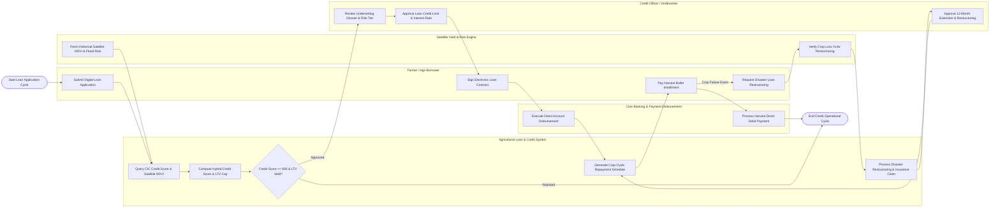

# Swimlane Diagram — Agricultural Loan & Credit System

## Mermaid Code

## Flow Description | Mo ta luong

| Lane | Actor | Role in Flow |
|------|-------|-------------|
| 1 | Farmer / Agri-Borrower | Submits digital loan application with farm GIS plot polygons, signs electronic loan contract via e-KYC/OTP, pays interest/principal installments, and requests restructuring during disaster events |
| 2 | Agricultural Loan & Credit System | Queries CIC credit bureau and satellite crop risk feeds, calculates hybrid credit scores ($300-850$), checks LTV limits ($70\%$), generates crop-cycle aligned repayment schedules, and processes restructuring |
| 3 | Credit Officer / Underwriter | Reviews credit scoring dossiers, approves credit limits and interest rates, verifies collateral land title encumbrances, and authorizes loan restructuring plans |
| 4 | Satellite Yield & Risk Engine | Provides historical multi-temporal NDVI vegetation indices, flood/drought risk scores, and verifies crop vegetation loss ($>60\%$) to confirm natural disaster damage |
| 5 | Core Banking & Payment Disbursement | Executes automated principal fund transfers to borrower bank accounts via Core Banking APIs and processes automated direct debit repayments following harvest |
