# Action Tree — Agricultural Loan & Credit System

## Mermaid Code

```mermaid
graph TD
    Root["Agricultural Loan & Credit System"]

    Root --> M1["Borrower Profile & Farmland Cadastre"]
    Root --> M2["Loan Application & Digital Underwriting"]
    Root --> M3["Satellite Crop Yield & Risk Scoring"]
    Root --> M4["Collateral Valuation & Cadastral Liens"]
    Root --> M5["Disbursement & Flexible Repayment"]
    Root --> M6["Crop Insurance & Restructuring"]
    Root --> M7["Credit Scoring & Regulatory Admin"]

    M1 --> A11["Register Borrower Identity & Farm Acreage"]
    M1 --> A12["Verify National Credit Bureau CIC Scores"]
    M1 --> A13["Link Land Certificate Red Book Metadata"]
    M1 --> A14["Track Historical Borrower Crop Revenue Logs"]

    M2 --> A21["Ingest Digital Loan Applications & Plot Polygons"]
    M2 --> A22["Calculate Hybrid Financial & Satellite Credit Scores"]
    M2 --> A23["Evaluate Debt Service Coverage Ratio DSCR"]
    M2 --> A24["Generate Underwriting Risk Tier Recommendations"]

    M3 --> A31["Ingest Multi-Temporal Satellite NDVI Indices"]
    M3 --> A32["Compute Flood & Drought Risk Severity Scores"]
    M3 --> A33["Project Expected Harvest Crop Yield Volumes"]
    M3 --> A34["Monitor In-Season Crop Health Stress Events"]

    M4 --> A41["Assess Farmland Market Value USD per Hectare"]
    M4 --> A42["Calculate Standing Crop Harvest Valuation"]
    M4 --> A43["Check Regulatory Loan-to-Value LTV Cap Limits"]
    M4 --> A44["Register Digital Mortgage Lien Encumbrances"]

    M5 --> A51["Generate Electronic Loan Contract Agreements"]
    M5 --> A52["Execute Core Banking Fund Disbursements"]
    M5 --> A53["Structure Harvest-Aligned Seasonal Schedules"]
    M5 --> A54["Process Direct Debit Account Installments"]

    M6 --> A61["Verify Disaster Satellite Crop Loss Reports"]
    M6 --> A62["Submit Parametric Crop Insurance Claims"]
    M6 --> A63["Execute Loan Tenure Extension & Grace Periods"]
    M6 --> A64["Monitor Non-Performing Loan NPL Portfolio Ratios"]

    M7 --> A71["Configure Credit Scoring Rule Parameter Weights"]
    M7 --> A72["Manage Agricultural Loan Product Catalog"]
    M7 --> A73["Export Central Bank Regulatory Credit Disclosures"]
    M7 --> A74["Manage User Security Access Roles & Permissions"]
```

## Module Description | Mo ta Module

| # | Module | Description | Actions |
|---|--------|-------------|---------|
| 1 | Borrower Profile & Farmland Cadastre | Manages borrower profiles, national ID verifications, credit bureau (CIC) score queries, land certificate (Red Book) metadata, and harvest revenue logs | Register Borrower Identity & Farm Acreage, Verify National Credit Bureau CIC Scores, Link Land Certificate Red Book Metadata, Track Historical Borrower Crop Revenue Logs |
| 2 | Loan Application & Digital Underwriting | Ingests digital loan applications, computes hybrid credit scores, evaluates Debt Service Coverage Ratios (DSCR), and generates underwriting risk tier decisions | Ingest Digital Loan Applications & Plot Polygons, Calculate Hybrid Financial & Satellite Credit Scores, Evaluate Debt Service Coverage Ratio DSCR, Generate Underwriting Risk Tier Recommendations |
| 3 | Satellite Crop Yield & Risk Scoring | Ingests multi-temporal satellite NDVI vegetation indices, computes flood/drought risk scores, projects harvest yield volumes, and monitors in-season crop stress | Ingest Multi-Temporal Satellite NDVI Indices, Compute Flood & Drought Risk Severity Scores, Project Expected Harvest Crop Yield Volumes, Monitor In-Season Crop Health Stress Events |
| 4 | Collateral Valuation & Cadastral Liens | Appraises farmland market value ($USD/ha$), assesses standing crop value, checks Loan-to-Value (LTV $70\%$) cap limits, and registers legal mortgage liens | Assess Farmland Market Value USD per Hectare, Calculate Standing Crop Harvest Valuation, Check Regulatory Loan-to-Value LTV Cap Limits, Register Digital Mortgage Lien Encumbrances |
| 5 | Disbursement & Flexible Repayment | Generates electronic loan contracts, executes Core Banking fund disbursements, structures crop-cycle aligned seasonal schedules, and processes direct debit payments | Generate Electronic Loan Contract Agreements, Execute Core Banking Fund Disbursements, Structure Harvest-Aligned Seasonal Schedules, Process Direct Debit Account Installments |
| 6 | Crop Insurance & Restructuring | Verifies satellite crop loss evidence during natural disasters, submits parametric insurance claims, restructures loan tenures, and monitors NPL ratios | Verify Disaster Satellite Crop Loss Reports, Submit Parametric Crop Insurance Claims, Execute Loan Tenure Extension & Grace Periods, Monitor Non-Performing Loan NPL Portfolio Ratios |
| 7 | Credit Scoring & Regulatory Admin | Configures hybrid credit scoring weighting parameters, manages agricultural loan product catalogs, exports Central Bank disclosures, and controls security roles | Configure Credit Scoring Rule Parameter Weights, Manage Agricultural Loan Product Catalog, Export Central Bank Regulatory Credit Disclosures, Manage User Security Access Roles & Permissions |
