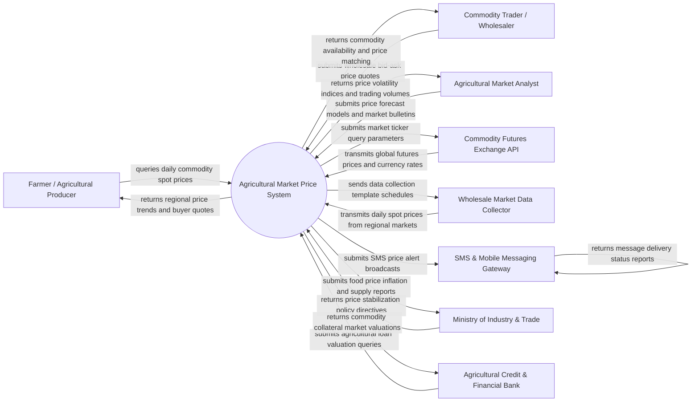

# Context Diagram — Agricultural Market Price Information System

## Mermaid Code

## Actor & Interaction Table | Bang Actor & Tuong tac

| # | Actor | Actor Type | Data Sent TO System | Data Received FROM System | Notes |
|---|-------|------------|---------------------|---------------------------|-------|
| 1 | Farmer / Agricultural Producer | Primary | Spot price queries, crop location, target sell prices, SMS alert subscriptions | Daily regional market prices, buyer bid quotes, 7-day price forecasts | Primary agricultural beneficiary seeking transparent market prices to negotiate sales |
| 2 | Commodity Trader / Wholesaler | Primary | Purchase bid-ask quotes, desired buy volumes, preferred pickup regions | Available crop supply volumes, farmer contact matches, price trend heatmaps | Commercial buyer posting purchasing prices and connecting with local producers |
| 3 | Agricultural Market Analyst | Primary | Statistical forecast parameters, market commentary, supply-demand balances | Aggregated price volatility indices, spatial price spreads, historical data | Expert economist creating market intelligence reports and price prediction models |
| 4 | Commodity Futures Exchange API | Supporting System | Global futures contract prices (CBOT, ICE, Dalian), currency exchange rates | API market ticker query requests, commodity code mapping parameters | External financial exchange providing macro international commodity market benchmarks |
| 5 | Wholesale Market Data Collector | Supporting System | Daily wholesale market spot prices (min/max/average), volume turnover, quality grade | Data entry templates, validation threshold rules, market assignment schedules | Field data collector gathering daily spot prices directly from physical wholesale markets |
| 6 | SMS & Mobile Messaging Gateway | Supporting System | SMS delivery receipts, network status codes, opt-out requests | Bulk SMS price alert broadcasts, USSD interactive price query payloads | Telecommunications gateway broadcasting daily price SMS alerts to rural farmers |
| 7 | Ministry of Industry & Trade | Regulatory System | Food price stabilization mandates, trade tariffs, export quota policies | National Food Price Index (FPI) reports, price spike alerts, regional supply reports | Government authority regulating food price inflation and market transparency |
| 8 | Agricultural Credit & Financial Bank | Supporting | Loan collateral valuation requests, farmer credit verification queries | Real-time commodity market valuations, historical crop price risk scores | Financial institution valuing agricultural commodities pledged as loan collateral |

## System Boundary Description | Mo ta Pham vi He thong

The **Agricultural Market Price Information System** is an enterprise market intelligence platform designed to aggregate, analyze, and disseminate daily spot and futures prices for agricultural commodities across regional and national markets. The system boundary encompasses wholesale price data ingestion, futures exchange API integration, predictive price forecasting algorithms, spatial price mapping, buyer-seller matching, and automated SMS/USSD price broadcasting. Excluded from the system boundary are physical commodity transport logistics execution, direct bank monetary escrow settlements, physical market building management, and financial futures derivative trading execution. The system connects via RESTful APIs, web scrapers, and USSD gateway integrations to deliver real-time market transparency to rural agricultural communities.
