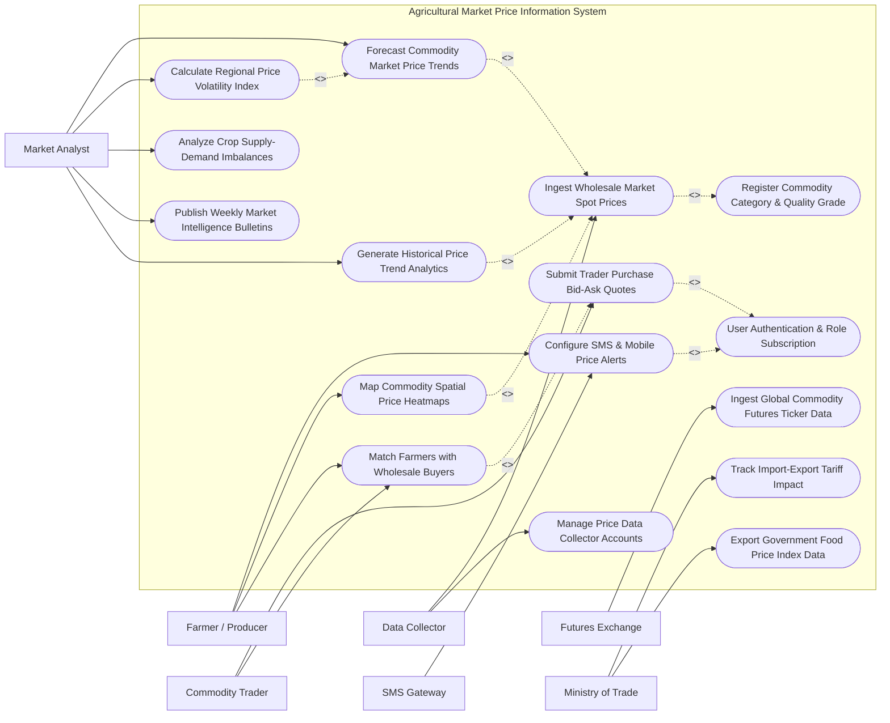

# Use Case Diagram — Agricultural Market Price Information System

## Mermaid Code

## Actor Table | Bang Actor

| # | Actor | Actor Type | Role Description | Related Use Cases |
|---|-------|------------|------------------|-------------------|
| 1 | Farmer / Producer | Primary | Subscribes to daily price alerts, views regional price heatmaps, and connects with matched wholesale buyers | UC02, UC07, UC09, UC10 |
| 2 | Commodity Trader | Primary | Submits wholesale purchasing bid-ask price quotes, specifies buy volumes, and initiates deal matching with farmers | UC02, UC05, UC10 |
| 3 | Market Analyst | Primary | Configures machine learning price forecasting models, calculates volatility indices, and publishes market bulletins | UC02, UC06, UC08, UC11, UC12, UC15 |
| 4 | Futures Exchange | Secondary | Transmits global futures prices (CBOT, ICE, Dalian) and foreign currency exchange rates | UC04 |
| 5 | Data Collector | Secondary | Enters daily spot prices collected directly from regional physical wholesale agricultural markets | UC03, UC14 |
| 6 | SMS Gateway | System | Delivers daily price update broadcasts and alert triggers to registered farmer mobile numbers via SMS/USSD | UC07 |
| 7 | Ministry of Trade | System | Receives food price inflation indices and monitors market tariffs to formulate stabilization policies | UC13, UC16 |

## Use Case Table | Bang Use Case

| # | UC ID | Use Case Name | Primary Actor | Secondary Actor | Description | Priority |
|---|-------|---------------|---------------|-----------------|-------------|----------|
| 1 | UC01 | Register Commodity Category & Quality Grade | Market Analyst | Data Collector | Defines commodity master codes (e.g., Jasmine Rice Grade A, Robusta Coffee Grade 1) and quality specifications | High |
| 2 | UC02 | User Authentication & Role Subscription | Farmer / Producer | Commodity Trader | Validates security credentials and manages user subscription tiers (Free Farmer vs. Premium Trader) | High |
| 3 | UC03 | Ingest Wholesale Market Spot Prices | Data Collector | Market Analyst | Captures daily minimum, maximum, and average spot prices from physical wholesale markets across provinces | High |
| 4 | UC04 | Ingest Global Commodity Futures Ticker Data | Futures Exchange | Market Analyst | Ingests real-time international futures prices and calculates local currency equivalent market values | High |
| 5 | UC05 | Submit Trader Purchase Bid-Ask Quotes | Commodity Trader | Farmer / Producer | Allows buyers to post firm purchase prices, minimum quality requirements, and target pickup regions | High |
| 6 | UC06 | Forecast Commodity Market Price Trends | Market Analyst | None | Executes time-series machine learning models (ARIMA/Prophet) to project 7-day to 30-day commodity price trends | High |
| 7 | UC07 | Configure SMS & Mobile Price Alerts | Farmer / Producer | SMS Gateway | Enables farmers to set target price trigger thresholds and receive automated daily SMS price broadcasts | High |
| 8 | UC08 | Calculate Regional Price Volatility Index | Market Analyst | None | Computes daily and monthly price variance scores to identify high-risk speculative market fluctuations | Medium |
| 9 | UC09 | Map Commodity Spatial Price Heatmaps | Farmer / Producer | None | Renders interactive GIS maps displaying price differences across provinces to highlight arbitrage opportunities | High |
| 10 | UC10 | Match Farmers with Wholesale Buyers | Farmer / Producer | Commodity Trader | Automatically pairs farmer crop harvest availability with trader purchase quotes based on location and price | High |
| 11 | UC11 | Analyze Crop Supply-Demand Imbalances | Market Analyst | None | Correlates regional crop production volumes with wholesale market arrivals to predict price surges or crashes | Medium |
| 12 | UC12 | Publish Weekly Market Intelligence Bulletins | Market Analyst | Farmer / Producer | Compiles expert market commentary, export demand trends, and weather impacts into published advisory reports | Medium |
| 13 | UC13 | Track Import-Export Tariff Impact | Ministry of Trade | Market Analyst | Simulates the effect of international import tariffs and export quotas on domestic agricultural spot prices | Medium |
| 14 | UC14 | Manage Price Data Collector Accounts | Data Collector | Market Analyst | Tracks data collector submission timeliness, audit logs, and validates raw spot price entries | Medium |
| 15 | UC15 | Generate Historical Price Trend Analytics | Market Analyst | None | Generates multi-year price comparison charts, seasonal price cycles, and crop profitability benchmarks | High |
| 16 | UC16 | Export Government Food Price Index Data | Ministry of Trade | Market Analyst | Exports standardized Food Price Index (FPI) datasets formatted for government economic policy planning | High |

## Use Case Specification | Dac ta Use Case

---

### UC03 — Ingest Wholesale Market Spot Prices

| Field | Detail |
|-------|--------|
| **UC ID** | UC03 |
| **Use Case Name** | Ingest Wholesale Market Spot Prices |
| **Actor(s)** | Primary: Data Collector / Secondary: Market Analyst |
| **Description** | Captures daily spot prices (minimum, maximum, modal average) and trading turnover volumes directly from physical wholesale agricultural markets, validating data quality before database commitment. |
| **Precondition** | 1. Data Collector is assigned to a verified wholesale market location.   2. Commodity master codes are registered in UC01. |
| **Main Flow** | 1. Data Collector opens the mobile market entry application at 07:00 AM.   2. Collector selects wholesale market location (e.g., Binh Dien Wholesale Market, HCMC) and target commodity (e.g., Red Chili Grade 1).   3. Collector inputs surveyed minimum price (e.g., 45,000 VND/kg), maximum price (52,000 VND/kg), modal average (48,000 VND/kg), and estimated daily market arrival volume (15 tons).   4. System checks entered prices against statistical historical range rules (e.g., flags price jumps >30% from yesterday).   5. System validates data integrity and prompts collector to confirm submission.   6. Collector submits record; System updates live market spot price database, triggers subscriber alerts (UC07), and updates price heatmaps (UC09). |
| **Alternative Flow** | **AF1** — Bulk Market API Import: Wholesale market management board uploads a CSV/JSON daily pricing file via automated API integration. System validates file syntax and ingests price records in batch mode.   **AF2** — Secondary Verification Override: System detects a 35% price jump. Market Analyst receives verification ticket, contacts collector to confirm market shortage, and approves price entry manually. |
| **Exception Flow** | **EX1** — Price Outlier Rejection: Collector enters typo (e.g., 480,000 VND instead of 48,000 VND). System blocks submission with error "PRICE OUTLIER — EXCEEDS DAILY VARIANCE LIMIT (300%)".   **EX2** — Late Submission Warning: Data Collector fails to submit prices by 09:00 AM cutoff time. System generates an automated "Overdue Market Data Alert" to regional supervisor. |
| **Postcondition** | Daily wholesale spot price is committed to database, live pricing tickers are refreshed, and price trend analytics are updated. |
| **Business Rule** | **BR1**: Daily spot price entries must be submitted before 09:00 AM local time to be included in morning SMS broadcast alerts.   **BR2**: Price entries deviating by >25% from the previous day's average require mandatory secondary supervisor verification. |

---

### UC05 — Submit Trader Purchase Bid-Ask Quotes

| Field | Detail |
|-------|--------|
| **UC ID** | UC05 |
| **Use Case Name** | Submit Trader Purchase Bid-Ask Quotes |
| **Actor(s)** | Primary: Commodity Trader / Secondary: Farmer / Producer |
| **Description** | Enables wholesale buyers and commodity traders to post active buying quotes, specifying target commodity, quality grade, firm bid price per kg, required volume, and preferred pickup regions. |
| **Precondition** | 1. Trader user is authenticated with a verified business profile (UC02).   2. Commodity species and quality standards are active in the system. |
| **Main Flow** | 1. Commodity Trader logs into trader portal and clicks "Create Purchase Bid Quote".   2. Trader selects commodity (e.g., Cat Chu Mango Grade A), target buy volume (10,000 kg), and firm offer price (32,000 VND/kg).   3. Trader specifies preferred procurement region (e.g., Dong Thap Province) and delivery window (July 28 – August 5).   4. System checks offered price against current regional wholesale spot average (UC03) and displays competitiveness rating ("Market Competitive — +5% Above Market").   5. Trader submits the purchase bid quote.   6. System activates the quote on the public trading board, notifies matching farmers in Dong Thap Province (UC10), and logs the bid record. |
| **Alternative Flow** | **AF1** — Automated Bid Price Adjustment: Trader enables "Auto-Index Pricing" option. System dynamically adjusts trader's buying bid price to remain +2% above daily wholesale spot average automatically.   **AF2** — Quote Expiration & Renewal: Bid quote reaches its 7-day expiration date without full volume fulfillment. System prompts trader to renew quote or update offered price. |
| **Exception Flow** | **EX1** — Below-Cost Predatory Bid Alert: Trader inputs bid price >50% below current market average. System displays warning "Low Bid Alert — May Receive Low Farmer Engagement".   **EX2** — Unverified Trader Lock: Trader has 3 unfulfilled broken deal matches. System suspends bid posting privileges pending business audit. |
| **Postcondition** | Purchase bid quote is active on the trading board, farmer matching engine is triggered, and trader buy orders are published. |
| **Business Rule** | **BR1**: Purchase bid quotes must specify firm unit price, total target quantity, and expiration date.   **BR2**: Active purchase quotes cannot be modified downward while open farmer deal matches are pending acceptance. |

---

### UC06 — Forecast Commodity Market Price Trends

| Field | Detail |
|-------|--------|
| **UC ID** | UC06 |
| **Use Case Name** | Forecast Commodity Market Price Trends |
| **Actor(s)** | Primary: Market Analyst / Secondary: None |
| **Description** | Executes statistical and machine learning time-series forecasting models (ARIMA, Prophet, LSTM) combining historical spot prices, seasonal cycles, international futures, and weather data to project future price trends. |
| **Precondition** | 1. Historical spot price database contains at least 365 days of continuous price data.   2. International futures tickers and weather feeds are updated (UC04). |
| **Main Flow** | 1. Market Analyst opens "Price Prediction Studio" and selects target commodity (e.g., Robusta Coffee).   2. Analyst chooses forecast horizon (7-day, 14-day, or 30-day) and selects forecasting model algorithm (Prophet Time-Series).   3. System compiles input features: historical 3-year spot prices, London ICE futures trend, rainfall anomalies, and export volume data.   4. System executes model training and generates price prediction curve with 95% confidence intervals.   5. System computes Model Mean Absolute Percentage Error (MAPE = 3.2%).   6. Analyst reviews forecast accuracy, approves prediction output, and publishes trend forecast to farmer and trader dashboards. |
| **Alternative Flow** | **AF1** — Automated Nightly Forecast Batch: System automatically executes scheduled 7-day price prediction pipeline every night at midnight for top 50 national commodities, updating dashboard charts without manual intervention.   **AF2** — Scenario Simulation Mode: Analyst inputs hypothetical shock scenario (e.g., +20% export tariff increase). System simulates impact and outputs revised price forecast trajectory. |
| **Exception Flow** | **EX1** — High MAPE Model Error: Model prediction error MAPE exceeds 15% (due to extreme market shock). System flags "Low Model Confidence Alert" and requires analyst manual tuning before publishing.   **EX2** — Missing Feature Data: Future weather data feed is offline. System falls back to univariate ARIMA model relying solely on historical price series. |
| **Postcondition** | Commodity price forecast curves are generated, confidence margins are logged, and predictive trend charts are published. |
| **Business Rule** | **BR1**: Price forecast models must display explicit confidence interval bands (95% upper/lower bounds) alongside point predictions.   **BR2**: Forecast models exhibiting MAPE >12% must be automatically suppressed from public farmer mobile views. |

---

### UC07 — Configure SMS & Mobile Price Alerts

| Field | Detail |
|-------|--------|
| **UC ID** | UC07 |
| **Use Case Name** | Configure SMS & Mobile Price Alerts |
| **Actor(s)** | Primary: Farmer / Producer / Secondary: SMS Gateway |
| **Description** | Allows farmers to subscribe to daily market price broadcasts via SMS/USSD or push notifications, setting custom price alert triggers for specific commodities and target provinces. |
| **Precondition** | 1. Farmer mobile phone number is registered (UC02).   2. SMS Gateway API integration is online and active. |
| **Main Flow** | 1. Farmer sends USSD code `*789#` or uses mobile app to open "Price Alert Settings".   2. Farmer selects target commodity (e.g., Black Pepper) and preferred market region (Gia Lai Province).   3. Farmer selects subscription mode: "Daily Morning Digest" (08:00 AM) or "Target Price Trigger" (Notify if price > 70,000 VND/kg).   4. System saves subscription preferences and binds user phone number to alert queue.   5. Next morning at 08:00 AM following spot price ingestion (UC03), System formats SMS payload: `[AGRI-PRICE] Gia Lai Black Pepper: 72,000 VND/kg (+2,000). Trend: UP. Call *789*1# for buyers.`   6. System dispatches message to SMS Gateway, which delivers SMS to farmer's mobile phone and logs delivery receipt. |
| **Alternative Flow** | **AF1** — USSD Interactive Real-Time Inquiry: Farmer dials `*789*2*1#` on feature phone. USSD gateway instantly returns real-time spot price on phone screen without waiting for scheduled broadcast.   **AF2** — Mobile App Push Notification: Smartphone user receives rich push notification containing interactive price trend chart instead of plain text SMS. |
| **Exception Flow** | **EX1** — SMS Delivery Failure: Telecommunications network returns "Undeliverable / Out of Range". System queues SMS for retry 2 hours later; if failed 3 times, flags phone number for SMS audit.   **EX2** — Unsubscribe Keyword: Farmer replies "STOP" to SMS alert. System instantly deactivates subscription and sends opt-out confirmation. |
| **Postcondition** | Farmer price alert subscription is active, daily SMS updates are dispatched, and delivery receipts are recorded. |
| **Business Rule** | **BR1**: Daily SMS price broadcasts must be delivered to rural subscribers before 08:30 AM local time.   **BR2**: Farmers must be provided a zero-cost option to opt-out or modify subscription preferences at any time via SMS keyword. |

---

### UC10 — Match Farmers with Wholesale Buyers

| Field | Detail |
|-------|--------|
| **UC ID** | UC10 |
| **Use Case Name** | Match Farmers with Wholesale Buyers |
| **Actor(s)** | Primary: Farmer / Producer / Secondary: Commodity Trader |
| **Description** | Algorithmic matchmaking engine that pairs farmer crop harvest availability records with active trader purchase bid quotes based on geographic proximity, price agreement, and quality grade matching. |
| **Precondition** | 1. Active trader purchase bid quotes exist (UC05).   2. Farmer has registered upcoming harvest availability details. |
| **Main Flow** | 1. Farmer registers upcoming harvest: 5,000 kg Cat Chu Mangoes available on July 30 in Dong Thap Province.   2. Matchmaking engine queries active purchase bid quotes (UC05) for matching parameters (Commodity: Cat Chu Mango, Region: Dong Thap, Price >= Farmer Target).   3. Engine identifies Trader B's active bid quote (Offering 32,000 VND/kg for 10,000 kg).   4. System calculates Match Compatibility Score (96% Match based on price, location, and date alignment).   5. System sends "Deal Match Alert" push/SMS to both Farmer and Trader B displaying matched offer details.   6. Farmer clicks "Accept Deal Match"; System locks the match, exchanges contact details between parties, and updates quote reserved volume. |
| **Alternative Flow** | **AF1** — Counter-Offer Negotiation: Farmer accepts location match but requests +1,000 VND/kg price increase. Trader receives counter-offer, accepts price adjustment, and system finalizes match.   **AF2** — Multi-Farmer Aggregation Match: Single trader wants 50 tons. System aggregates 5 smallholder farmers in the same village to fulfill trader's total volume requirement under a joint match deal. |
| **Exception Flow** | **EX1** — Deal Cancellation by Trader: Trader cancels match claiming quality inspection failure upon physical arrival. System logs deal cancellation and prompts both parties to rate deal reliability.   **EX2** — No Active Buyer Match Found: No trader bids exist in farmer's province. System alerts farmer "No Direct Buyer Match — Viewing Nearest Regional Market Prices Instead". |
| **Postcondition** | Farmer-buyer match deal is created, contact details are exchanged, and bid quote reserved volume is updated. |
| **Business Rule** | **BR1**: Contact details cannot be disclosed between parties until both farmer and trader confirm initial deal match parameters.   **BR2**: Deal match engine must prioritize local geographic proximity to minimize agricultural transport carbon footprint and losses. |
