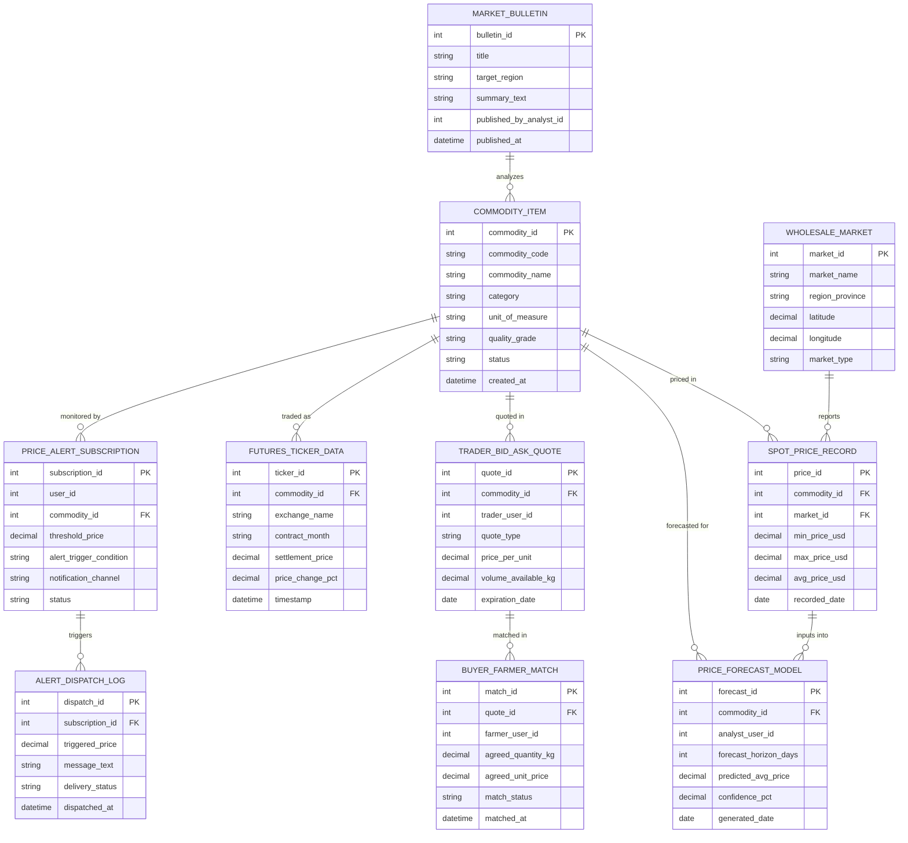

# Conceptual ERD — Agricultural Market Price Information System

## Mermaid Code

## Entity Description Table | Bang mo ta Entity

| # | Entity Name | Vietnamese Name | Description | Key Attributes | Main Relationships |
|---|-------------|-----------------|-------------|----------------|-------------------|
| 1 | COMMODITY_ITEM | Mặt Hàng Nông Sản | Master commodity catalog record defining standardized crop codes, categories, and quality grades | commodity_id, commodity_code, commodity_name, category, unit_of_measure, quality_grade | Has many SPOT_PRICE_RECORD, FUTURES_TICKER_DATA, TRADER_BID_ASK_QUOTE, PRICE_FORECAST_MODEL, PRICE_ALERT_SUBSCRIPTION, MARKET_BULLETIN |
| 2 | WHOLESALE_MARKET | Chợ Đầu Mối | Physical or regional wholesale agricultural market facility location and geographic coordinates | market_id, market_name, region_province, latitude, longitude, market_type | Has many SPOT_PRICE_RECORD |
| 3 | SPOT_PRICE_RECORD | Giá Giao Ngay Spot | Daily spot price record capturing minimum, maximum, and modal average prices at a specific wholesale market | price_id, commodity_id, market_id, min_price_usd, max_price_usd, avg_price_usd, recorded_date | Belongs to COMMODITY_ITEM, WHOLESALE_MARKET; inputs into PRICE_FORECAST_MODEL |
| 4 | FUTURES_TICKER_DATA | Ticker Hợp Đồng Tương Lai | Real-time commodity futures contract settlement price and percent change ingested from global exchanges | ticker_id, commodity_id, exchange_name, contract_month, settlement_price, price_change_pct | Belongs to COMMODITY_ITEM |
| 5 | TRADER_BID_ASK_QUOTE | Chào Giá Mua Bán Thương Nhân | Active purchase bid or selling offer posted by commodity traders detailing unit price and volume | quote_id, commodity_id, trader_user_id, quote_type, price_per_unit, volume_available_kg | Belongs to COMMODITY_ITEM; has BUYER_FARMER_MATCH |
| 6 | PRICE_FORECAST_MODEL | Mô Hình Dự Báo Giá | Output record of predictive machine learning models projecting commodity prices and confidence intervals | forecast_id, commodity_id, analyst_user_id, forecast_horizon_days, predicted_avg_price, confidence_pct | Belongs to COMMODITY_ITEM; uses SPOT_PRICE_RECORD |
| 7 | PRICE_ALERT_SUBSCRIPTION | Đăng Ký Nhận Cảnh Báo Giá | User subscription profile defining target commodities, price trigger thresholds, and delivery channels | subscription_id, user_id, commodity_id, threshold_price, alert_trigger_condition, notification_channel | Belongs to COMMODITY_ITEM; has ALERT_DISPATCH_LOG |
| 8 | ALERT_DISPATCH_LOG | Nhật Ký Gửi SMS Cảnh Báo | Outbound dispatch log tracking SMS/push price alert messages, triggered prices, and delivery receipts | dispatch_id, subscription_id, triggered_price, message_text, delivery_status, dispatched_at | Belongs to PRICE_ALERT_SUBSCRIPTION |
| 9 | BUYER_FARMER_MATCH | Khớp Nối Nông Dân & Thương Lái | Algorithmic match deal record linking a farmer's crop availability with a trader's active buying quote | match_id, quote_id, farmer_user_id, agreed_quantity_kg, agreed_unit_price, match_status | Belongs to TRADER_BID_ASK_QUOTE |
| 10 | MARKET_BULLETIN | Bản Tin Thị Trường | Published market intelligence report compiling expert commentary, price trends, and regional trade analysis | bulletin_id, title, target_region, summary_text, published_by_analyst_id, published_at | Analyzes COMMODITY_ITEM |

## Relationship Description | Mo ta Quan he

| # | From Entity | Cardinality | To Entity | Relationship Label | Business Explanation |
|---|-------------|-------------|-----------|-------------------|----------------------|
| 1 | COMMODITY_ITEM | one-to-many | SPOT_PRICE_RECORD | priced in | Mot mat hang nong san duoc ghi nhan gia giao ngay spot tai nhieu cho dau moi theo ngay. |
| 2 | COMMODITY_ITEM | one-to-many | FUTURES_TICKER_DATA | traded as | Mot mat hang duoc giao dich duoi dang nhieu hop dong tuong lai tren cac san giao dich. |
| 3 | COMMODITY_ITEM | one-to-many | TRADER_BID_ASK_QUOTE | quoted in | Mot mat hang duoc thuong lai chao gia mua/ban voi nhieu muc gia va san luong khac nhau. |
| 4 | COMMODITY_ITEM | one-to-many | PRICE_FORECAST_MODEL | forecasted for | Mot mat hang duoc chay cac mo hinh thuat toan du bao gia cho cac chu ky tuong lai. |
| 5 | COMMODITY_ITEM | one-to-many | PRICE_ALERT_SUBSCRIPTION | monitored by | Mot mat hang duoc nhieu nong dan va thuong nhan dang ky theo doi va nhan canh bao gia. |
| 6 | WHOLESALE_MARKET | one-to-many | SPOT_PRICE_RECORD | reports | Mot cho dau moi khao sat va bao cao nhieu ban ghi gia ca nong san giao ngay hang ngay. |
| 7 | PRICE_ALERT_SUBSCRIPTION | one-to-many | ALERT_DISPATCH_LOG | triggers | Mot dang ky canh bao kich hoat nhieu luot gui tin nhan SMS/Push thuc te den nguoi dung. |
| 8 | TRADER_BID_ASK_QUOTE | one-to-many | BUYER_FARMER_MATCH | matched in | Mot chao gia mua cua thuong lai co the khop noi giao dich voi nhieu ho nong dan. |
| 9 | SPOT_PRICE_RECORD | one-to-many | PRICE_FORECAST_MODEL | inputs into | Du lieu gia spot lich su duoc dua vao lam dau vao huan luyen cac mo hinh du bao gia. |
| 10 | MARKET_BULLETIN | one-to-many | COMMODITY_ITEM | analyzes | Mot ban tin thi truong phan tich va phat hanh khuyen cao cho nhieu mat hang nong san. |
