# Swimlane Diagram — Agricultural Market Price Information System

## Mermaid Code

```mermaid
flowchart LR
    Start(["Start Daily Market Pricing Cycle"])

    subgraph Lane1["Wholesale Market Data Collector"]
        C1["Survey Wholesale Market Spot Prices at 07:00 AM"]
        C2["Submit Raw Min/Max/Avg Prices via Mobile App"]
    end

    subgraph Lane2["Agricultural Market Price System"]
        SYS1["Validate Price Entry vs Historical 30% Variance Rule"]
        SYS2{"Price Jump > 30% Variance?"}
        SYS3["Flag Entry for Analyst Secondary Verification"]
        SYS4["Update Live Spot Price Database & Heatmaps"]
        SYS5["Execute Automated Machine Learning Forecast Pipeline"]
        SYS6["Check SMS Subscription Triggers & Broadcast SMS"]
    end

    subgraph Lane3["Agricultural Market Analyst"]
        A1["Review Price Anomaly & Confirm Market Shortage"]
        A2["Approve Verified Price Entry & Publish Bulletin"]
    end

    subgraph Lane4["Farmer / Producer"]
        F1["Receive Morning SMS Price Broadcast at 08:00 AM"]
        F2["View Buyer Bid Quotes & Accept Direct Match Deal"]
    end

    Finish(["End Process"])

    Start --> C1 --> C2 --> SYS1 --> SYS2
    SYS2 -->|"Yes — Anomaly"| SYS3 --> A1 --> A2 --> SYS4
    SYS2 -->|"No — Normal"| SYS4 --> SYS5 --> SYS6 --> F1 --> F2 --> Finish
```

## Flow Description | Mo ta luong

| Lane | Actor / Subsystem | Role in Flow |
|------|-------------------|--------------|
| Wholesale Market Data Collector | Field Survey Agent | Surveys early morning spot prices (min, max, average) at physical wholesale markets and enters raw price data via mobile app. |
| Agricultural Market Price System | Core Engine | Validates price entries against historical variance limits, routes anomalies for supervisor audit, updates live price heatmaps, runs ML forecast pipelines, and broadcasts daily SMS alerts. |
| Agricultural Market Analyst | Market Economist | Reviews price jump anomalies, verifies market supply shortage conditions, approves verified entries, and publishes market commentary bulletins. |
| Farmer / Producer | Primary Subscriber | Receives daily morning SMS price digests, views regional buyer bid quotes, and executes direct match deals with wholesale traders. |
