# Action Tree — Agricultural Market Price Information System

## Mermaid Code

```mermaid
graph TD
    Root["Agricultural Market Price System"]

    Root --> M1["Commodity & Market Master Infrastructure"]
    Root --> M2["Wholesale & Futures Spot Price Ingestion"]
    Root --> M3["Price Forecasting & Volatility Analytics"]
    Root --> M4["Trader Quotes & Buyer-Farmer Matching"]
    Root --> M5["SMS Subscriptions & Mobile Price Alerting"]
    Root --> M6["Government Policy & Economic Audit Reporting"]

    M1 --> A11["Register Master Commodity Codes & Grades"]
    M1 --> A12["Map Regional Wholesale Market GIS Locations"]
    M1 --> A13["Manage Price Data Collector Field Accounts"]

    M2 --> A21["Ingest Daily Wholesale Spot Prices"]
    M2 --> A22["Fetch Global Futures Ticker Data & Currencies"]
    M2 --> A23["Validate Statistical Price Jump Outliers"]

    M3 --> A31["Execute ARIMA & Prophet Time-Series Forecasts"]
    M3 --> A32["Compute Regional Price Volatility Index"]
    M3 --> A33["Render Spatial Commodity Price Heatmaps"]
    M3 --> A34["Publish Weekly Market Intelligence Bulletins"]

    M4 --> A41["Post Commodity Trader Purchase Bid Quotes"]
    M4 --> A42["Execute Farmer-Buyer Matchmaking Engine"]
    M4 --> A43["Track Farmer Crop Harvest Availability"]

    M5 --> A51["Manage Farmer SMS Subscription Preferences"]
    M5 --> A52["Broadcast Daily Morning SMS Price Digests"]
    M5 --> A53["Process USSD Interactive Price Queries"]

    M6 --> A61["Export Government Food Price Index FPI"]
    M6 --> A62["Simulate Import-Export Tariff Impact"]
    M6 --> A63["Generate Commodity Collateral Valuation Files"]
```

## Module Description | Mo ta Module

| # | Module | Description | Actions |
|---|--------|-------------|---------|
| 1 | Commodity & Market Master Infrastructure | Manages commodity master codes, quality grade classifications, wholesale market locations, and data collector accounts | Register Master Commodity Codes & Grades, Map Regional Wholesale Market GIS Locations, Manage Price Data Collector Field Accounts |
| 2 | Wholesale & Futures Spot Price Ingestion | Captures daily spot prices from physical markets, ingests international futures tickers, and validates statistical price outliers | Ingest Daily Wholesale Spot Prices, Fetch Global Futures Ticker Data & Currencies, Validate Statistical Price Outliers |
| 3 | Price Forecasting & Volatility Analytics | Executes machine learning time-series price predictions, calculates volatility indices, renders spatial heatmaps, and publishes bulletins | Execute ARIMA & Prophet Time-Series Forecasts, Compute Regional Price Volatility Index, Render Spatial Commodity Price Heatmaps, Publish Weekly Market Intelligence Bulletins |
| 4 | Trader Quotes & Buyer-Farmer Matching | Manages trader purchase bid-ask quotes, tracks farmer crop harvest availability, and pairs farmers with wholesale buyers | Post Commodity Trader Purchase Bid Quotes, Execute Farmer-Buyer Matchmaking Engine, Track Farmer Crop Harvest Availability |
| 5 | SMS Subscriptions & Mobile Price Alerting | Handles farmer subscription profiles, dispatches daily morning SMS price alerts, and responds to USSD interactive queries | Manage Farmer SMS Subscription Preferences, Broadcast Daily Morning SMS Price Digests, Process USSD Interactive Price Queries |
| 6 | Government Policy & Economic Audit Reporting | Exports government Food Price Index (FPI) datasets, models tariff impacts, and generates bank loan collateral market valuations | Export Government Food Price Index FPI, Simulate Import-Export Tariff Impact, Generate Commodity Collateral Valuation Files |
