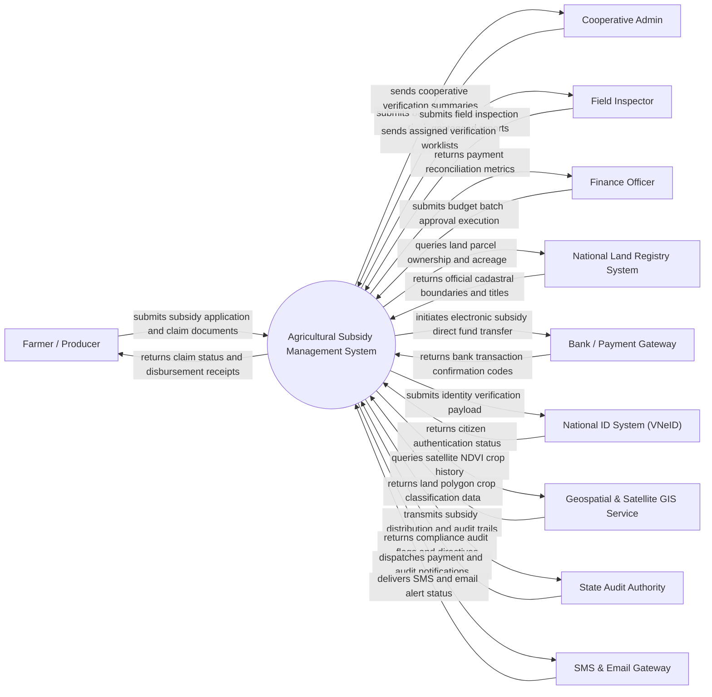

# Context Diagram — Agricultural Subsidy Management System

## Mermaid Code

## Actor & Interaction Table | Bang Actor & Tuong tac

| # | Actor | Actor Type | Data Sent TO System | Data Received FROM System | Notes |
|---|-------|------------|---------------------|---------------------------|-------|
| 1 | Farmer / Producer | Primary | Subsidy claim forms, land cultivation proofs, identity details, bank account info | Claim status updates, entitlement calculations, digital payment receipts, appeal decisions | Agricultural producer eligible for government subsidies based on crop type and verified land area |
| 2 | Cooperative Admin | Primary | Group cultivation declarations, member lists, aggregated yield metrics | Bulk application status, cooperative disbursement summaries, validation errors | Representative submitting aggregated subsidy requests for agricultural cooperative members |
| 3 | Field Inspector | Primary | On-site geotagged inspection photos, crop verification reports, damaged area assessments | Scheduled field inspection tasks, mobile spatial land parcel boundaries | Agricultural officer conducting physical or drone-based field checks to verify claimed crops |
| 4 | Finance Officer | Primary | Budget allocation parameters, fund approval decisions, disbursement execution commands | Payment reconciliation reports, batch disbursement logs, financial audit trails | Ministry or department official managing subsidy funds and approving final bank disbursements |
| 5 | National Land Registry System | Supporting System | Cadastral parcel maps, land ownership titles, official land use right certificates | Land parcel ID queries, title verification requests, ownership conflict flags | Government registry validating legal land boundaries and ownership rights |
| 6 | Bank / Payment Gateway | Supporting System | Payment processing status, transaction reference numbers, bank account validation status | Direct credit transfer instructions, account numbers, payout amount batches | Financial intermediary executing direct electronic transfer of subsidy funds to farmers |
| 7 | National ID System (VNeID) | Supporting System | Citizen verification status, biometric hash validation, registered residential address | National ID query, citizen identity verification request | Government identity service ensuring authentic citizen identity and preventing duplicate claims |
| 8 | Geospatial & Satellite GIS Service | Supporting System | Satellite NDVI vegetation index, crop growth history, polygon boundary intersection metrics | Parcel polygon coordinates, crop seasonality query dates | Satellite remote sensing provider confirming crop presence and active farming activities |
| 9 | State Audit Authority | Regulatory System | Compliance guidelines, audit sampling queries, fraud investigation directives | Historical subsidy logs, transaction registries, field inspection evidence | Oversight body ensuring transparency and legal compliance in public fund allocation |
| 10 | SMS & Email Gateway | Supporting System | SMS/Email delivery receipts, carrier status logs | Notification dispatch payloads, target phone numbers, localized alert messages | Automated communication service sending application milestones and payment confirmations to farmers |

## System Boundary Description | Mo ta Pham vi He thong

The **Agricultural Subsidy Management System** is a public sector software platform designed to manage the entire lifecycle of agricultural government subsidies, from program configuration and farmer application submission to multi-layer eligibility verification, geospatial parcel validation, field inspection management, financial disbursement, and audit reporting. 

The **system boundary** encompasses farmer profile management, subsidy entitlement policy calculation engines, integration with national identity and cadastral registries, field inspection workflow dispatching, satellite crop verification processing, payment batch generation, dispute appeal tracking, and compliance audit trail maintenance. 

**External to the system boundary** are physical banking fund clearing house operations, satellite constellation orbital operations, physical field inspection travel execution, government land title issuance, and citizen biometric database management. The system connects to these external actors via secure encrypted APIs, REST webservices, and geospatial data formats (GeoJSON/Shapefile).
