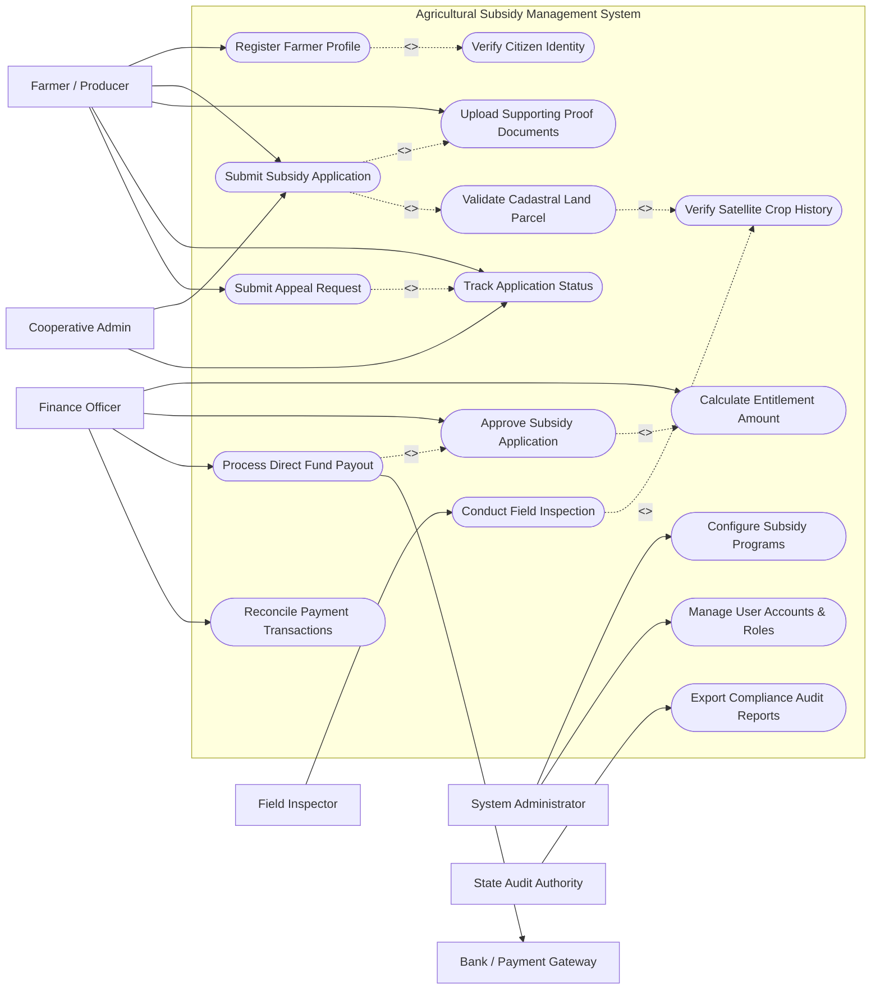

# Use Case Diagram — Agricultural Subsidy Management System

## Mermaid Code

## Actor Table | Bang Actor

| # | Actor | Actor Type | Role Description | Related Use Cases |
|---|-------|------------|------------------|-------------------|
| 1 | Farmer / Producer | Primary | Individual agricultural land operator applying for financial subsidy programs | UC01, UC02, UC03, UC04, UC11, UC12 |
| 2 | Cooperative Admin | Primary | Authorized manager acting on behalf of farming cooperative members | UC03, UC12 |
| 3 | Field Inspector | Primary | Agriculture department officer performing physical and drone parcel assessments | UC06, UC07 |
| 4 | Finance Officer | Primary | Government finance official managing subsidy budgets and approving disbursements | UC08, UC09, UC10, UC14 |
| 5 | System Administrator | Primary | Technical admin configuring subsidy rules, system parameters, and security roles | UC13, UC16 |
| 6 | Bank / Payment Gateway | Secondary / System | External financial gateway executing electronic direct fund transfers | UC10, UC14 |
| 7 | State Audit Authority | Secondary / Regulatory | External auditor monitoring public expenditure and verifying compliance | UC15 |

## Use Case Table | Bang Use Case

| # | UC ID | Use Case Name | Primary Actor | Secondary Actor | Description | Priority |
|---|-------|---------------|---------------|-----------------|-------------|----------|
| 1 | UC01 | Register Farmer Profile | Farmer / Producer | Citizen Identity | Creates a verified farmer account with personal and bank details | High |
| 2 | UC02 | Verify Citizen Identity | System | Citizen Identity | Validates farmer identity attributes via national ID service | High |
| 3 | UC03 | Submit Subsidy Application | Farmer / Producer | Cooperative Admin | Submits a claim for a specific subsidy program and land parcel | High |
| 4 | UC04 | Upload Supporting Proof Documents | Farmer / Producer | None | Attaches land titles, crop invoices, and damage evidence files | High |
| 5 | UC05 | Validate Cadastral Land Parcel | System | Land Registry | Cross-checks claimed land boundary against government parcel database | High |
| 6 | UC06 | Conduct Field Inspection | Field Inspector | None | Records on-site parcel measurements, crop verification, and photos | High |
| 7 | UC07 | Verify Satellite Crop History | System | Satellite GIS | Analyzes historical remote sensing data for crop presence | Medium |
| 8 | UC08 | Calculate Entitlement Amount | Finance Officer | System | Computes financial payout based on verified area, rate, and rules | High |
| 9 | UC09 | Approve Subsidy Application | Finance Officer | None | Reviews complete evaluation bundle and approves or rejects claim | High |
| 10 | UC10 | Process Direct Fund Payout | Finance Officer | Payment Gateway | Dispatches fund transfer request to payment gateway for credit | High |
| 11 | UC11 | Submit Appeal Request | Farmer / Producer | None | Files a formal dispute against rejected or reduced subsidy claim | Medium |
| 12 | UC12 | Track Application Status | Farmer / Producer | Cooperative Admin | Views real-time evaluation status and disbursement timelines | Medium |
| 13 | UC13 | Configure Subsidy Programs | System Administrator | None | Sets up program guidelines, budget caps, crop rates, and deadlines | High |
| 14 | UC14 | Reconcile Payment Transactions | Finance Officer | Payment Gateway | Matches bank transaction responses against issued payment batches | High |
| 15 | UC15 | Export Compliance Audit Reports | State Audit Authority | None | Generates full audit logs, entitlement traces, and payment records | High |
| 16 | UC16 | Manage User Accounts & Roles | System Administrator | None | Manages user access credentials, permissions, and regional assignments | Medium |

## Use Case Specification | Dac ta Use Case

---

### UC01 — Register Farmer Profile

| Field | Detail |
|-------|--------|
| **UC ID** | UC01 |
| **Use Case Name** | Register Farmer Profile |
| **Actor(s)** | Primary: Farmer / Producer   Secondary: National ID System (VNeID) |
| **Description** | Allows an agricultural producer to create a digital profile by providing national ID credentials, land parcel references, and bank account information required for subsidy disbursement. |
| **Precondition** | 1. The user possesses a valid government-issued National ID (VNeID/SSN).   2. The user has access to a registered mobile phone number. |
| **Main Flow** | 1. Farmer navigates to the portal registration page and enters National ID, full name, and mobile number.   2. System sends a registration query payload to the National ID System (VNeID).   3. System receives citizen verification response and autofills verified demographic data.   4. Farmer inputs bank account details, bank name, residential address, and primary crop categories.   5. System validates bank account format and issues an OTP code to the farmer's mobile number.   6. Farmer enters the correct OTP code.   7. System creates the active farmer profile and issues user credentials. |
| **Alternative Flow** | **AF1** — Manual Identity Verification: If automatic National ID lookup fails, farmer uploads digital copies of ID card and land title for manual review by local agriculture department staff.   **AF2** — Cooperative Registration: Cooperative Admin registers a profile on behalf of an elderly or non-tech-savvy farmer with written power of attorney. |
| **Exception Flow** | **EX1** — Duplicate Identity Detected: System identifies an existing active profile with the same National ID, blocks registration, and prompts account recovery.   **EX2** — Invalid OTP Code: If OTP is entered incorrectly three consecutive times, system invalidates registration session. |
| **Postcondition** | Farmer profile is saved in the database with status `VERIFIED` and linked to national identity records. |
| **Business Rule** | **BR1**: Each National ID can be linked to exactly one active farmer profile.   **BR2**: Bank account holder name must match the National ID legal name. |

---

### UC03 — Submit Subsidy Application

| Field | Detail |
|-------|--------|
| **UC ID** | UC03 |
| **Use Case Name** | Submit Subsidy Application |
| **Actor(s)** | Primary: Farmer / Producer   Secondary: National Land Registry System |
| **Description** | Enables a registered farmer to select an active agricultural subsidy program, specify cultivated land parcels, attach required documentation, and submit a financial claim. |
| **Precondition** | 1. Farmer profile status is `VERIFIED`.   2. Target subsidy program status is `ACTIVE` and open for submission. |
| **Main Flow** | 1. Farmer logs into the portal and selects an open subsidy program (e.g., Drought Relief, Organic Fertilizer Grant).   2. System displays eligible land parcels registered under the farmer's profile.   3. Farmer selects target land parcels and enters cultivated crop area and crop type.   4. System queries the National Land Registry System to verify parcel ownership and cadastral area.   5. Farmer attaches required supporting documents (e.g., seed purchase invoices, damage photos).   6. System calculates estimated subsidy entitlement based on program formula.   7. Farmer reviews terms, signs electronic declaration, and clicks submit.   8. System records application, generates unique Application ID, and sets status to `UNDER_REVIEW`. |
| **Alternative Flow** | **AF1** — Tenant Farmer Submission: If farmer is a tenant, system prompts for upload of notarized land lease agreement before allowing submission.   **AF2** — Cooperative Bulk Submission: Cooperative Admin submits a combined multi-parcel application for all member farmers. |
| **Exception Flow** | **EX1** — Overlapping Parcel Claim: If selected land parcel has already been claimed by another farmer for the same fiscal season, system flags conflict and blocks submission until resolved.   **EX2** — Expired Program Deadline: If submission attempt occurs after program closing date, system rejects application entry. |
| **Postcondition** | Application record created with status `UNDER_REVIEW` and assigned to local agriculture review queue. |
| **Business Rule** | **BR1**: Total claimed area for a parcel cannot exceed the official cadastral area in the registry.   **BR2**: A land parcel can only receive one subsidy payment per program fiscal year. |

---

### UC06 — Conduct Field Inspection

| Field | Detail |
|-------|--------|
| **UC ID** | UC06 |
| **Use Case Name** | Conduct Field Inspection |
| **Actor(s)** | Primary: Field Inspector   Secondary: Geospatial & Satellite GIS Service |
| **Description** | Allows a field inspector to conduct physical on-site or drone parcel verification, capture geotagged photos, measure crop area, and record verification findings in the mobile inspection application. |
| **Precondition** | 1. Subsidy application status is `PENDING_INSPECTION`.   2. Inspection task is assigned to the Field Inspector's mobile workspace. |
| **Main Flow** | 1. Inspector arrives at target land parcel and opens the assigned inspection task on mobile app.   2. Mobile app displays GPS overlay of official cadastral polygon boundaries.   3. Inspector walks parcel perimeter or deploys drone to capture geotagged photos and crop health data.   4. System queries Geospatial & Satellite GIS Service for satellite NDVI index comparison.   5. Inspector inputs verified crop type, estimated yield impact percentage, and physical measured area.   6. Inspector selects inspection result (`APPROVED`, `PARTIAL_APPROVAL`, or `REJECTED`) and adds notes.   7. Inspector signs digital inspection record and submits evaluation.   8. System updates application inspection status to `INSPECTION_COMPLETED`. |
| **Alternative Flow** | **AF1** — Remote Inspection via High-Res Drone Imagery: Inspector performs verification remotely using verified drone orthomosaic maps without physical walk-through.   **AF2** — Discrepancy Flagging: If physical crop differs from application, inspector logs discrepancy and requests farmer clarification. |
| **Exception Flow** | **EX1** — GPS Signal Lost: App saves inspection data locally in offline cache and syncs automatically when network connectivity is restored.   **EX2** — Inaccessible Land Parcel: Inspector flags parcel as `UNINSPECTABLE` due to extreme weather or force majeure, triggering supervisor re-assignment. |
| **Postcondition** | Inspection report with geotagged media attached is permanently recorded and linked to the subsidy application. |
| **Business Rule** | **BR1**: Geotagged photos must be captured within 50 meters of parcel polygon boundary.   **BR2**: Physical inspection must be completed within 14 calendar days of assignment. |

---

### UC09 — Approve Subsidy Application

| Field | Detail |
|-------|--------|
| **UC ID** | UC09 |
| **Use Case Name** | Approve Subsidy Application |
| **Actor(s)** | Primary: Finance Officer   Secondary: System |
| **Description** | Enables a government finance officer to conduct final administrative and financial evaluation of a verified application bundle and authorize subsidy entitlement approval. |
| **Precondition** | 1. Application status is `INSPECTION_COMPLETED` with positive verification result.   2. Finance Officer holds authorized financial approval authority for the regional jurisdiction. |
| **Main Flow** | 1. Finance Officer opens pending approval dashboard and selects an application bundle.   2. System presents complete application file: farmer details, land registry check, satellite GIS logs, and field inspection report.   3. System displays calculated entitlement sum based on verified area and active program rates.   4. Finance Officer reviews document compliance and checks program budget availability.   5. Finance Officer selects `APPROVE` and enters digital security authorization key.   6. System changes application status to `APPROVED_FOR_PAYMENT`.   7. System updates program committed budget counter and generates automated approval notice to farmer. |
| **Alternative Flow** | **AF1** — Application Rejection: Officer rejects claim due to non-compliance, inputs rejection reason code, and system sends rejection notice with appeal instructions to farmer.   **AF2** — Amount Adjustment: Officer approves a reduced area/amount based on partial field inspection findings. |
| **Exception Flow** | **EX1** — Budget Exceeded: System blocks approval action if program remaining budget is insufficient, prompting budget reallocation request.   **EX2** — Audit Lock: If application is selected for random state audit sampling, system locks approval until audit clearing. |
| **Postcondition** | Application status moves to `APPROVED_FOR_PAYMENT` and entitlement amount is queued for payment batch processing. |
| **Business Rule** | **BR1**: Approvals exceeding $10,000 equivalent require dual-signoff by Senior Finance Director.   **BR2**: Total approved amount across all applications cannot exceed total program budget cap. |

---

### UC10 — Process Direct Fund Payout

| Field | Detail |
|-------|--------|
| **UC ID** | UC10 |
| **Use Case Name** | Process Direct Fund Payout |
| **Actor(s)** | Primary: Finance Officer   Secondary: Bank / Payment Gateway |
| **Description** | Executes electronic fund transfers by compiling approved subsidy claims into encrypted payment batches and transmitting them to the central banking gateway for direct account credit. |
| **Precondition** | 1. At least one application status is `APPROVED_FOR_PAYMENT`.   2. Financial payment gateway connection status is `ONLINE`. |
| **Main Flow** | 1. Finance Officer initiates new payout cycle on the financial management portal.   2. System aggregates all approved applications into a structured payment batch file (ISO 20022 / ACH format).   3. System calculates total batch payout amount and validates farmer bank account numbers.   4. Finance Officer authorizes payment batch using hardware security token / digital signature.   5. System transmits encrypted payment batch payload to Bank / Payment Gateway.   6. Payment Gateway processes direct deposits and returns transaction status response file.   7. System updates individual application statuses to `DISBURSED` for successful credits.   8. System dispatches SMS/Email payout notifications to receiving farmers. |
| **Alternative Flow** | **AF1** — Digital Wallet Payout: For farmers without traditional bank accounts, system routes direct credit to verified e-wallet / mobile money accounts.   **AF2** — Partial Batch Processing: System processes successful transactions immediately and queues failed items into exception handling queue. |
| **Exception Flow** | **EX1** — Account Invalid / Rejected by Bank: Gateway returns error code (e.g., account closed/invalid name), system sets application status to `PAYMENT_FAILED` and alerts farmer to update bank details.   **EX2** — Banking Gateway Connection Timeout: System retries batch transmission up to 3 times before setting batch status to `PENDING_RETRY`. |
| **Postcondition** | Funds credited to farmer bank accounts, transaction reference numbers logged, and application status set to `DISBURSED`. |
| **Business Rule** | **BR1**: Payment batches must be cryptographically signed using government financial security certs.   **BR2**: Disbursed transactions are irreversible within the system; corrections require formal recovery workflows. |
