# Conceptual ERD — Agricultural Subsidy Management System

## Mermaid Code

```mermaid
erDiagram
    FARMER {
        int farmer_id PK
        string national_id_number
        string full_name
        string phone_number
        string bank_account_number
        string bank_name
        string residential_address
        datetime created_at
    }

    LAND_PARCEL {
        int parcel_id PK
        int farmer_id FK
        string cadastral_number
        decimal area_hectares
        string primary_crop_type
        string geo_coordinates
        string boundary_polygon
        string status
    }

    SUBSIDY_PROGRAM {
        int program_id PK
        string program_name
        int fiscal_year
        decimal total_budget
        decimal rate_per_hectare
        date start_date
        date end_date
        string program_status
    }

    SUBSIDY_APPLICATION {
        int application_id PK
        int farmer_id FK
        int program_id FK
        int parcel_id FK
        datetime submission_date
        decimal claimed_amount
        decimal approved_amount
        string application_status
    }

    DOCUMENT_PROOF {
        int document_id PK
        int application_id FK
        string document_type
        string file_path
        datetime uploaded_at
        string verification_status
    }

    INSPECTION_RECORD {
        int inspection_id PK
        int application_id FK
        int inspector_id FK
        datetime inspection_date
        decimal land_area_verified
        string crop_condition_status
        string inspector_notes
        string overall_result
    }

    DISBURSEMENT_BATCH {
        int batch_id PK
        int program_id FK
        int created_by_user FK
        decimal total_disbursed_amount
        string payment_channel
        string processing_status
        datetime approved_at
    }

    PAYMENT_TRANSACTION {
        int transaction_id PK
        int application_id FK
        int batch_id FK
        string payment_reference
        decimal transaction_amount
        datetime transaction_date
        string bank_status_code
        string error_message
    }

    APPEAL_REQUEST {
        int appeal_id PK
        int application_id FK
        int farmer_id FK
        string appeal_reason
        datetime submitted_at
        string resolution_status
        string decision_notes
    }

    SYSTEM_USER {
        int user_id PK
        string username
        string email
        string user_role
        string department
        boolean is_active
    }

    AUDIT_LOG {
        int log_id PK
        int user_id FK
        string action_type
        string entity_affected
        datetime timestamp
        string ip_address
        string change_summary
    }

    FARMER ||--o{ LAND_PARCEL : "owns"
    FARMER ||--o{ SUBSIDY_APPLICATION : "submits"
    SUBSIDY_PROGRAM ||--o{ SUBSIDY_APPLICATION : "governs"
    LAND_PARCEL ||--o{ SUBSIDY_APPLICATION : "pertains_to"
    SUBSIDY_APPLICATION ||--o{ DOCUMENT_PROOF : "includes"
    SUBSIDY_APPLICATION ||--o{ INSPECTION_RECORD : "undergoes"
    SYSTEM_USER ||--o{ INSPECTION_RECORD : "conducts"
    SUBSIDY_PROGRAM ||--o{ DISBURSEMENT_BATCH : "allocates"
    DISBURSEMENT_BATCH ||--o{ PAYMENT_TRANSACTION : "contains"
    SUBSIDY_APPLICATION ||--|| PAYMENT_TRANSACTION : "results_in"
    SUBSIDY_APPLICATION ||--o{ APPEAL_REQUEST : "generates"
    FARMER ||--o{ APPEAL_REQUEST : "files"
    SYSTEM_USER ||--o{ AUDIT_LOG : "triggers"
```

## Entity Description Table | Bang mo ta Entity

| # | Entity Name | Vietnamese Name | Description | Key Attributes | Main Relationships |
|---|-------------|-----------------|-------------|----------------|-------------------|
| 1 | FARMER | Nông Dân / Chủ Thể | Stores demographic, national identity, contact, and banking information of agricultural producers | farmer_id, national_id_number, full_name, bank_account_number | Has many LAND_PARCEL, SUBSIDY_APPLICATION, APPEAL_REQUEST |
| 2 | LAND_PARCEL | Thửa Đất Nông Nghiệp | Represents physical agricultural land parcels with cadastral references and spatial GIS boundaries | parcel_id, farmer_id, cadastral_number, area_hectares, boundary_polygon | Belongs to FARMER, linked to SUBSIDY_APPLICATION |
| 3 | SUBSIDY_PROGRAM | Chương Trình Trợ Cấp | Defines government subsidy initiatives, fiscal year allocations, crop rates, and active periods | program_id, program_name, total_budget, rate_per_hectare, program_status | Governs SUBSIDY_APPLICATION, allocates DISBURSEMENT_BATCH |
| 4 | SUBSIDY_APPLICATION | Hồ Sơ Đăng Ký Trợ Cấp | Central claim record capturing farmer requests, claimed area, evaluation status, and approved funds | application_id, farmer_id, program_id, parcel_id, application_status | Belongs to FARMER and PROGRAM, has many DOCUMENT_PROOF, INSPECTION_RECORD |
| 5 | DOCUMENT_PROOF | Chứng Từ Kèm Theo | Stores uploaded supporting evidence such as land titles, crop seed invoices, and disaster photos | document_id, application_id, document_type, file_path, verification_status | Belongs to SUBSIDY_APPLICATION |
| 6 | INSPECTION_RECORD | Biên Bản Kiểm Tra Thực Địa | Records on-site physical/drone inspection findings, verified land area, and crop health status | inspection_id, application_id, inspector_id, land_area_verified, overall_result | Belongs to SUBSIDY_APPLICATION, conducted by SYSTEM_USER |
| 7 | DISBURSEMENT_BATCH | Đợt Chi Trả Ngân Sách | Represents aggregated payout batches created by finance officers for direct electronic bank processing | batch_id, program_id, total_disbursed_amount, processing_status | Belongs to SUBSIDY_PROGRAM, contains PAYMENT_TRANSACTION |
| 8 | PAYMENT_TRANSACTION | Giao Dịch Chi Trả Ngân Hàng | Tracks individual electronic fund transfers executed via banking payment gateways | transaction_id, application_id, batch_id, payment_reference, bank_status_code | Belongs to DISBURSEMENT_BATCH and SUBSIDY_APPLICATION |
| 9 | APPEAL_REQUEST | Đơn Khiếu Nại Trợ Cấp | Captures formal farmer disputes against rejected claims or adjusted subsidy payout amounts | appeal_id, application_id, farmer_id, appeal_reason, resolution_status | Filed by FARMER, linked to SUBSIDY_APPLICATION |
| 10 | SYSTEM_USER | Người Dùng Hệ Thống | Stores administrative credentials, roles, and departmental assignments for government staff | user_id, username, user_role, department, is_active | Conducts INSPECTION_RECORD, triggers AUDIT_LOG |
| 11 | AUDIT_LOG | Nhật Ký Kiểm Toán | Maintains immutable log records of system changes, approval decisions, and security events | log_id, user_id, action_type, entity_affected, timestamp | Triggered by SYSTEM_USER |

## Relationship Description | Mo ta Quan he

| # | From Entity | Cardinality | To Entity | Relationship Label | Business Explanation |
|---|-------------|-------------|-----------|-------------------|----------------------|
| 1 | FARMER | one-to-many | LAND_PARCEL | owns | A registered farmer can own or cultivate multiple legal agricultural land parcels |
| 2 | FARMER | one-to-many | SUBSIDY_APPLICATION | submits | A farmer can submit multiple subsidy applications across different programs and fiscal years |
| 3 | SUBSIDY_PROGRAM | one-to-many | SUBSIDY_APPLICATION | governs | A subsidy program governs multiple applications submitted by eligible producers |
| 4 | LAND_PARCEL | one-to-many | SUBSIDY_APPLICATION | pertains_to | A land parcel can be the subject of subsidy applications across different fiscal seasons |
| 5 | SUBSIDY_APPLICATION | one-to-many | DOCUMENT_PROOF | includes | An application can include multiple uploaded proof documents (land title, seed invoices) |
| 6 | SUBSIDY_APPLICATION | one-to-many | INSPECTION_RECORD | undergoes | An application can undergo one or more field inspections during its evaluation lifecycle |
| 7 | SYSTEM_USER | one-to-many | INSPECTION_RECORD | conducts | A field inspector (system user) can conduct multiple field inspection tasks |
| 8 | SUBSIDY_PROGRAM | one-to-many | DISBURSEMENT_BATCH | allocates | A subsidy program allocates budget across multiple financial disbursement batches |
| 9 | DISBURSEMENT_BATCH | one-to-many | PAYMENT_TRANSACTION | contains | A disbursement batch contains multiple individual electronic payment transactions |
| 10 | SUBSIDY_APPLICATION | one-to-one | PAYMENT_TRANSACTION | results_in | An approved subsidy application results in exactly one successful payout transaction |
| 11 | SUBSIDY_APPLICATION | one-to-many | APPEAL_REQUEST | generates | A rejected or adjusted application can generate formal appeal requests |
| 12 | FARMER | one-to-many | APPEAL_REQUEST | files | A farmer can file appeal requests for disputed subsidy decisions |
| 13 | SYSTEM_USER | one-to-many | AUDIT_LOG | triggers | System user actions and approvals trigger immutable security audit log entries |
