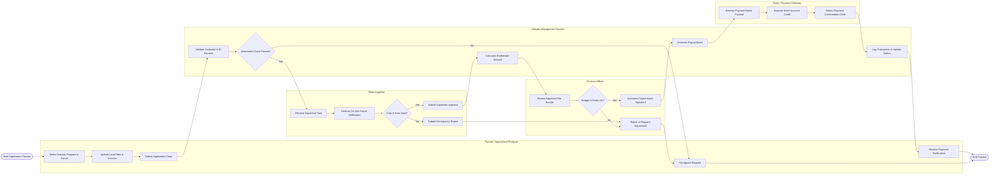

# Swimlane Diagram — Agricultural Subsidy Management System

## Mermaid Code

## Flow Description | Mo ta luong

| Lane | Actor | Role in Flow |
|------|-------|-------------|
| 1 | Farmer / Agricultural Producer | Initiates claim by selecting eligible subsidy programs, linking registered land parcels, uploading proof documentation, receiving electronic payout alerts, or submitting appeals for disputed decisions |
| 2 | Subsidy Management System | Performs automated cross-system identity and land registry validation, dispatches field verification tasks, calculates subsidy entitlement amounts according to official formulas, compiles payment batches, and maintains audit trails |
| 3 | Field Inspector | Receives mobile inspection tasks, conducts physical on-site or drone parcel reviews, verifies crop condition against claims, and logs approval or discrepancy findings into the system |
| 4 | Finance Officer | Conducts final administrative and compliance review of verified evaluation bundles, checks remaining budget allocations, and executes cryptographic signatures to authorize payment batches |
| 5 | Bank / Payment Gateway | Ingests secure ISO 20022 payment batches, processes direct fund credits into farmer bank accounts, and returns electronic bank confirmation codes to complete reconciliation |
