# Action Tree — Agricultural Subsidy Management System

## Mermaid Code

```mermaid
graph TD
    Root["Agricultural Subsidy Management System"]

    Root --> M1["Farmer & Land Profile Management"]
    Root --> M2["Subsidy Program & Policy Configuration"]
    Root --> M3["Application & Claim Processing"]
    Root --> M4["Field & Geospatial Inspection"]
    Root --> M5["Entitlement & Financial Disbursement"]
    Root --> M6["Appeals & Exception Dispute Handling"]
    Root --> M7["Audit, Compliance & Analytics"]

    M1 --> A11["Register Farmer Account"]
    M1 --> A12["Verify Identity via VNeID"]
    M1 --> A13["Register Land Parcel Boundaries"]
    M1 --> A14["Update Bank Account Details"]

    M2 --> A21["Create New Subsidy Program"]
    M2 --> A22["Configure Rate & Budget Caps"]
    M2 --> A23["Define Crop Eligibility Criteria"]
    M2 --> A24["Set Program Opening Schedule"]

    M3 --> A31["Select Active Subsidy Program"]
    M3 --> A32["Attach Land & Crop Proof Docs"]
    M3 --> A33["Validate Cadastral Registry Title"]
    M3 --> A34["Submit Claim for Review"]

    M4 --> A41["Dispatch Field Verification Task"]
    M4 --> A42["Capture Geotagged Field Photos"]
    M4 --> A43["Query Satellite NDVI History"]
    M4 --> A44["Log Field Verification Findings"]

    M5 --> A51["Calculate Entitlement Sum"]
    M5 --> A52["Conduct Finance Officer Signoff"]
    M5 --> A53["Generate Payment Payout Batch"]
    M5 --> A54["Execute Bank Direct Transfer"]

    M6 --> A61["File Dispute Appeal Claim"]
    M6 --> A62["Upload Additional Proof File"]
    M6 --> A63["Review Appeal Case Board"]
    M6 --> A64["Issue Re-evaluation Decision"]

    M7 --> A71["Generate Program Expenditure Report"]
    M7 --> A72["Export State Audit Trail Logs"]
    M7 --> A73["Monitor Fraud Risk Indicators"]
    M7 --> A74["Track Regional Disbursement Metrics"]
```

## Module Description | Mo ta Module

| # | Module | Description | Actions |
|---|--------|-------------|---------|
| 1 | Farmer & Land Profile Management | Manages agricultural producer demographic profiles, citizen identity verification, bank account details, and registered land parcel GIS polygon references | Register Farmer Account, Verify Identity via VNeID, Register Land Parcel Boundaries, Update Bank Account Details |
| 2 | Subsidy Program & Policy Configuration | Enables administrators to define government subsidy initiatives, fiscal year budgets, crop subsidy rates per hectare, eligibility rules, and application windows | Create New Subsidy Program, Configure Rate & Budget Caps, Define Crop Eligibility Criteria, Set Program Opening Schedule |
| 3 | Application & Claim Processing | Handles the submission, documentation attachment, automated land registry checking, and status tracking of individual and cooperative subsidy claims | Select Active Subsidy Program, Attach Land & Crop Proof Docs, Validate Cadastral Registry Title, Submit Claim for Review |
| 4 | Field & Geospatial Inspection | Coordinates physical and drone parcel verification tasks, captures geotagged spatial evidence, and integrates remote sensing satellite NDVI crop validation data | Dispatch Field Verification Task, Capture Geotagged Field Photos, Query Satellite NDVI History, Log Field Verification Findings |
| 5 | Entitlement & Financial Disbursement | Computes entitlement sums according to policy formulas, handles multi-level finance officer approvals, creates encrypted payment batches, and interfaces with banking gateways | Calculate Entitlement Sum, Conduct Finance Officer Signoff, Generate Payment Payout Batch, Execute Bank Direct Transfer |
| 6 | Appeals & Exception Dispute Handling | Provides formal dispute resolution workflows for farmers contesting rejected or adjusted subsidy claims, allowing document re-examination and re-inspection | File Dispute Appeal Claim, Upload Additional Proof File, Review Appeal Case Board, Issue Re-evaluation Decision |
| 7 | Audit, Compliance & Analytics | Provides comprehensive reporting, financial audit trails, regional disbursement analytics, and automated fraud detection indicators for oversight authorities | Generate Program Expenditure Report, Export State Audit Trail Logs, Monitor Fraud Risk Indicators, Track Regional Disbursement Metrics |
