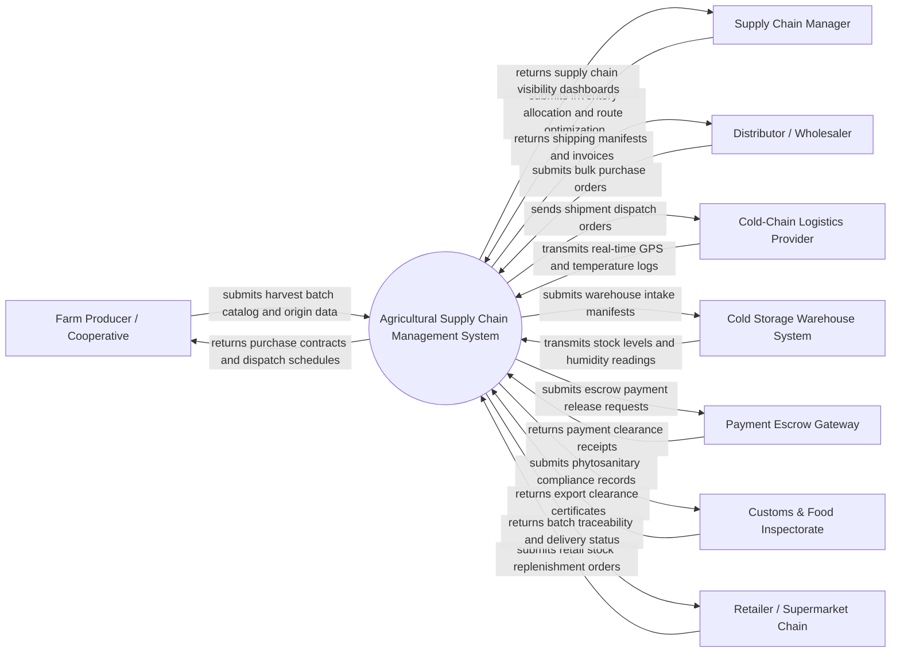

# Context Diagram — Agricultural Supply Chain Management System

## Mermaid Code

## Actor & Interaction Table | Bang Actor & Tuong tac

| # | Actor | Actor Type | Data Sent TO System | Data Received FROM System | Notes |
|---|-------|------------|---------------------|---------------------------|-------|
| 1 | Farm Producer / Cooperative | Primary | Harvest batch volumes, crop varieties, harvest dates, farm origin data | Purchase agreements, pickup dispatch schedules, payment escrow milestones | Primary agricultural entity supplying harvested produce batches |
| 2 | Supply Chain Manager | Primary | Route optimization parameters, warehouse allocation rules, safety thresholds | Enterprise supply chain dashboards, spoilage alerts, fleet tracking | Internal administrator overseeing multi-tiered logistics and distribution |
| 3 | Distributor / Wholesaler | Primary | Bulk purchase orders, quality specifications, preferred delivery dates | Order confirmation manifests, shipment tracking links, sales invoices | Commercial buyer purchasing bulk agricultural commodities for regional distribution |
| 4 | Cold-Chain Logistics Provider | Supporting | Real-time vehicle GPS coordinates, refrigerated cargo temperature, door status | Shipment dispatch manifests, pickup locations, route itinerary | Freight carrier transporting temperature-sensitive produce in reefer trucks |
| 5 | Cold Storage Warehouse System | Supporting System | Warehouse intake scans, bin allocations, ambient humidity, available capacity | Storage booking manifests, pallet dispatch instructions | Automated warehouse system managing regional refrigerated inventory storage |
| 6 | Payment Escrow Gateway | Supporting System | Payment confirmation receipts, escrow funding verification, payout status | Escrow holding requests, milestone release authorizations | Third-party financial escrow system protecting buyer-seller transactions |
| 7 | Customs & Food Inspectorate | Regulatory System | Import/export phytosanitary regulations, quarantine holds, inspection approvals | Digital origin certificates, chemical residue logs, shipment manifests | Government regulatory authority verifying food safety and export compliance |
| 8 | Retailer / Supermarket Chain | Supporting | Store replenishment orders, shelf-life criteria, store delivery slots | Batch QR traceability profiles, delivery status, store invoices | Downstream retail client purchasing packaged produce for end-consumer sales |

## System Boundary Description | Mo ta Pham vi He thong

The **Agricultural Supply Chain Management System** is an enterprise logistics and traceability platform controlling the end-to-end flow of agricultural commodities from farm origin to retail distribution points. The system boundary encompasses harvest batch registration, cold-chain temperature telemetry monitoring, warehouse stock intake and allocation, automated route planning, wholesale order fulfillment, escrow payment settlement, and QR-based traceability compliance. Excluded from the system boundary are physical vehicle engine mechanics, physical refrigeration compressor operation, raw financial bank wire processing, and physical customs laboratory chemical assay testing. The system interfaces securely with external logistics providers, IoT sensor networks, and government compliance portals using RESTful APIs and EDI electronic data exchange protocols.
