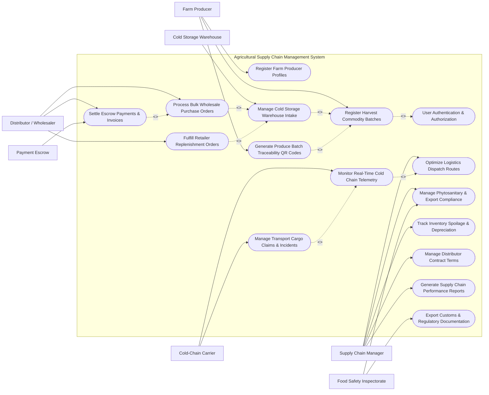

# Use Case Diagram — Agricultural Supply Chain Management System

## Mermaid Code

## Actor Table | Bang Actor

| # | Actor | Actor Type | Role Description | Related Use Cases |
|---|-------|------------|------------------|-------------------|
| 1 | Farm Producer | Primary | Registers farming cooperatives, logs harvested commodity batches, and prints origin traceability tags | UC01, UC02, UC03, UC08 |
| 2 | Supply Chain Manager | Primary | Manages routing strategies, monitors inventory expiration, oversees contract agreements, and analyzes operational KPIs | UC02, UC06, UC09, UC10, UC14, UC15 |
| 3 | Distributor / Wholesaler | Primary | Places bulk wholesale produce orders, authorizes escrow payment releases, and tracks cargo deliveries | UC02, UC07, UC12, UC13 |
| 4 | Cold-Chain Carrier | Secondary | Transmits truck GPS telemetry, monitors cargo compartment temperatures, and reports transit incidents | UC05, UC11 |
| 5 | Cold Storage Warehouse | Secondary | Scans incoming commodity pallets, manages temperature-controlled bin locations, and processes outbound shipments | UC04 |
| 6 | Payment Escrow Gateway | System | Holds buyer funds in escrow and releases payments to producers upon verified delivery milestones | UC12 |
| 7 | Food Safety Inspectorate | System | Verifies phytosanitary certificates, residue testing logs, and authorizes international export customs clearance | UC09, UC16 |

## Use Case Table | Bang Use Case

| # | UC ID | Use Case Name | Primary Actor | Secondary Actor | Description | Priority |
|---|-------|---------------|---------------|-----------------|-------------|----------|
| 1 | UC01 | Register Farm Producer Profiles | Farm Producer | Supply Chain Manager | Enrolls farming cooperatives, verifies agricultural certifications, and records farm geo-locations | High |
| 2 | UC02 | User Authentication & Authorization | Farm Producer | Supply Chain Manager | Secures portal access using multi-factor authentication and role-based permissions | High |
| 3 | UC03 | Register Harvest Commodity Batches | Farm Producer | None | Logs newly harvested produce batches with weight, variety, harvest date, and farm origin details | High |
| 4 | UC04 | Manage Cold Storage Warehouse Intake | Cold Storage Warehouse | Supply Chain Manager | Scans incoming produce pallets, verifies temperature upon arrival, and assigns warehouse storage bins | High |
| 5 | UC05 | Monitor Real-Time Cold Chain Telemetry | Cold-Chain Carrier | Supply Chain Manager | Streams continuous GPS locations, temperature readings, and humidity levels from refrigerated trucks | High |
| 6 | UC06 | Optimize Logistics Dispatch Routes | Supply Chain Manager | Cold-Chain Carrier | Calculates fuel-efficient transport routes while factoring in perishable produce shelf-life constraints | Medium |
| 7 | UC07 | Process Bulk Wholesale Purchase Orders | Distributor / Wholesaler | Supply Chain Manager | Receives, verifies stock availability, and allocates produce batches for bulk commercial purchase orders | High |
| 8 | UC08 | Generate Produce Batch Traceability QR Codes | Farm Producer | Distributor / Wholesaler | Creates tamper-proof digital QR codes encoding harvest origin, chemical logs, and supply chain history | High |
| 9 | UC09 | Manage Phytosanitary & Export Compliance | Supply Chain Manager | Food Safety Inspectorate | Submits laboratory test reports and secures government phytosanitary clearance certificates for export | High |
| 10 | UC10 | Track Inventory Spoilage & Depreciation | Supply Chain Manager | Cold Storage Warehouse | Monitors produce expiration dates, calculates decay rates, and flags items for markdown or disposal | Medium |
| 11 | UC11 | Manage Transport Cargo Claims & Incidents | Cold-Chain Carrier | Supply Chain Manager | Logs refrigerated truck breakdowns, temperature breaches, and submits insurance loss claims | Medium |
| 12 | UC12 | Settle Escrow Payments & Invoices | Distributor / Wholesaler | Payment Escrow Gateway | Releases buyer escrow funds to producers once delivery conditions and quality inspections pass | High |
| 13 | UC13 | Fulfill Retailer Replenishment Orders | Distributor / Wholesaler | Cold Storage Warehouse | Dispatches recurring produce shipments to supermarket chains based on automated stock thresholds | Medium |
| 14 | UC14 | Manage Distributor Contract Terms | Supply Chain Manager | Distributor / Wholesaler | Establishes commercial pricing tiers, volume discounts, and payment credit limits for buyers | Medium |
| 15 | UC15 | Generate Supply Chain Performance Reports | Supply Chain Manager | None | Compiles operational reports on transit times, cold-chain compliance rates, and logistics margins | High |
| 16 | UC16 | Export Customs & Regulatory Documentation | Supply Chain Manager | Food Safety Inspectorate | Formats shipping manifests, origin certificates, and bill of lading files for international customs | Medium |

## Use Case Specification | Dac ta Use Case

---

### UC03 — Register Harvest Commodity Batches

| Field | Detail |
|-------|--------|
| **UC ID** | UC03 |
| **Use Case Name** | Register Harvest Commodity Batches |
| **Actor(s)** | Primary: Farm Producer / Secondary: None |
| **Description** | Allows a registered farm producer or cooperative manager to log a newly harvested crop batch into the supply chain network, generating a unique Global Trade Item Number (GTIN) and lot tracking ID. |
| **Precondition** | 1. Farm Producer profile is verified and active (UC01).   2. User is authenticated into the supply chain mobile or web portal (UC02). |
| **Main Flow** | 1. Farm Producer selects "Register Harvest Batch" in the portal.   2. System presents a form requesting commodity type, crop variety, harvest date/time, net weight (kg), field origin parcel, and initial quality grade (Grade A/B).   3. Farm Producer inputs batch metrics and attaches chemical application compliance logs.   4. System validates entered weight against estimated parcel yield capacity.   5. System generates a unique 14-digit Batch Lot ID and GTIN barcode payload.   6. System saves the batch record with status "Harvested — Awaiting Pickup" and displays printable barcode labels. |
| **Alternative Flow** | **AF1** — Bulk Cooperative Batch Registration: Cooperative manager uploads a CSV manifest registering 50+ individual farmer harvest batches simultaneously. System processes file in background and returns batch label PDFs.   **AF2** — Organic Certification Tagging: Producer toggles "Organic Certified" option. System validates farm's active organic license number before applying organic seal to batch record. |
| **Exception Flow** | **EX1** — Excessive Weight Anomaly: If entered batch weight exceeds field parcel capacity by >30%, System flags "Yield Anomaly Warning" and requires supervisor photo verification before proceeding.   **EX2** — Lapsed Organic License: If producer's organic certification is expired, System strips organic tag and alerts producer to update compliance credentials. |
| **Postcondition** | Commodity batch is registered in database, lot tracking ID is assigned, and batch is visible on warehouse intake schedules. |
| **Business Rule** | **BR1**: Every registered batch must be assigned a globally unique Lot ID compliant with GS1 agricultural standards.   **BR2**: Harvest registration must occur within 12 hours of physical harvesting to preserve freshness calculation accuracy. |

---

### UC04 — Manage Cold Storage Warehouse Intake

| Field | Detail |
|-------|--------|
| **UC ID** | UC04 |
| **Use Case Name** | Manage Cold Storage Warehouse Intake |
| **Actor(s)** | Primary: Cold Storage Warehouse / Secondary: Supply Chain Manager |
| **Description** | Handles physical receipt of produce pallets at cold storage facilities, including pallet barcode scanning, core probe temperature verification, and bin location allocation. |
| **Precondition** | 1. Commodity batch has been registered (UC03) and assigned to incoming freight dispatch.   2. Warehouse intake bay terminal and handheld barcode scanners are operational. |
| **Main Flow** | 1. Warehouse receiver scans incoming pallet barcode tag upon truck unloading.   2. System retrieves batch manifest (commodity type, expected weight, target storage temperature).   3. Warehouse receiver performs core temperature probe test and enters reading into handheld terminal.   4. System checks temperature reading against safe commodity tolerance range (e.g., 2°C – 4°C for strawberries).   5. System assigns an optimal cold storage bin/rack location based on current zone temperatures and humidity.   6. Warehouse receiver places pallet in assigned bin, scans bin barcode to confirm placement, and System updates inventory status to "In Cold Storage". |
| **Alternative Flow** | **AF1** — Cross-Docking Direct Transit: Pallet is scheduled for immediate shipment to buyer without long-term storage. System routes pallet directly to outbound staging lane instead of storage bin.   **AF2** — Weight Variance Adjustment: Receiver weighs pallet on calibrated intake scale. If net weight differs by ±2% from harvest log, System updates inventory weight record automatically. |
| **Exception Flow** | **EX1** — Temperature Abuse Quarantine: If core temperature exceeds maximum safety limit (>8°C for cold-chain produce), System flags "Thermal Abuse Alert", routes pallet to Quarantine Zone, and alerts Supply Chain Manager.   **EX2** — Damaged Packaging Rejection: Receiver logs crushed boxes or mold presence. System generates a "Warehouse Receiving Defect Report" and halts intake approval. |
| **Postcondition** | Pallet inventory is registered in warehouse WMS database, bin location is locked, and real-time inventory availability is updated. |
| **Business Rule** | **BR1**: Produce pallets failing arrival temperature checks must be isolated in quarantine within 15 minutes of intake scan.   **BR2**: Storage bin allocation must prioritize First-Expired, First-Out (FEFO) picking logic. |

---

### UC05 — Monitor Real-Time Cold Chain Telemetry

| Field | Detail |
|-------|--------|
| **UC ID** | UC05 |
| **Use Case Name** | Monitor Real-Time Cold Chain Telemetry |
| **Actor(s)** | Primary: Cold-Chain Carrier / Secondary: Supply Chain Manager |
| **Description** | Ingests continuous IoT sensor streams from refrigerated transport vehicles, monitoring GPS location, cargo bay temperature, relative humidity, and door-open events. |
| **Precondition** | 1. Vehicle is equipped with active cellular/satellite IoT telematics hardware.   2. Active shipment dispatch record is linked to vehicle ID. |
| **Main Flow** | 1. IoT gateway inside refrigerated truck transmits sensor data telemetry packet every 5 minutes.   2. System parses payload containing GPS coordinates, reefer setpoint temperature, actual cargo temperature, humidity, and battery voltage.   3. System checks temperature readings against prescribed shipment safety envelope.   4. System updates live tracking map and estimated time of arrival (ETA) calculation.   5. System logs telemetry data point into permanent shipment audit trail.   6. System displays normal green status badge on carrier and manager monitoring dashboards. |
| **Alternative Flow** | **AF1** — Cellular Dead-Zone Caching: Vehicle enters remote area without cellular signal. IoT device caches up to 72 hours of telemetry locally, auto-syncing bulk data to server upon regaining signal.   **AF2** — Door Sensor Activation: Cargo door is opened at authorized waypoint. System logs "Door Open — Authorized Stop" without triggering security breach alerts. |
| **Exception Flow** | **EX1** — Critical Temperature Excursion: If cargo temperature exceeds 6°C for more than 20 consecutive minutes, System triggers "CRITICAL COLD-CHAIN BREACH" alert via SMS/Email to driver and manager.   **EX2** — Unauthorized Route Deviation: Vehicle strays >10km from planned route. System flags "Route Deviation Warning" on manager control center dashboard. |
| **Postcondition** | Continuous telemetry audit log is maintained, live ETA is recalculated, and breach alerts are dispatched if safety bounds are exceeded. |
| **Business Rule** | **BR1**: Temperature excursions exceeding limits for >30 minutes automatically invalidate cold-chain guarantee certificates.   **BR2**: Telemetry logs must be retained for at least 2 years to satisfy international food safety audit requirements. |

---

### UC07 — Process Bulk Wholesale Purchase Orders

| Field | Detail |
|-------|--------|
| **UC ID** | UC07 |
| **Use Case Name** | Process Bulk Wholesale Purchase Orders |
| **Actor(s)** | Primary: Distributor / Wholesaler / Secondary: Supply Chain Manager |
| **Description** | Manages commercial wholesale purchase order submission, stock availability checking, batch allocation, pricing calculation, and order confirmation. |
| **Precondition** | 1. Distributor profile and credit terms are verified (UC14).   2. Available produce stock is registered in warehouse inventory (UC04). |
| **Main Flow** | 1. Distributor logs into wholesale portal and browses available produce inventory by commodity grade and origin.   2. Distributor selects desired quantity (e.g., 5,000 kg Grade A Mangoes), specifies target delivery date, and clicks "Create Purchase Order".   3. System checks available unreserved warehouse stock using FEFO rules.   4. System calculates total order cost, logistics freight charges, applicable volume discounts, and taxes.   5. System prompts Distributor to deposit order total into Payment Escrow Gateway (UC12).   6. Upon escrow deposit confirmation, System locks allocated inventory batches, updates order status to "Confirmed — Pending Dispatch", and notifies warehouse dispatch team. |
| **Alternative Flow** | **AF1** — Contract Price Override: System detects distributor has a pre-negotiated annual supply contract. System overrides standard catalog prices with contract tier pricing.   **AF2** — Split Warehouse Allocation: Single warehouse lacks sufficient stock. System splits order allocation across two nearby regional warehouses and calculates multi-leg shipping fees. |
| **Exception Flow** | **EX1** — Stock Out of Stock: If requested quantity exceeds total unreserved stock, System alerts distributor with option for partial fulfillment or backordering against future harvest dates.   **EX2** — Escrow Deposit Timeout: If buyer fails to fund escrow account within 4 hours of order creation, System cancels reserved stock reservation and resets order status to "Expired". |
| **Postcondition** | Purchase order is confirmed, inventory stock is locked, escrow funding is verified, and warehouse picking manifests are generated. |
| **Business Rule** | **BR1**: Reserved inventory cannot be held un-escrowed for longer than 4 hours during peak harvest demand.   **BR2**: Minimum wholesale order quantities (MOQ) must be enforced based on distributor tier level. |

---

### UC08 — Generate Produce Batch Traceability QR Codes

| Field | Detail |
|-------|--------|
| **UC ID** | UC08 |
| **Use Case Name** | Generate Produce Batch Traceability QR Codes |
| **Actor(s)** | Primary: Farm Producer / Secondary: Distributor / Wholesaler |
| **Description** | Generates secure GS1-compliant Digital Link QR codes for produce packages, allowing supply chain partners and retail consumers to scan and view full farm-to-shelf traceability data. |
| **Precondition** | 1. Harvest batch details and farm origin records exist (UC03).   2. Phytosanitary inspection status is verified (UC09). |
| **Main Flow** | 1. Farm Producer or Packaging Facility requests barcode generation for a confirmed harvest batch.   2. System compiles traceability payload including GTIN, Lot Serial, Farm Origin Name, Geo-Coordinates, Harvest Date, Chemical Residue Test Results, and Cold-Chain Temperature Compliance status.   3. System generates a GS1 Digital Link URL and encodes it into a high-density 2D QR code graphics file.   4. System generates printable vector PDF label sheets containing QR code and human-readable text.   5. Producer prints labels and applies them to produce cartons or individual consumer clam-shell packs.   6. System activates the QR code in the public traceability portal database. |
| **Alternative Flow** | **AF1** — Consumer Mobile Scan: End-consumer scans package QR code using smartphone camera. System displays interactive mobile web page showing farm origin map, farmer profile, harvest date, and carbon footprint score.   **AF2** — Dynamic Quality Status Update: If cold-chain breach occurs during transit (UC05), System dynamically updates QR lookup page to reflect reduced shelf-life warning without re-printing physical labels. |
| **Exception Flow** | **EX1** — Invalid Lot ID Error: System detects missing mandatory compliance fields (e.g., missing pesticide clearance). System blocks QR code activation until required compliance files are attached.   **EX2** — Duplicate QR Hash Conflict: If barcode generator detects duplicate serial hash, System regenerates unique cryptographic salt and issues fresh QR payload. |
| **Postcondition** | GS1 Digital Link QR code is activated, printed on physical packaging, and linked to real-time supply chain transparency databases. |
| **Business Rule** | **BR1**: QR codes must comply with GS1 Digital Link standards to ensure cross-platform interoperability with retail POS systems.   **BR2**: Public traceability views must obscure sensitive commercial wholesale pricing while displaying safety and origin attributes. |
